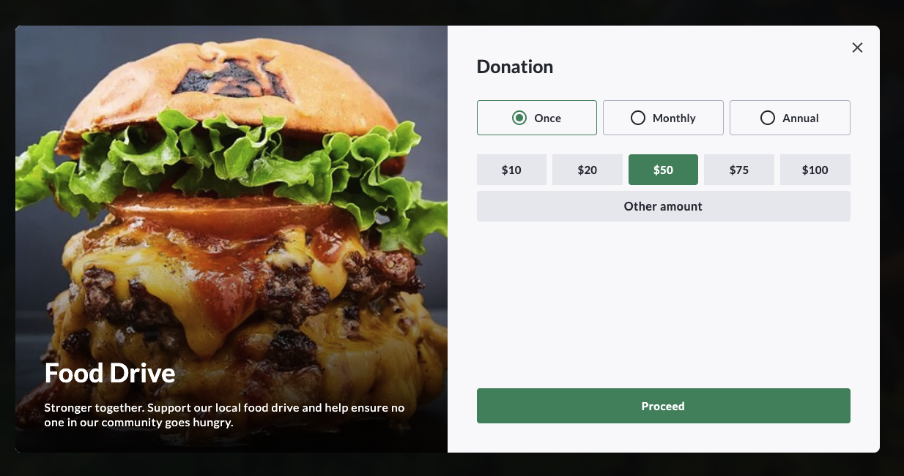
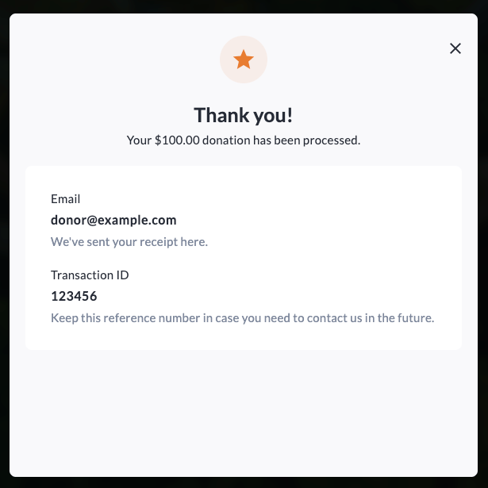

<!-- Source: https://apidoc.crowdchange.dev/widgets/donation-form-widget | Nav: Documentation > Widgets > Donation Form Widget | Mirrored 2026-10-14 -->

# Donation Form Widget

> Embed the CrowdChange donation form on your site to accept donations inline or in a popup, with customizable colors, language, and layout.

The `donation-form` widget embeds a fully functional CrowdChange donation form on your website. It can render **inline** within the page or open as a **popup** triggered by your own button or link, and it supports a compact **basic** layout as well as the **full** layout.

New to widgets? Start with the [Widgets Overview](overview.md) to add the embed script.



## Usage examples

### Inline donation form

Renders the donation form directly in the page flow.

```html
<crowdchange widget="donation-form"
             fundraiser="1000"
             mode="inline"
             language="en"
             color-primary="#cc0000"
             color-background="#e3ae7a"
></crowdchange>
```

Replace `fundraiser` with your fundraiser ID from Step 1 of the overview.

> **Tip:** For inline embeds, you can supply your own placeholder by nesting an element marked with `data-crowdchange-loading="true"` inside the `<crowdchange>` element. It is shown until the form finishes loading.

***

### Popup donation form (full layout)

A popup needs a trigger — a button or link — to open it. Set `target` to a CSS selector that matches the trigger.

```html
<crowdchange widget="donation-form"
             fundraiser="10000"
             mode="popup"
             target=".my-donate-button"
></crowdchange>

<button type="button" class="my-donate-button">Donate Now</button>
```

***

### Popup donation form (basic layout)

The basic layout renders a more compact form.

```html
<crowdchange widget="donation-form"
             fundraiser="16"
             layout="basic"
             mode="popup"
             target="#btn-donate-2"
             color-primary="#23990d"
></crowdchange>

<button type="button" id="btn-donate-2">Donate Now</button>
```

***

## Customize or hide the confirmation icon

Use `icon-confirmation` to change the icon displayed on the thank-you screen and `icon-confirmation-color` to set its color.

Any [Google Material Icons](https://fonts.google.com/icons) can be used for `icon-confirmation` value.

**Example:**

Using `orange` `star` icon:



Using the code below:

```html
<crowdchange widget="donation-form"
             fundraiser="1000"
             icon-confirmation="star"
             icon-confirmation-color="#e87c30"
></crowdchange>
```

Set `icon-confirmation` to `none` to hide the confirmation icon:

```html
<crowdchange widget="donation-form"
             fundraiser="1000"
             icon-confirmation="none"
></crowdchange>
```

***

## Supported settings

| JS Setting | Element Attribute | Description | Default |
| :- | :- | :- | :- |
| `widget` | `widget` | Widget type: `donation-form`. | Required |
| `fundraiser` | `fundraiser` | The ID of the fundraiser. | Required |
| `mode` | `mode` | `inline` or `popup`. | `popup` |
| `layout` | `layout` | `full` or `basic`. | `full` |
| `language` | `language` | The language code, e.g. `en`, `fr`. | `en` |
| `target` | `target` | CSS selector for the element that triggers the popup. | |
| `colorPrimary` | `color-primary` | Custom primary color. | Fundraiser's theme. |
| `colorBackground` | `color-background` | Custom background color. | |
| `iconConfirmation` | `icon-confirmation` | Confirmation icon. Use `none` to hide. | `favorite` |
| `iconConfirmationColor` | `icon-confirmation-color` | Confirmation icon color. | `#ffa0dc` |
| `refSource` | `ref-source` | Reference source, used only for reporting. | `embed` |

***

## Apple Pay

Apple Pay is available on donation forms. To display the Apple Pay button, Apple requires that every domain where the donation form is used be registered. This includes top-level domains (example.com) and subdomains (donate.example.com). Note, `www` is a regular domain that must be registered as well.

If your donation form is embedded on multiple websites, domains, or subdomains, each one must be registered before Apple Pay will appear.

To enable Apple Pay, please contact your Account Manager or email [support@crowdchange.co](mailto:support@crowdchange.co) with the complete list of domains where your donation forms are hosted.
