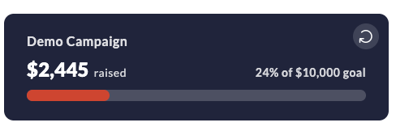

<!-- Source: https://apidoc.crowdchange.dev/widgets/progress-widget | Nav: Documentation > Widgets > Progress Widget | Mirrored 2026-10-14 -->

# Progress Widget

> Embed the CrowdChange progress widget to display a live fundraising progress bar for any campaign, team, or personal page, with customizable colors.

The `progress` widget displays a live progress bar showing how much a campaign has raised against its goal. It renders inline and can track an entire fundraiser, a specific team, or an individual personal page.

New to widgets? Start with the [Widgets Overview](overview.md) to add the embed script.



## Usage example

### Fundraiser progress

```html
<crowdchange widget="progress"
             fundraiser="1000"
             show-name="true"
             color-text="#ffffff"
             color-primary="#e43d31"
             color-background="#212944"
             progress-bar-color="#e43d31"
></crowdchange>
```

***

## Supported settings

| JS Setting | Element Attribute | Description | Default |
| :- | :- | :- | :- |
| `widget` | `widget` | Widget type: `progress`. | Required |
| `fundraiser` | `fundraiser` | The ID of the fundraiser. | \* |
| `fundraiserTeam` | `fundraiser-team` | The ID of the team. | \* |
| `fundraiserPage` | `fundraiser-page` | The ID of the personal page. | \* |
| `showName` | `show-name` | Show the name of the fundraiser, team, or personal page: `true` or `false`. | `false` |
| `language` | `language` | The language code, e.g. `en`, `fr`. | `en` |
| `colorPrimary` | `color-primary` | Primary color. | Fundraiser's theme. |
| `colorText` | `color-text` | Text color. | Fundraiser's theme. |
| `colorBackground` | `color-background` | Background color. | Fundraiser's theme. |
| `progressBarColor` | `progress-bar-color` | Progress bar color. | Fundraiser's theme. |

> **Note:** Provide **one** of the following IDs to choose what the widget tracks:
>
> * `fundraiser` — progress of the overall fundraiser.
> * `fundraiser-team` — progress of a specific team.
> * `fundraiser-page` — progress of a specific personal page.
>
> If you provide none of these, the widget shows the overall progress of your site.
