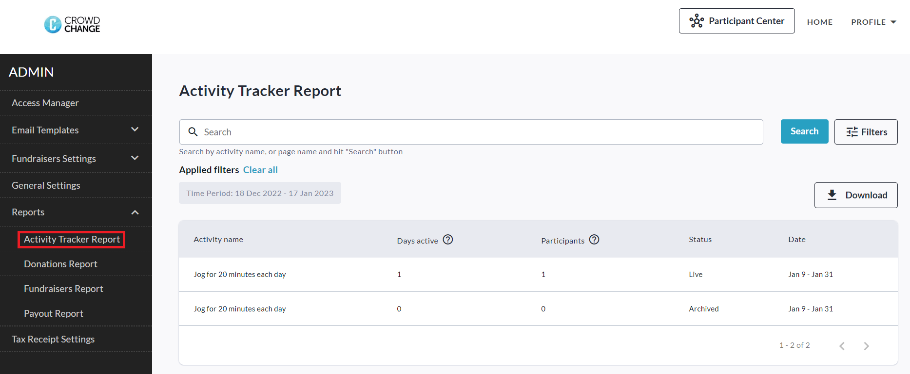
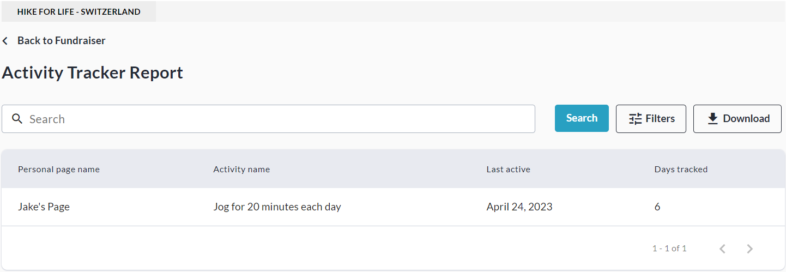

<!-- Source: https://chadmin.crowdchange.help/ct/activity-tracker-reporting | Nav: Activity Tracker > Activity Tracker Reporting | Mirrored 2026-10-14 -->

# Activity Tracker Reporting

The Activity Tracker is complete with reporting functionality, allowing you to get a bird's eye view of participant engagement with your campaign's Activities.  
**Please note** that the Admin Activity Tracker Report is **NOT** enabled by default and must first be enabled by your CrowdChange Partner Success Representative or Support Agent.

## **Admin Activity Tracker Report**

To view the Admin Activity Tracker Report, follow the steps below:

1. Go to your CrowdChange site and **Log In**.

2. Click **Profile** in in the top right corner, then**Admin**.

3. Navigate to **Reports** **→ Activity Tracker Report**using the left sidebar.

   
4. If needed, you can then **Search** and/or **Filter** for specific activities, and get the Excel version of this report by clicking **Download**.

The downloaded file will contain a **Macro** and **Micro**version of the report.

* The **Macro**version displays activity tracking data on an activity-by-activity basis.

* The **Micro**version displays activity tracking data on a user-by-user basis.

### **Fundraiser Level Activity Tracker Report**

To view the Fundraiser Level Activity Tracker Report, follow the steps below:

1. From anywhere on your CrowdChange site, **Log In**.

2. Go to your fundraising page and click **Manage Fundraiser**.

3. Go to**Reports** on the left sidebar, then**Activity Tracker Report**.

4. From here, you can **Search** and/or **Filter** for specific Activities, and view a simple overview.

   
5. You may also export this report to Excel using the **Download**button.

Note that the fundraiser-level version of this report is less detailed than the Admin version.
