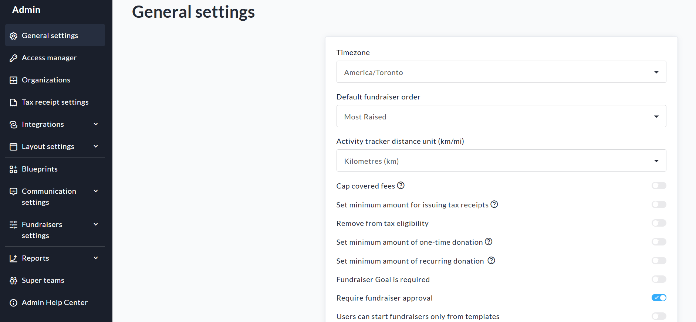
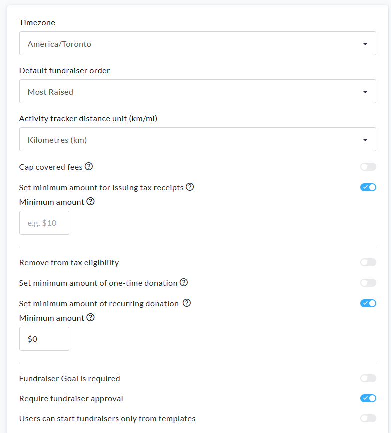
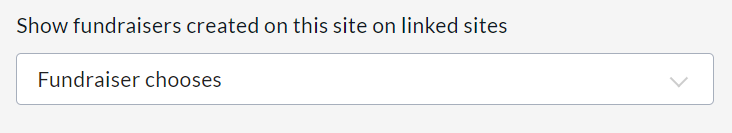
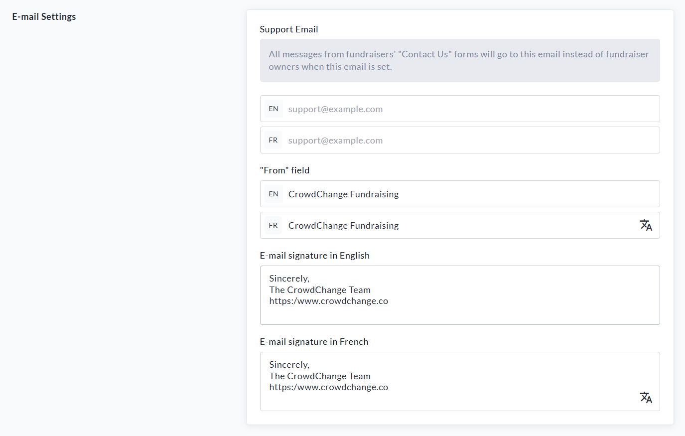

<!-- Source: https://chadmin.crowdchange.help/ct/admin-general-settings | Nav: Admin > General Settings | Mirrored 2026-10-14 -->

# Admin > General Settings

**General Settings**is where you can adjust the inner workings of your CrowdChange site, for example:

Donations List settings, Default Fundraiser Order, Credit Card statement descriptors, Tax Receipt minimum amounts, Fundraiser Approval settings and more.

To access **General Settings**:

1. Log In to a CrowdChange account with Admin permissions.

2. Click **Profile → Admin** in the upper right-hand corner of the site. You will be taken to **General Settings**.

On the General Settings page, you will have the ability to do the following:

1. Select your **Time Zone**. Once completed, your site will operate in the Time Zone selected.

2. **Default Fundraiser Order**- This dropdown lets you choose how fundraisers are sorted by default when the home page loads. The sort order will still be changeable from the top of the homepage.

3. You can **Cap Covered Fees** so that covered fees on donations are limited to a set dollar amount.

4. **Set a minimum amount for issuing tax receipts**- This decision should be made by your organization, as entering an amount here will set it across all fundraisers within your CrowdChange site. If you wish to decide on a fundraiser-by-fundraiser basis, leave this disabled and you will be prompted to do so when creating your fundraiser.

5. **Remove from tax eligibility** - This feature allows you to disable tax eligibility for specific purchase options (eg. Tickets \& Registrations). This will remove the Expense field from the selected purchase options (shown when they are created at the fundraiser level) and their costs will never be added to the tax-eligible amount on tax receipts.

6. **Set minimum amount of recurring donation** - This allows you to set a minimum donation amount for recurring donations across all fundraisers on your site.

7. **Fundraiser Goal is Required**- This toggle allows you to set whether Fundraiser Goals are mandatory for fundraisers created on the site.

8. **Require Fundraiser Approval**- This means that any fundraiser created on your CrowdChange site must first be 'Approved' by an Admin user before it becomes active.

9. **Users can start fundraisers only from templates** - This option is only shown when **Master Templates** is enabled in General Settings

Example of General Settings

If you are viewing this section on a sub-site (child site), you will have the following option as well:  

This dropdown allows you to determine if sub-site fundraisers are mirrored to parent sites.

There are 3 options available within the dropdown:

* Fundraiser chooses - default option - this is decided per-fundraiser in fundraiser settings.

* Never - sub-site created fundraisers are never mirrored to parent sites.

* Always - sub-site created fundraisers are always mirrored to parent sites.

## E-mail Settings

Here you can customize the footer text of the automated emails sent from your CrowdChange site. Specifically, you can enter custom text for the 'From' field and the Email Signature.  
  
Click the **Save**button at the bottom of the page to confirm your changes.  
  
**Please Note:** You can return to the General Settings page at any time to update your configuration.
