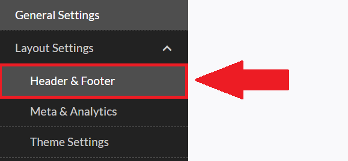
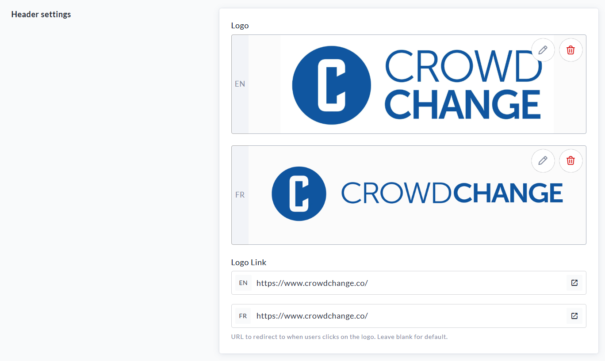
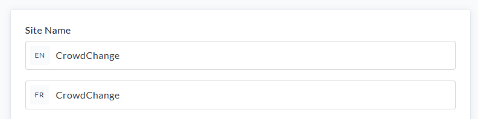
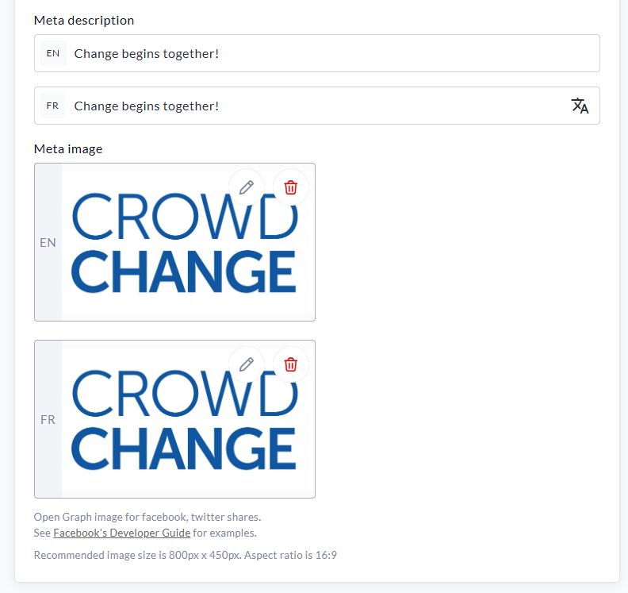
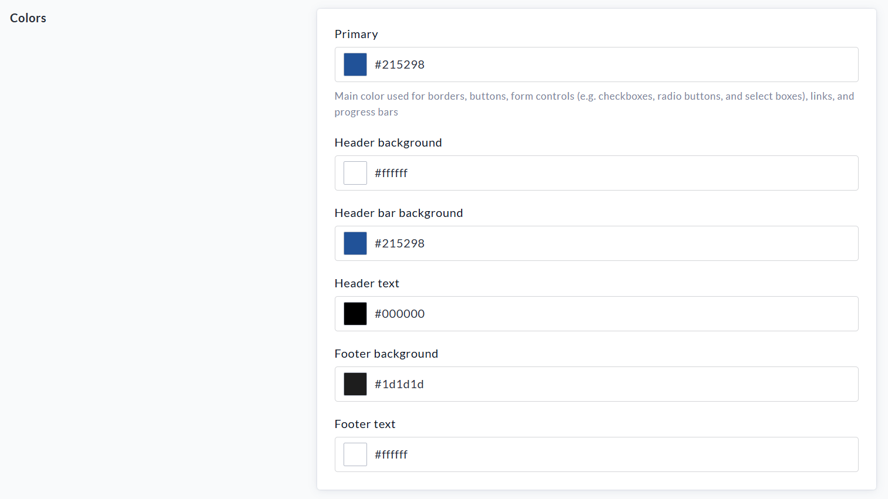

<!-- Source: https://chadmin.crowdchange.help/ct/admin-layout-settings | Nav: Admin > Layout Settings | Mirrored 2026-10-14 -->

# Admin > Layout Settings

Within the Admin menu, **Layout Settings**contains 3 sub-pages for adjusting the finer details of your site:

* **Header \& Footer**- Set your site logo, logo link, menu settings, and footer settings.

* **Meta \& Analytics** - Set your site name, meta description, meta image, and analytics connectors.

* **Theme Settings**- Set your site colours and fonts.

## How to Access Layout Settings

1. Log In to a CrowdChange account with Admin permissions.

2. Click **Profile → Admin** in the upper right-hand corner of the site. You will be taken to **General Settings**.

3. On the left sidebar, click **Layout Settings**, and select one of the three sub-pages.

   

### Header \& Footer Page

On the Header \& Footer page, you can do the following:

1. Upload a **Logo** to appear in the top-left hand corner of your CrowdChange site.

   
   Example of Header settings
2. Add a **Logo Link** to redirect users to a certain webpage when the logo is clicked.

3. Add additional header menu links within **Menu Settings**.

4. Adjust footer information within **Footer Settings**.

Ensure to click **Save**at the bottom to confirm your changes.

### Meta \& Analytics Page

On the Meta \& Analytics page, you can do the following:

1. Edit the **Site Name** - This can be changed at any time.

   
2. Edit the **Meta Description** and**Meta Image** which will appear across your Social Media Accounts.

   
3. Enter your **Google Tracking ID** , **Google Tag Manager** , **Facebook Pixel ID** and **Facebook Meta Tag Domain Verification**. This is optional, however, if your organization uses any of these analytics programs, we suggest entering the account details here.

See also [**Analytics Connectors**](https://chadmin.crowdchange.help/ct/Analytics-Connectors.1997897747.html), to learn more.

### Theme Settings Page

On the Theme Settings page, you can do the following:

1. Set your **Primary** site colour - this is the main colour used for borders, buttons, links, progress bars and form controls (e.g. checkboxes, radio buttons \& select boxes).

   
   Example of Primary site colours
2. Set your Header background colour.

3. Set your Header Bar Background colour.

4. Set your Header Text colour.

5. Set your Footer Background colour.

6. Set your Footer Text colour.

7. Choose your **Font**.

   1. If desired, you can also click '**Advanced settings**' to import a custom font.
