<!-- Source: https://chadmin.crowdchange.help/ct/allow-donors-to-a-team-to-split-their-donation-amo | Nav: Product Updates > Allow donors to a team to split their donation amongst personal pages within the team | Mirrored 2026-10-14 -->

# Allow donors to a team to split their donation amongst personal pages within the team

We offer an optional feature which can be enabled on your CrowdChange site called **Split Team Donations**.  
Please note that this feature is **NOT**enabled by default.

Reach out to your Partner Success Representative today to request it be enabled on your site!

Enabling this feature will allow donors making a donation to a team page (or a personal page within a team), to select single or multiple personal pages to apply their donation to, or auto-split it evenly amongst all personal pages connected to the team.

To enable this feature at the fundraiser level, follow the steps below:

1. Login to your fundraiser

2. Click **Manage fundraiser** in the top right corner.

3. Click **Donation settings** in the menu on the left.

4. Toggle on **Allow split donation on team members.**

   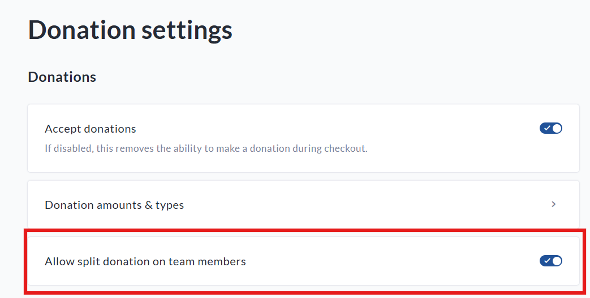

Here's how it looks in practice for the different user flows:

## Donating to a Team Page

1. Donor goes to a Team Page and clicks **Donate**.

   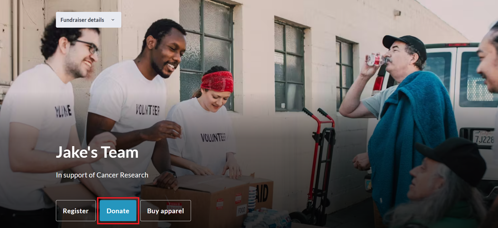
2. Donor selects **General Donation.**

   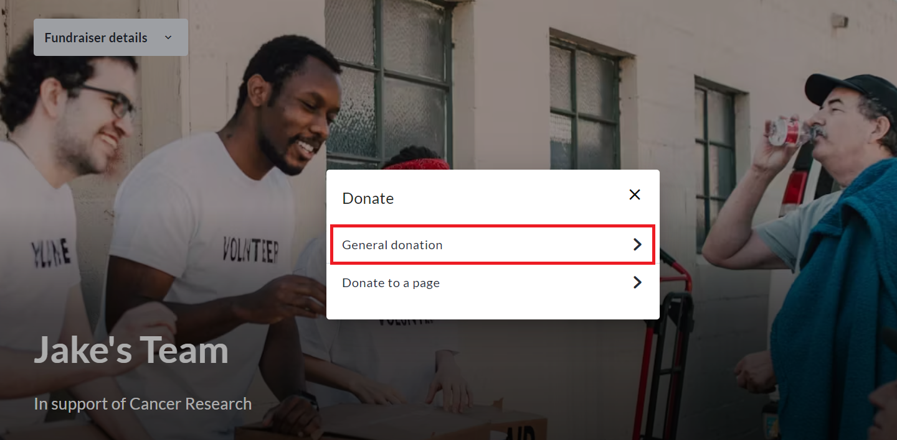
3. Donor selects a donation amount and an auto-split is applied to split the donation evenly across all personal pages within the team. Donor can click **Adjust**if desired to edit split amounts.

   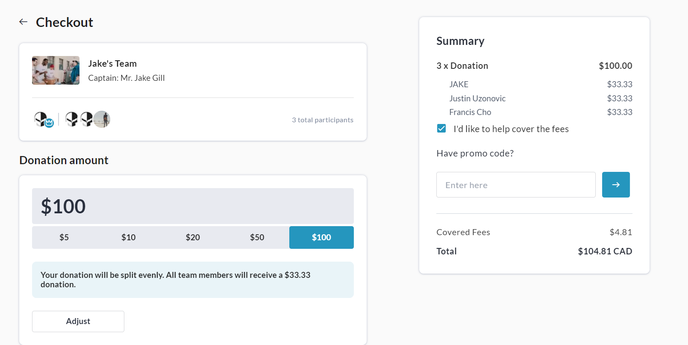
4. If desired, the donor clicks the **Adjust**button and sets specific amounts for each page.

   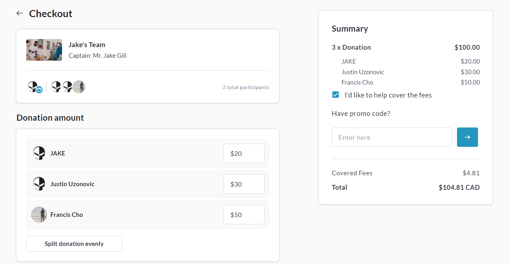

## Donating to a specific Personal Page

### Via Team → Donate → Donate to a Page

1. Donor goes to a Team Page and clicks **Donate**.

   
2. Donor selects **Donate to a page**.

   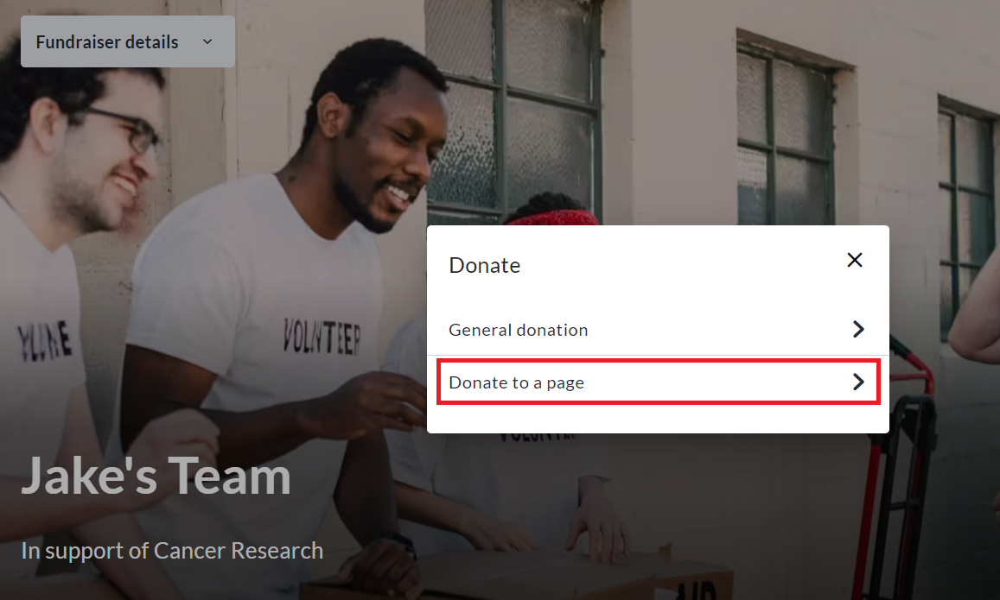
3. Donor selects the page they'd like to support.

   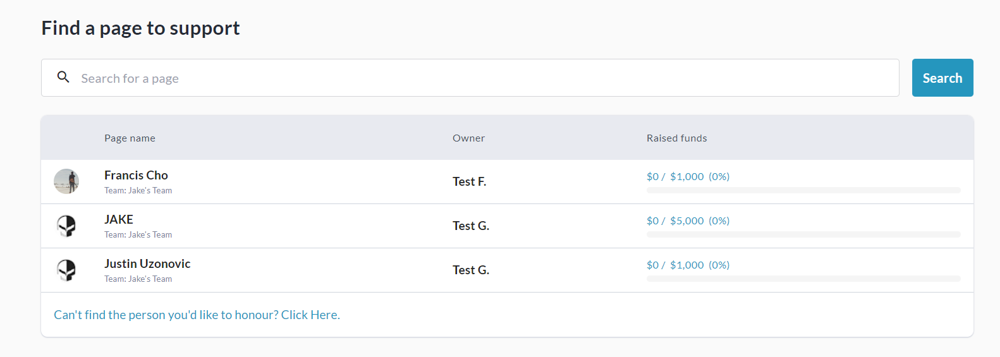
4. Donor is given the option to split the donation between multiple pages, as opposed to donating solely to the specific page.

   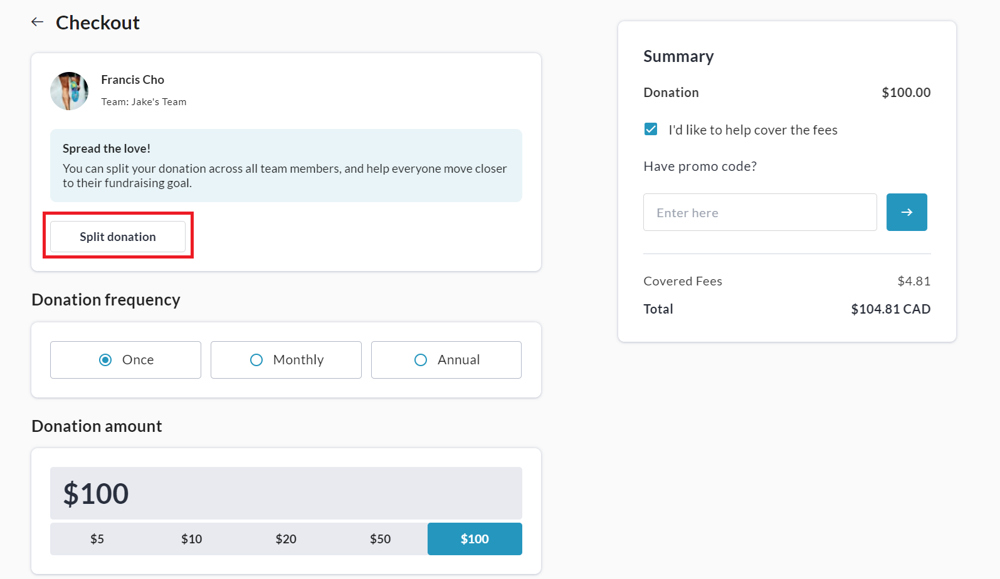
5. If **Split donation** is clicked, the user will be prompted to select which personal pages the donation should be split amongst and click **Next**.

   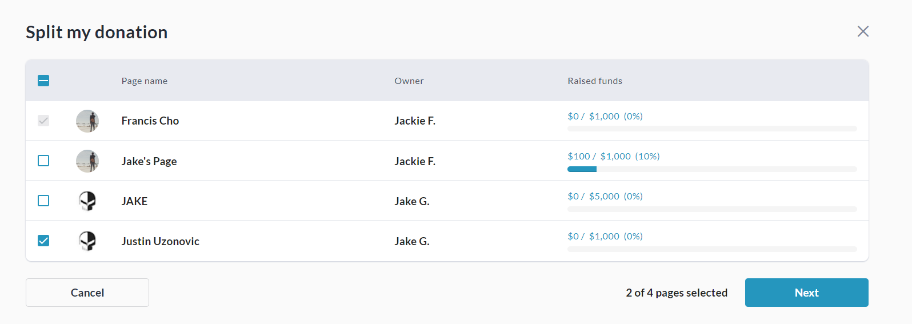
6. At checkout, an auto-split is applied to split the donation evenly across all selected personal pages within the team. Donor can click **Adjust**if desired to edit split amounts.

   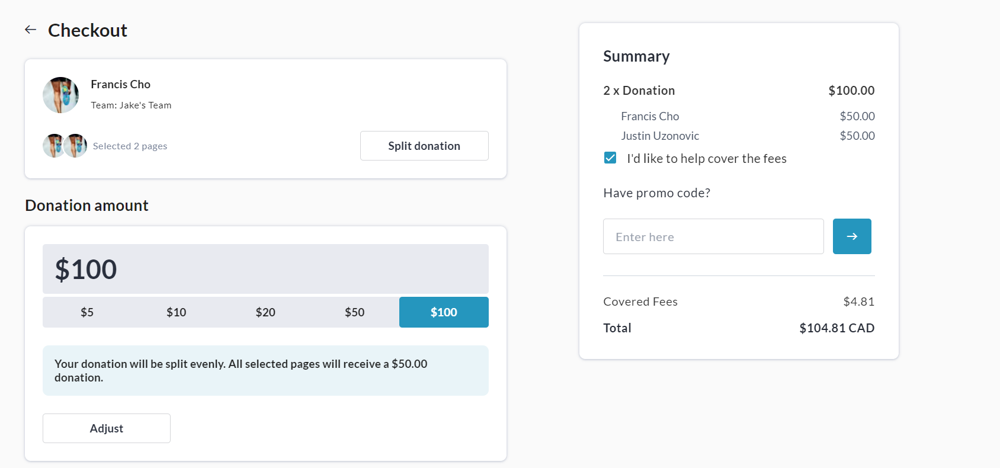
7. If desired, the donor clicks the **Adjust**button and sets specific amounts for each page.

   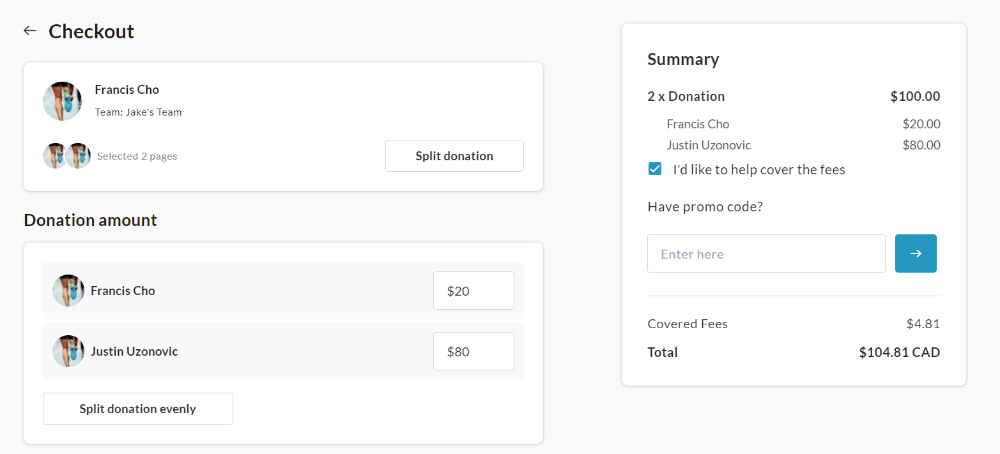

### Via Page → Donate

1. Donor goes to a Personal Page and clicks **Donate**.

   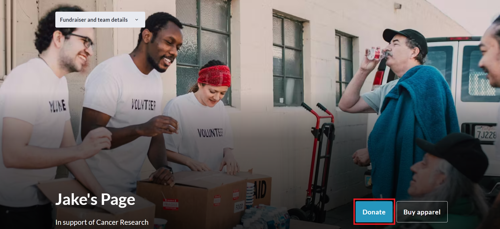
2. Donor selects a donation amount and clicks **Split Donation**.

   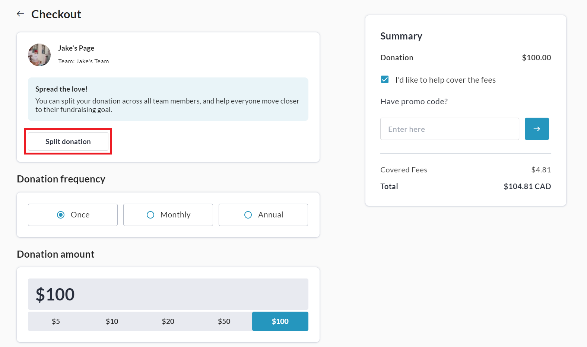
3. Donor selects the other personal page(s) they would like to split the donation between and clicks **Next**.

   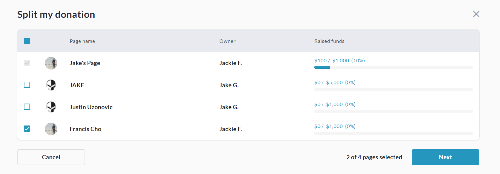
4. An auto-split is applied to split the donation evenly across all selected personal pages within the team. Donor can click **Adjust**if desired to edit split amounts.

   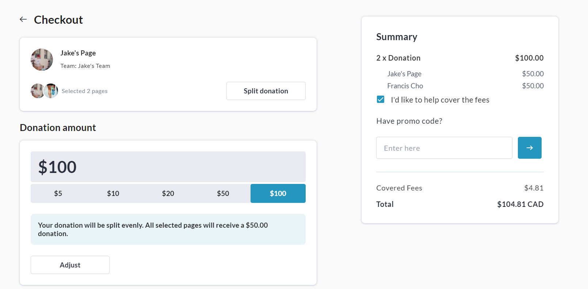
5. If desired, the donor clicks the **Adjust**button and sets specific amounts for each page.

   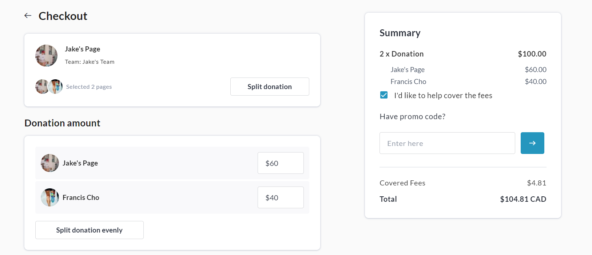

## Additional Information

### Refunds

When transaction is refunded (or disputed), all split amounts are refunded.

### Personal Page Deletion

If one of the personal pages is deleted- the donated amount will remain in the team.

### Moving Transactions Feature

Transactions that use the split donations feature **cannot** be moved to different fundraisers and **cannot** be partially refunded. If such a change needs to be made, the transaction must be fully refunded and re-done.
