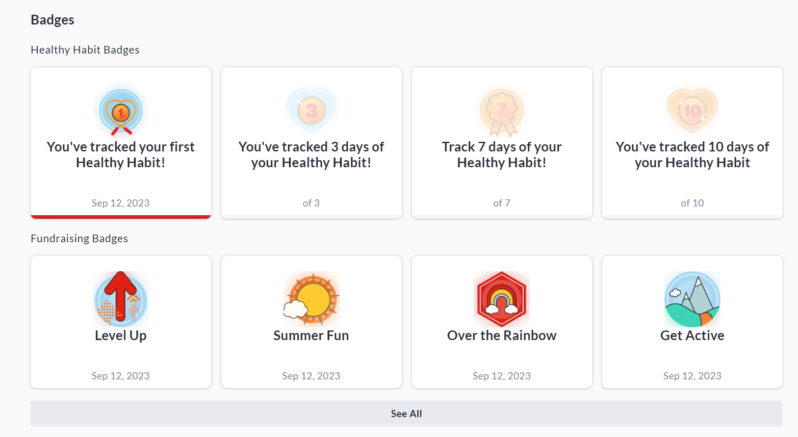
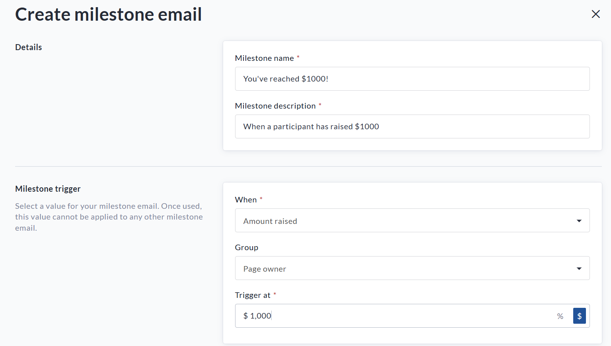
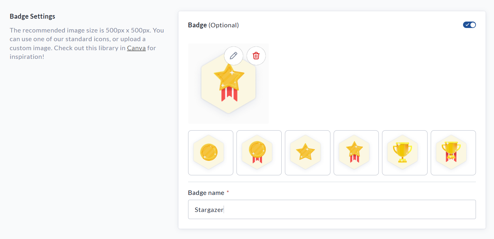
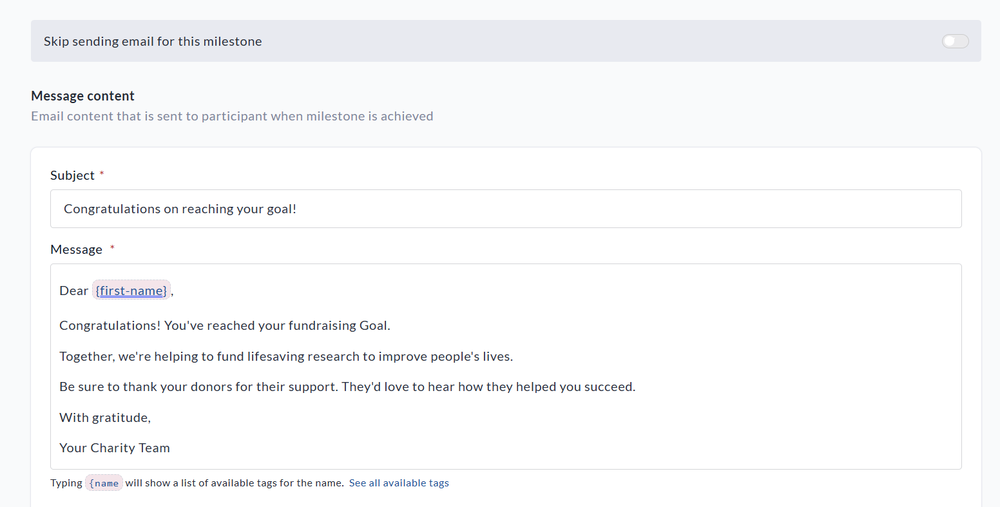
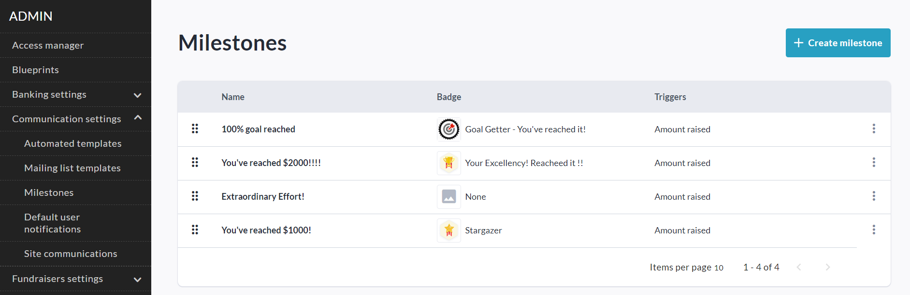
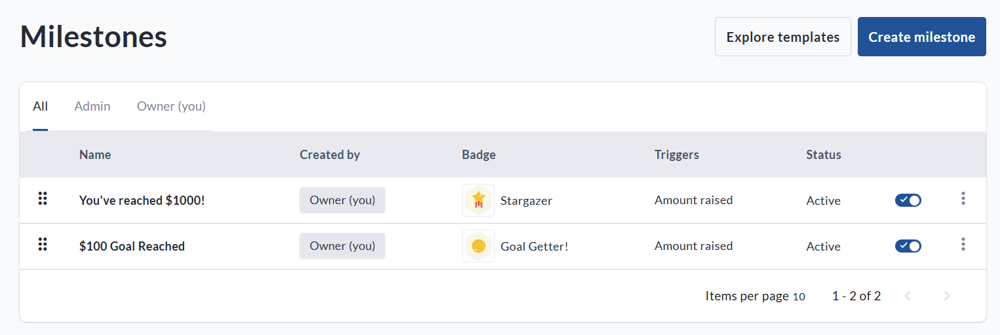

<!-- Source: https://chadmin.crowdchange.help/ct/badges-and-milestones | Nav: Badges and Milestones | Mirrored 2026-10-14 -->

# Badges and Milestones

A great way to incentivize fundraising is to set up custom **Badges** and **Milestones**!

**Milestone Notification Emails**can be sent when a Fundraiser, Team or Personal Page reaches certain goals.

For example, when a Fundraiser reaches 50% of it's goal or a personal/team page raises it's first $1,000.  
These emails are sent to the Fundraiser Owner and Personal / Team Page Owners, **NOT** to donors.

**Badges** can be created and linked to Milestones to reward achievers with a virtual prize - they are included in the Milestone Notification Emails, and displayed publicly on the achiever's personal or team page:  

## Setting up Milestone Notification Emails \& Badges

To customize and provide pre-built templates for Milestone Notification Emails, follow the steps below:

1. Go to **Profile → Admin → Communication Settings → Milestones**.

2. Click **Create milestone** .

3. Name the milestone and **select a trigger** from the '**When**' dropdown (Eg: Page Created, End of an event, Certain amount raised, certain number of donations reached, etc).

4. Select the Group which this milestone applies to (Eg: the Fundraiser owner, a page owner, registrant etc).

5. Enter a specific value which should trigger the milestone.

See the example milestone below which will be sent to page owners when they reach $1000 raised.  

Now you will have the option of adding a **Badge**to the milestone email. See example screenshot below. This is an awesome way to reward fundraisers for their hard work and support of your cause! You can select from our pre-built badges, or upload your own custom badge image using the pencil icon.  

Finally, ensure to fill out the **Message Body** section which sets what text will appear in the milestone notification email. See example below.  
If you would prefer not to send an email notification for this milestone, simply toggle on the '**Skip sending email for this milestone**' option.  

When you are finished creating your milestone email template, click the **Save**button.  
  
Now, when a Fundraiser Owner goes to **Manage Fundraiser → Milestones** , they will be able to click **Create Milestone** and create their own milestones. They can see all active milestones but those set at the Admin level are only editable by Admin users.

## Editing Milestone Notification Emails \& Badges

You can come back to the **Admin** or **Fundraiser Level** Milestones Menus at any time to made adjustments to existing milestones, delete them, or add more.

To access the Admin Milestones Menu, go to **Profile → Admin → Communication Settings → Milestones**.  

To access the Fundraiser Level Milestones Menu, go to **Manage Fundraiser → Milestones**.  

