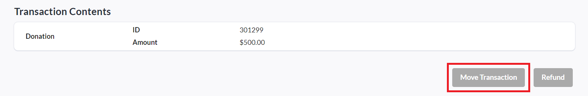

<!-- Source: https://chadmin.crowdchange.help/ct/beta-moving-a-transaction-to-a-different-fundraise | Nav: How to Access the Admin Donations Report > Beta - Moving a Transaction to a Different Fundraiser | Mirrored 2026-10-14 -->

# Beta - Moving a Transaction to a Different Fundraiser

We have recently released a new feature in Beta, that allows certain types of transactions to be moved from one fundraiser to another within the same CrowdChange site.  
**Please Note:** This feature is **NOT**available by default and must be enabled by CrowdChange staff.

Once enabled, moving these transactions can be done from the[**Admin Donations Report**](how-to-access-the-admin-donations-report.md).

Simply select a transaction and click '**Move Transaction**' at the bottom of the transaction panel:  

You will be prompted to select the fundraiser you'd like to move the transaction to, and (if applicable), the purchase options in the new fundraiser you'd like to map current purchase options to.

*** ** * ** ***

**When moving a transaction, the following data will be moved:**

* The transaction information, purchase options \& answers to custom registration questions.

* Any related team information (if a team is being moved, custom questions for the team).

* Any related personal page information (if attached pages are moved, custom questions for the pages).

* Any donations moving with pages (including custom reg. question answers, purchase options, etc).

**Transactions can only be moved to another fundraiser if these conditions are met:**

* Fundraisers must be within the same CrowdChange site.

* Fundraisers must be connected to the same bank account.

* Fundraisers must allow for transfer (see more details below), for example:

  * You cannot move a transaction with tickets to a fundraiser without tickets.

  * You cannot move a transaction attached to a personal page to a fundraiser that has no personal pages.

**Transactions can NOT be moved if the fundraiser / transaction has:**

* Activity tracker

* eCards / Tribute cards

* Donation matching applied

* Promo codes applied

* If there would be any changes to the total price (e.g. If tickets don't match in pricing, etc)

**NOTE:**The inclusion of the above features will be addressed in further iterations of Moving Transactions.

**Additional Notes:**

* If a transaction is attached to a registration which is attached to a personal page:

  * The personal page will be moved to the new fundraiser, along with all its attached transactions.

  * You are able to select a new team or no team from the new fundraiser.

* If the transaction was made to a personal page or a team:

  * You are able to select a new team or page from the new fundraiser.

* If tickets / apparel / registration / sponsorship are involved:

  * Transaction must be manually mapped to purchase options in the new fundraiser.

    * Coming soon - If both fundraisers were created from a Master Template, this will be automatic.

    * Admin must select new ticket / apparel / registration / sponsorship that matches the price of the existing purchase option (e.g. A $10 ticket cannot be mapped to a $5 ticket, a free ticket cannot be mapped to a $1 ticket, etc).

  * Limits will be checked (to ensure the purchase option is not sold out and would go over the limit).

  * Ticket / apparel / registration / sponsorship counts will be properly updated in both fundraisers.

* If custom questions are involved:

  * Custom questions must be manually remapped.

    * Coming soon - If both fundraisers were created from a Master Template, this will be automatic.

      * For now, all current responses are archived (Question + response from current transaction is shown) and the user is forced to provide responses to any new questions. The user must copy/paste, or enter that data themselves.

    * If custom questions cannot be mapped (e.g. Fundraiser A had 5 questions and Fundraiser B has 2 questions):

      * Existing answers are archived, not deleted, so that they can be accessed in future updates.

      * A warning is shown before trying to move the transaction, saying that custom questions will not be moved, and will be archived instead, and the user will need to provide new answers manually.

      * The user must fill in the new custom questions.

* Amounts are updated for all affected fundraisers, teams \& pages.
