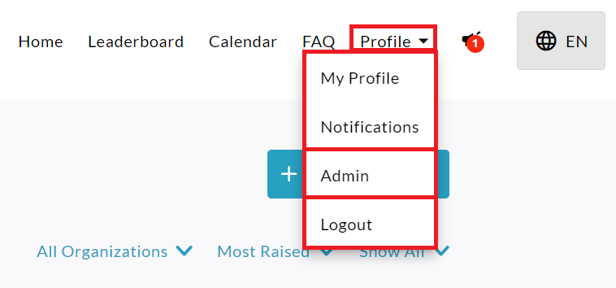
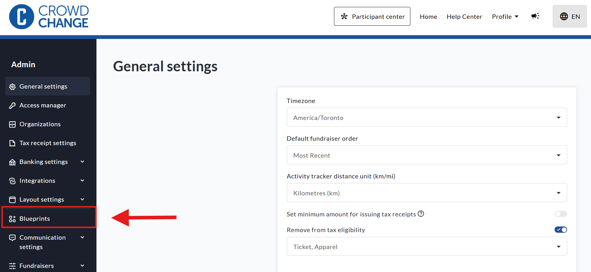
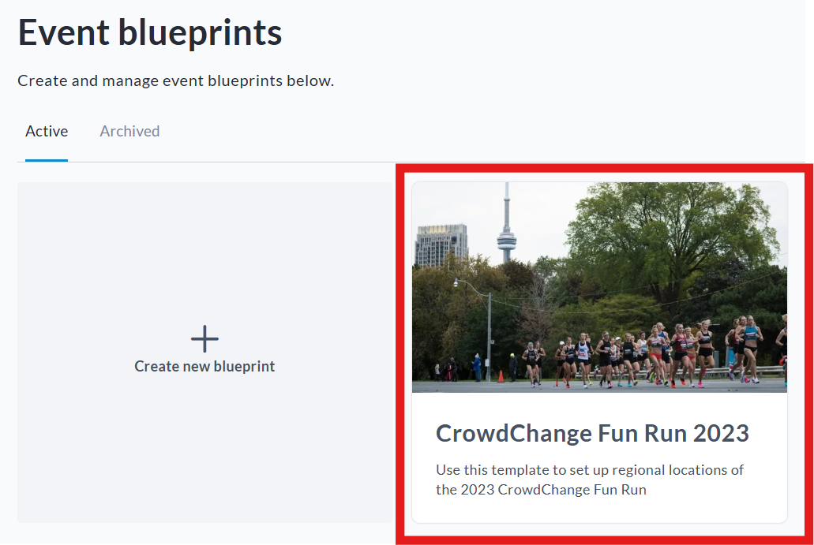
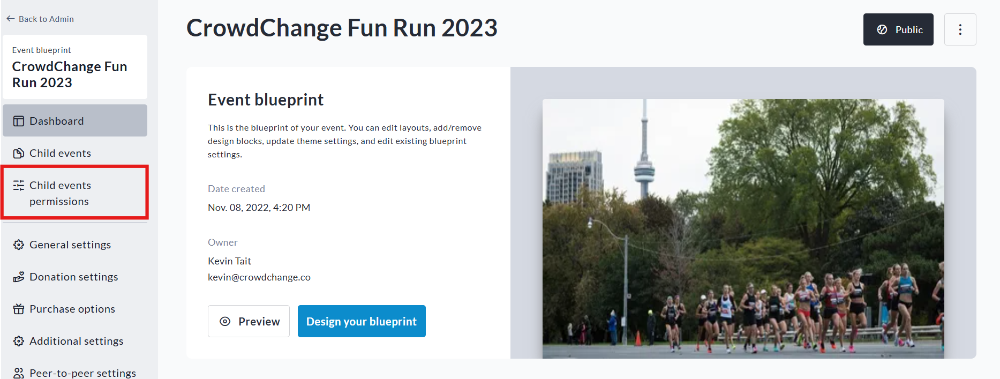
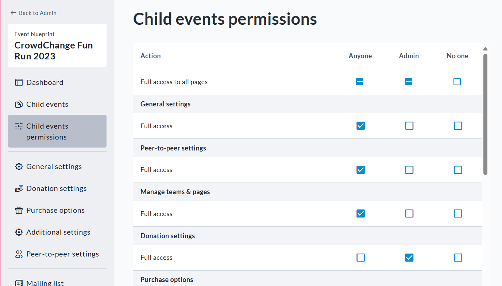

<!-- Source: https://chadmin.crowdchange.help/ct/blueprint-child-event-permissions | Nav: Event Blueprints > Blueprint Child Event Permissions | Mirrored 2026-10-14 -->

# Blueprint Child Event Permissions

Within each Blueprint, there is a dedicated permissions page for child events, allowing you to set exactly which controls are available to non-admin fundraiser owners.

This provides flexible, granular access control for organization Admins managing large campaigns.

To access this page within a Blueprint, follow the steps below:

1. From anywhere on your CrowdChange site, click **Profile → Admin** in the top right corner.

   
2. On the left sidebar, click **Blueprints** .

   
3. Click on the specific blueprint.

   
4. Click **Child Events Permissions**on the bottom-left within the Blueprint dashboard.

   
5. On the **Child Events Permissions** page, you will be able to set the access controls.

   
6. When you are finished adjusting the settings, click Save.

   

**Please Note:**

Setting to **Anyone** means that fundraiser owners will be able to change it.

Setting to **Admin** means only site Admins will be able to change it.

Setting to **No one** means no one will be able to change it.
