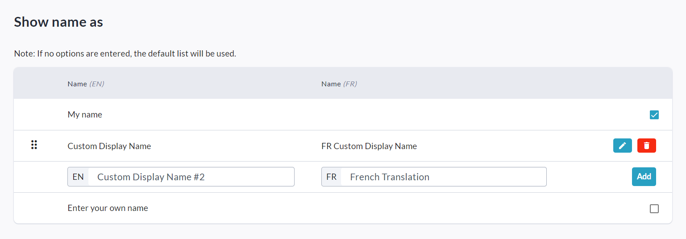

<!-- Source: https://chadmin.crowdchange.help/ct/changing-the-show-my-name-as-options | Nav: Changing the 'Show my name as' options | Mirrored 2026-10-14 -->

# Changing the 'Show my name as' options

If you would like to specify exactly what options are available to donors within the 'Show my name as' field at checkout, we offer the ability to set these options at the Admin, Blueprint or Fundraiser level.  
Please note that this functionality is not enabled by default - Reach out to your Partner Success Representative to request it be enabled on your CrowdChange site.

Once enabled on your site, follow the steps below to set the 'Show my name as' options at the **Admin** level:

1. Go to your CrowdChange site and **Log In**with your Admin credentials.

2. Click **Profile** in the top right corner, then **Admin**.

3. On the left sidebar, click **Fundraisers Settings** , then **Show name as**.

4. From this page, you can enter your own custom display name options for donors to select from.

If no custom options are entered, the default list will be used.

*** ** * ** ***

You can also set these options at the **Blueprint** level or at the **Fundraiser**level:

* To set them at the Blueprint level, go to **Admin → Blueprints → Donation Settings → Donor Name Display Settings** (of a specific BP).

* To set them at the Fundraiser level, go to the fundraiser and click **Manage Fundraiser** **→ Donation Settings \> Donor Name Display Settings**.
