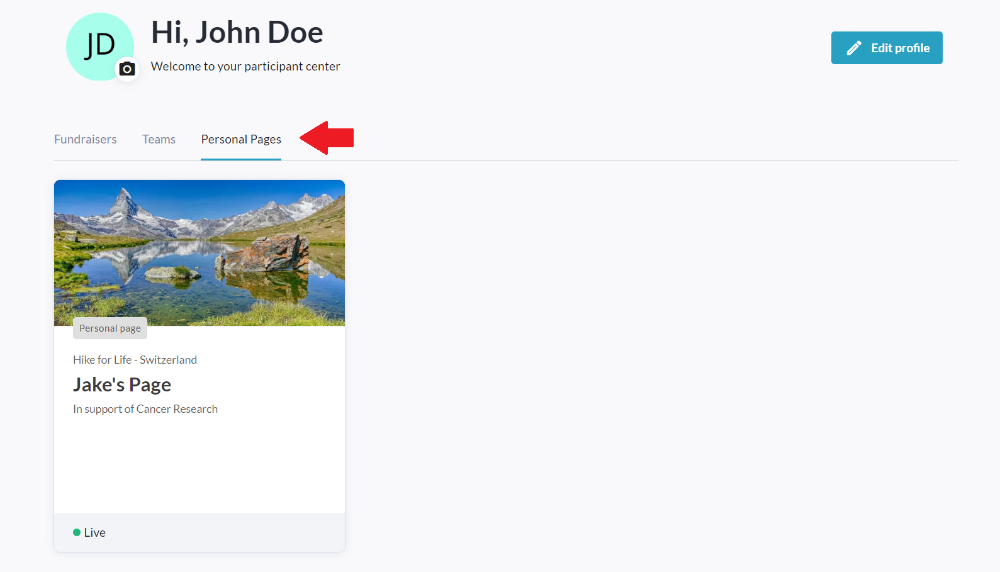
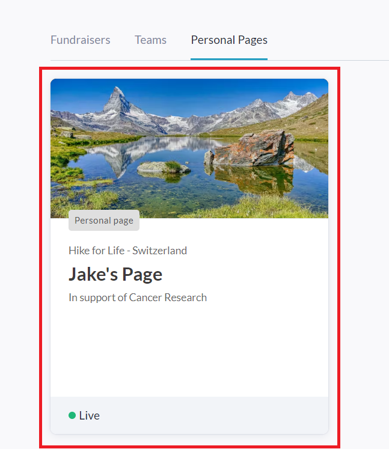
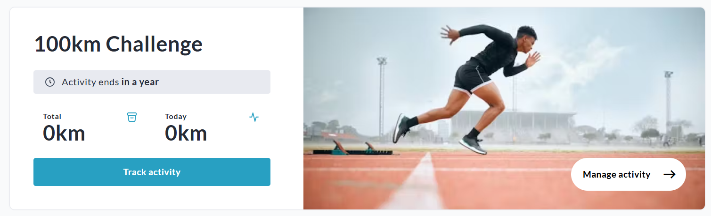
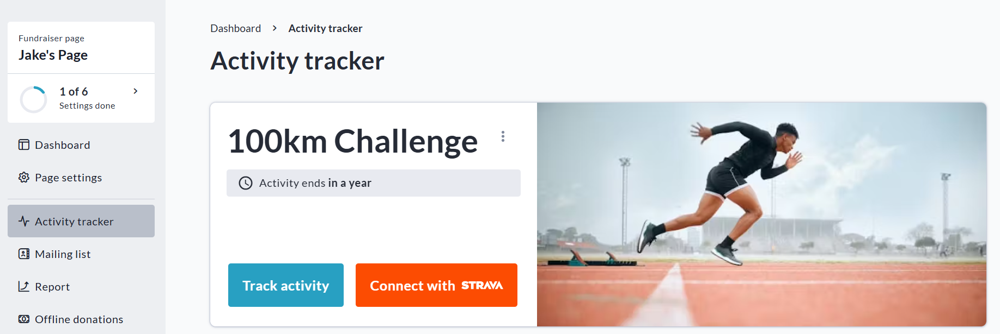
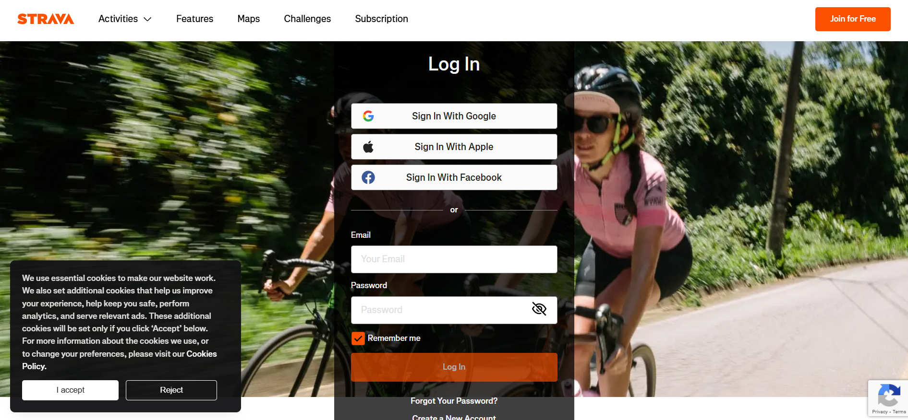
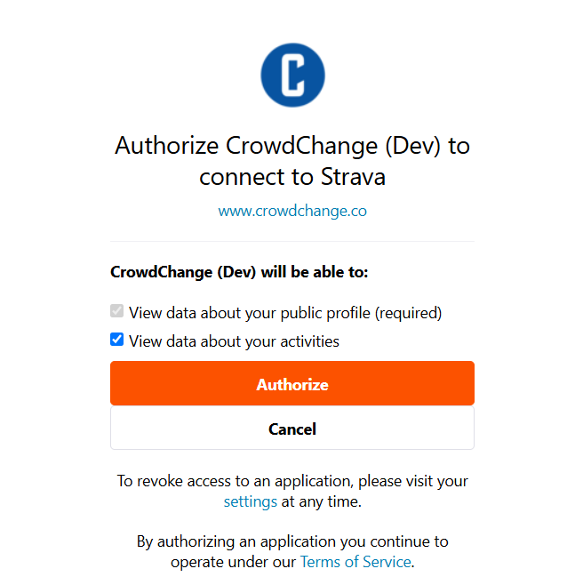

<!-- Source: https://chadmin.crowdchange.help/ct/connecting-with-strava | Nav: Activity Tracker > Connecting with Strava | Mirrored 2026-10-14 -->

# Connecting with Strava

If you already use Strava to track your fitness activity, you can quickly connect your Strava account to CrowdChange so that tracked activity going forward is also tracked in CrowdChange.  
Please note that our Strava integration only works with distance based Activities (km or miles).

Once enabled, all supported data from your Strava activities (**going forward**) is automatically transferred to your selected activity within the CrowdChange Activity Tracker.

Here's how you can set this up!

## How to Connect to Strava

1. Go to your **Participant Center** (click the icon at the top of your screen).

   
2. Click the **Personal Pages** tab under your name.

   
3. Click on your specific personal page tile.

   
4. Scroll down to the **Activity Tracker** section (Your Current Activity will be shown).

   
5. Click **Manage Activity** (pictured bottom right above).

6. You will be taken to the Activity Tracker Dashboard of your personal page.

   
7. Click **Connect with Strava** (pictured above).

8. You will be redirected to Strava's website where you must log in to your Strava account.

   
9. You will then be prompted to authorizethe required permissions for the integration to function.

   
10. Click **Authorize**and you will be redirected to CrowdChange where you will see Strava is now connected.

    

Distance based entries you make in Strava will now be automatically reflected within your CrowdChange Activity Tracker.
