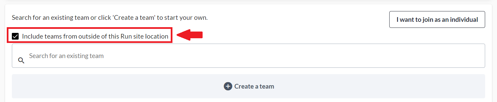
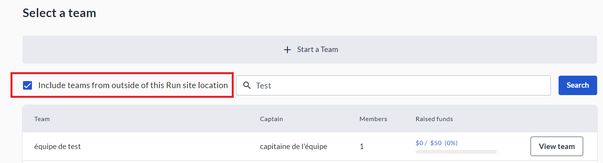
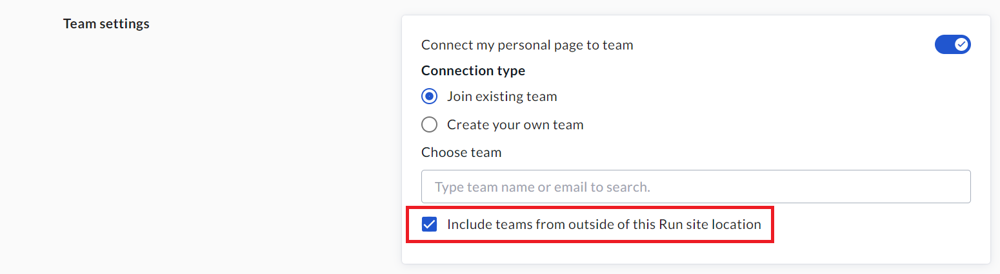
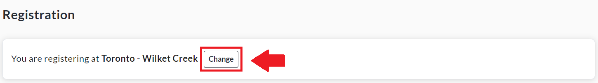

<!-- Source: https://chadmin.crowdchange.help/ct/cross-fundraiser-teams-registration-feature | Nav: How to Link Registrations to Personal & Team Pages > Cross-Fundraiser Teams & Registration Feature | Mirrored 2026-10-14 -->

# Cross-Fundraiser Teams & Registration Feature

For child sites (sub-sites) with Multi-Registration enabled, we provide some **optional**extra functionality, described below, to give added flexibility to registrants.

These features were built for large scale fundraising campaigns with many locations / branches. For example, a nation-wide event with satellite locations in all provinces or cities.  
**Please Note:** These features are **NOT**enabled by default - Reach out to your Partner Success Representative today to discuss how they can benefit your campaign!

* **Cross Fundraiser Teams**- This feature allows registrants to one fundraiser/location the option of joining a team from a different fundraiser/location. The registrant's personal page will be created under the 'Cross-Fundraiser Team', allowing them to be registered in the initial fundraiser/location, but fundraise for a team in another location.

* **Cross Fundraiser Registration (Sub-Feature)**- Cross-Fundraiser Teams must be enabled to use this sub-feature. This sub-feature adds the ability for registrants to change the fundraiser/location they are registering to during their registration. Any filled-in registration details would be removed and they would be redirected to register to the new fundraiser/location.

To use the Cross-Fundraiser Teams \& Registration features, the following must be in place:

1. The site being used must be a child site (sub-site).

2. Multi-Registration must be enabled at the sub-site level.

3. Cross Fundraiser Teams \& Cross Fundraiser Registration must be enabled at the sub-site level.

4. Multi-Registration must be enabled on the fundraiser(s) as detailed in [this article](how-to-link-registrations-to-personal-team-pages.md).

## Cross-Fundraiser Teams in Action

When registering to an event with both Multi-Registration and Cross-Fundraiser Teams enabled, you have the option of joining a team from a different fundraiser/location. Simply check the box highlighted below when joining a team. You can then search for a team on a different location, or scroll through the list.  

This option is also available from the '**See All**' teams list on a fundraiser/location, as shown below:  

Lastly, the option is also shown within the **Edit**menu of users' personal fundraising pages.  
  
Please note that doing as shown above and changing the team a personal page is connected to - to a cross-fundraiser team - does not change (within Admin Reports) the location/fundraiser attached to the page owner's registration nor the donations on their page. It is mainly a front-end change.

## Cross-Fundraiser Registration in Action

When the Cross-Fundraiser Registration feature is enabled, registrants have the option of switching the location/fundraiser they are registering to during registration. They can do so via the 'Change' button highlighted below. Then they will be shown a list of the other locations/fundraisers to select from.  

If they filled-in any registration details, these would be removed and they would be redirected to register again at the new fundraiser/location.
