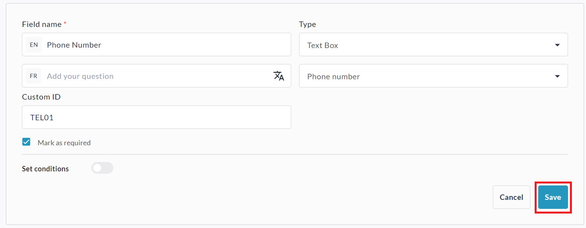
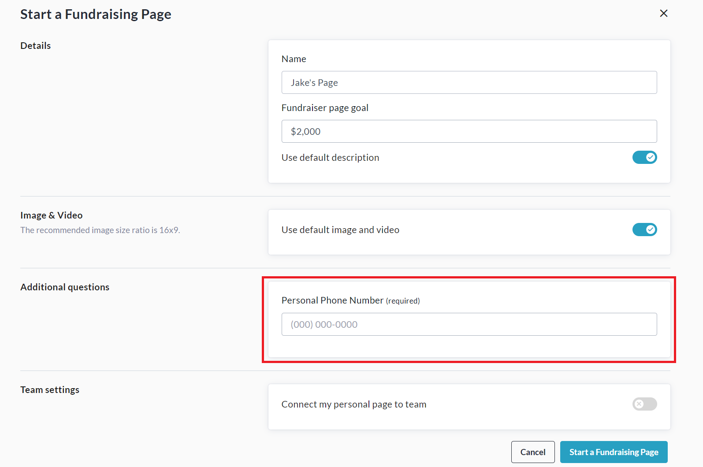
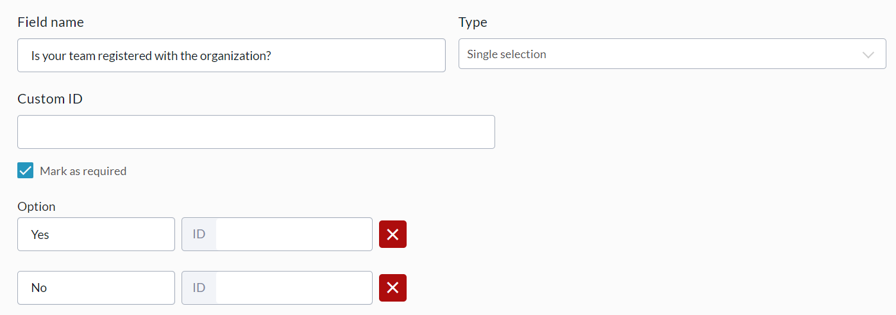
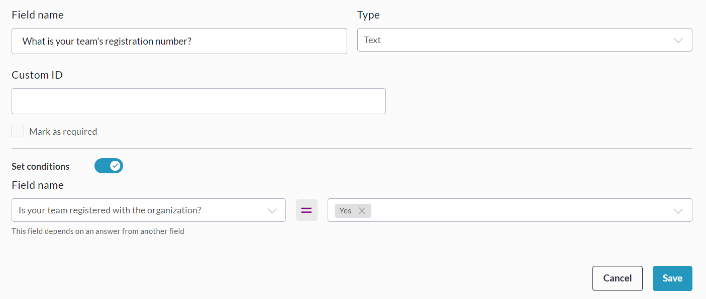

<!-- Source: https://chadmin.crowdchange.help/ct/custom-questions-for-teams-personal-pages | Nav: Custom Questions for Teams & Personal Pages | Mirrored 2026-10-14 -->

# Custom Questions for Teams & Personal Pages

Need to gather specific information from Team Captains or Personal Page creators? You're bound to love our custom questions feature for Teams \& Personal Pages!

Using it, you can create questions (including conditional questions), which are asked when someone is creating a team or personal page, via our simplified peer-to-peer, or multi-registration workflows.  
Please note that this feature is **NOT**enabled by default.

Reach out to your Partner Success Representative today to explore how this functionality could benefit your campaign!

See instructions below for how to set up Team and Personal Page Questions:
Setting up Team Questions  

## Setting up Team Questions

1. On a fundraiser where Team Fundraising Pages are enabled, click**Manage Fundraiser** , then**Peer to Peer settings** on the left sidebar.

2. Click **Team Fundraising Pages** and scroll down to **Custom Questions**.

3. Click **Add Question** to create a custom team question.

   
4. Select your question **Type** (Text, Checkboxes, Dropdown, Waiver or Multi-line text), sub-type (if applicable), fill out the details of your question, and click **Save** when finished.

   
5. Add in as many questions as needed (optional, conditional or required), ensuring to **Save**.

6. When creating a new team, creators/captains will be asked the custom questions.

   1. During the normal "Start a Team" process:

      
   2. During the multi-registration team creation process:

      
Setting up Personal Page Questions  

## Setting up Personal Page Questions

1. On a fundraiser where Personal Fundraising Pages are enabled, click**Manage Fundraiser** , then**Peer to Peer settings** on the left sidebar.

2. Click **Personal Fundraising Pages** and scroll down to **Custom Questions**.

3. Click **Add Question** to create a custom personal page question.

   
4. Select your question **Type** (Text, Checkboxes, Dropdown, Waiver or Multi-line text), sub-type (if applicable), fill out the details of your question, and click **Save** when finished.

   
5. Add in as many questions as needed (optional, conditional or required), ensuring to **Save**.

6. When creating a new personal page, creators will be asked the custom questions during the normal (non multi-reg) "Start a Fundraising Page" process:

   

## **Conditional Questions**

You can also ask **Conditional Questions** within your Team and Personal Page Custom Questions.

These are questions which will only show up if a certain condition is met relating to a previous question.

For example, a question like '*What is your team's registration number?* ' could appear after the response '*Yes* ' is given for '*Is your team registered with X organization?*'.

To set this up, you will create both questions you would like your donors to answer (following the instructions above) - the Parent question, and the Child question.

The Parent question must be either a **Single Selection** or **Multiple Choice** question - it cannot be a **Text** or **Waiver**question. See example parent question below:  

Now you can create the Child question and set it to appear only if a specific answer is given to the Parent question. To do so, once you've created it, toggle on **Set Conditions**.

Here you can select the (Parent) question which the Child question should be linked to, and determine what answers should cause the Child question to appear. See example below:  

Be sure to click **Save** in the bottom right when you are finished.

## Additional Information

The answers to these questions will be visible in the Admin **Teams Report** and **Personal Pages Report**.

Additionally, the answers to these questions are editable from the **Manage my Team** / **Manage my Page** → **Team Settings / Page Settings** menus at any time.

If using **Blueprints**, you will have the ability to set these questions at the blueprint level and apply to all connected fundraisers.  
If you require the ability to set**Custom ID's** for each question, reach out to your Partner Success Representative for this feature to be enabled on your site.
