<!-- Source: https://chadmin.crowdchange.help/ct/customizing-your-fundraiser-ui-design | Nav: Customizing your fundraiser UI & design | Mirrored 2026-10-14 -->

# Customizing your fundraiser UI & design

CrowdChange's offers a fully customizable fundraising page with detailed options for branding, layouts and content!

Fundraisers are built in a 'block' structure and are designed on a block-by-block basis with each section representing a different element of your fundraiser. Personal \& team pages will inherit the visual format of the overall fundraiser. *These layouts will appear slightly differently on mobile devices for screen optimization.*  

Full-screen "Hero" Layout  
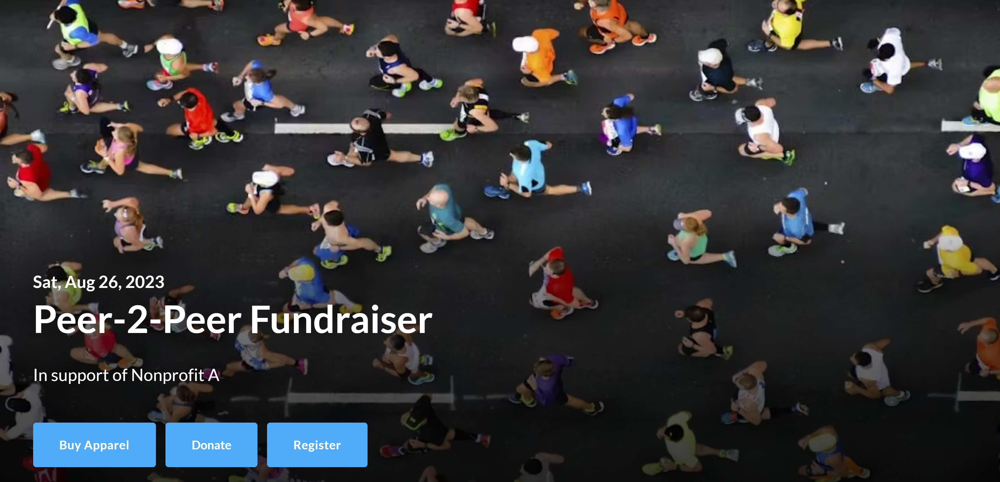
Full-screen Gallery Layout - Same as "Hero", but with slideshow of multiple images.  
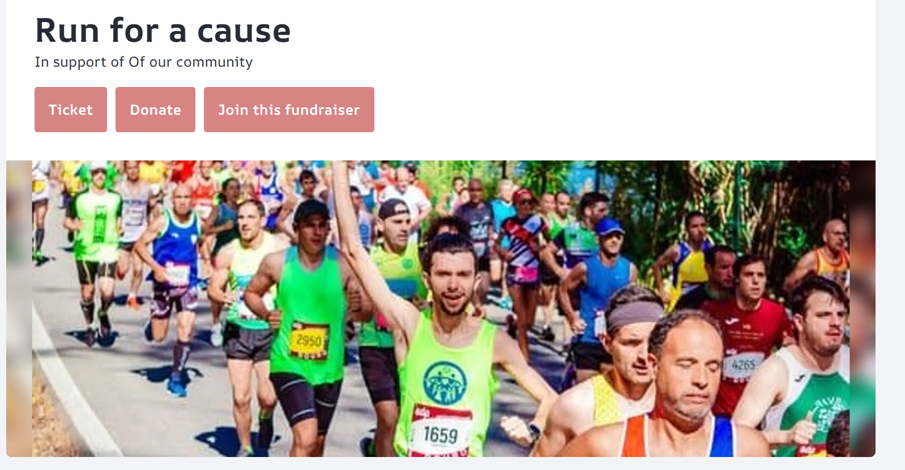  
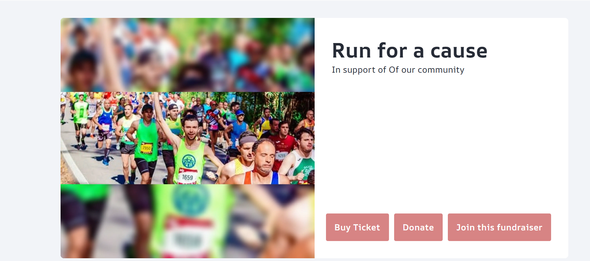

*** ** * ** ***

**Please Note** : Before you can access editing features, you must click **Manage your fundraiser** as shown below.  
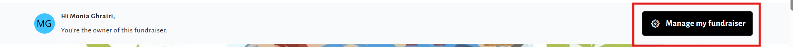

From your fundraiser dashboard click **Design your fundraiser** and click the "**Edit**" button in the top right corner.  
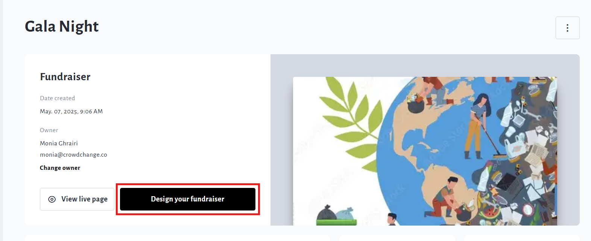

## Blocks and Design Controls

The fundraiser UI uses the 'block' structure, whereby fundraiser pages are built on a block-by-block basis. As shown in the image below, you have the ability to **add** , **edit** , **move** , **hide** or **delete** blocks.  
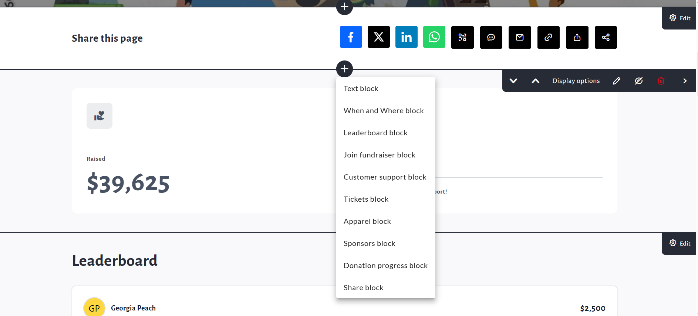

There are different types of blocks available depending on the settings of your fundraiser and each has a different function. Here are the block types with a brief description:

* **Donation Progress** block - Shows total amount raised, progress bar, fundraiser goal (if enabled), amount raised by teams and pages, number of donors, as desired. This block is very customizable.

* **Text**block - Allows you to enter a header title and text body.

* **When and Where** block - Allows you to display date(s) and pinpoint a geographic location.

* **Leaderboard**block - Allows you to display Top or Recent Donations, Top Teams and Top Pages.

* **Join fundraiser** block - Displays option to Join Fundraiser and create P2P pages. If a user has already joined they will see a list of any created pages with a 'Take me there' button.

* **Customer support**block - Displays 'Contact Us' button which brings up a contact form for support.

* **Purchase options** blocks - These will show up as Registrations, Tickets, Apparel or Sponsorsblocks depending on the settings of your fundraiser. They provide a quicker way for users to see and select purchase options.

* **eCards**block - Available if eCards is enabled within fundraiser settings. Allows you to display select eCards on your fundraiser's main page.

## Fundraiser and Layout Options

For Admins and Fundraiser Owners managing their fundraiser, options such as **Edit** , **Offline Donations** , **Mailing List, Reports, Purchase options** and more will be found under the fundraiser dashboard when clicking **Manager fundraiser** in the top left corner of the screen.

Basic color and style options are found under **Theme Settings** , but to edit the overall design of the page, you must click the **Gear** icon on below the theme setting.  
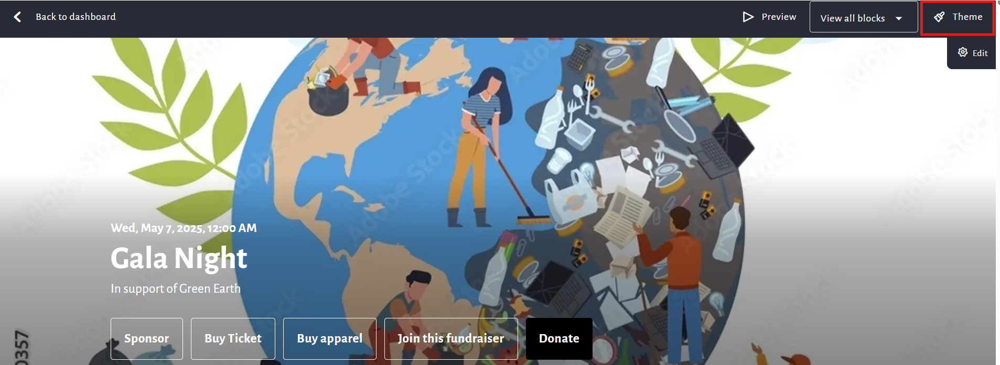

Once you click the**Gear**icon, a scrollable side panel will appear on the right with more fundraiser options.

This is where you can go to edit your fundraiser title, choose which buttons are shown and in what order, change the layout, images, background and more. Be sure to scroll down and click **Save**.  
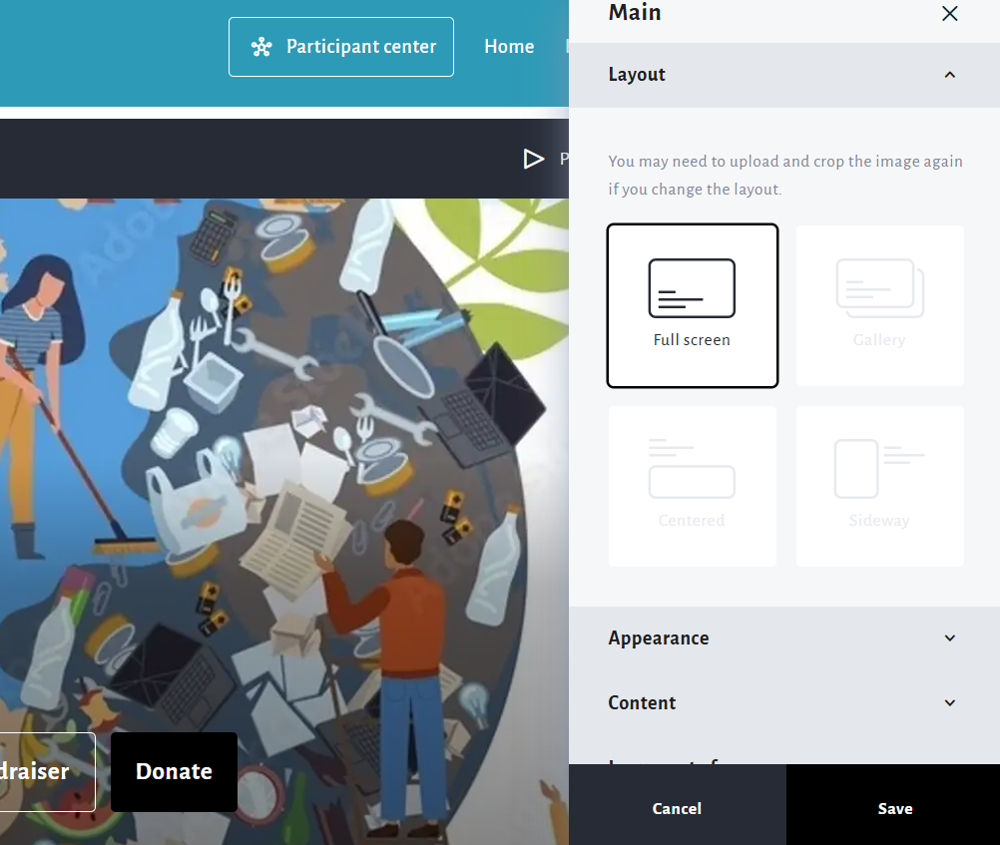

## Share Feature \& Block

The **Share** feature has also been updated, with more sharing options now available such as **QR code** , **WhatsApp** , **Twitter** , and **sharing to other apps**. The Share button also now exists within it's own block.  
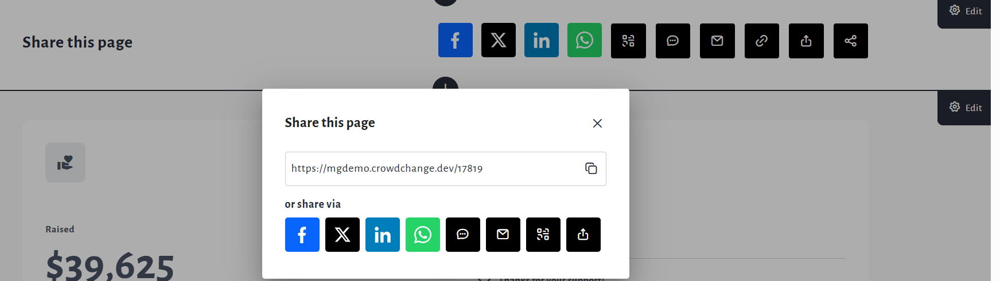

The text, design and placement of the Share block can be customized by following these steps:

1. From the fundraiser, go to **Manage fundraiser → Design your fundraiser**.

2. Click the **Gear** icon that appears while hovering over the **Share block.**

3. From the Sharing menu, you can make adjustments to the Share block as shown below.

   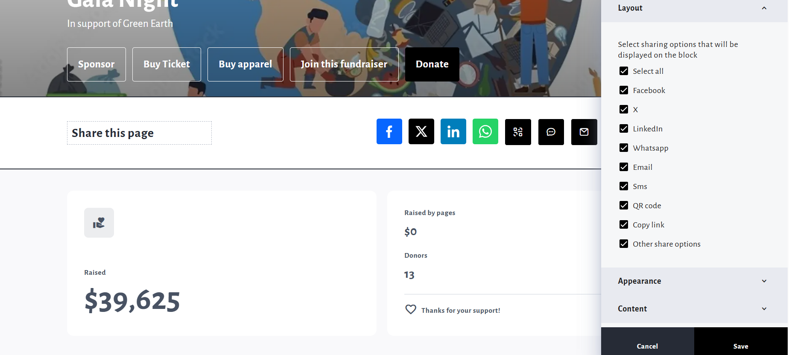

## A Note on P2P Pages

Personal and Team fundraising pages will inherit the visual format of the overall fundraiser, including buttons shown. The position of the 'Manage my Page' (or Team) and 'Share' buttons also follows the new design.

To navigate from your personal fundraising page to the main fundraiser or your connected team page, you must now click **Fundraiser and team details**, then select either the fundraiser or the team page.  
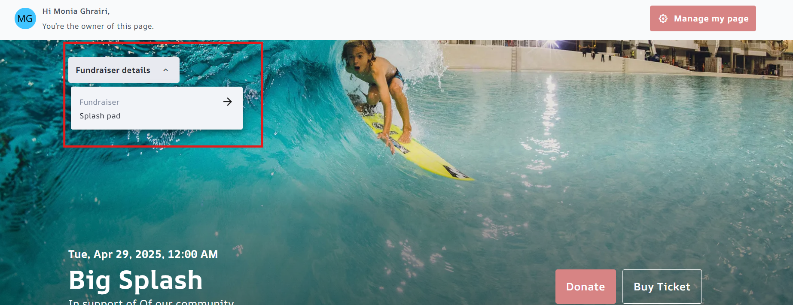

## Customizing Button titles on a page-by-page basis

Button titles can differ depending on placement - you can have a different setup on your **Main fundraiser page** , **Team** and **Personal fundraising pages** . Depending on your needs, you can adjust this by following these steps within the **Design your fundraiser** function:

1. Click on the **Edit** button within the **Cover image**

2. Click **Buttons**

3. Click the **Gear icon**beside the button you wish to adjust

4. Scroll and click either **Settings for team pages** , or **Settings for personal pages**

5. Make any changes on the following page, then click **Save**

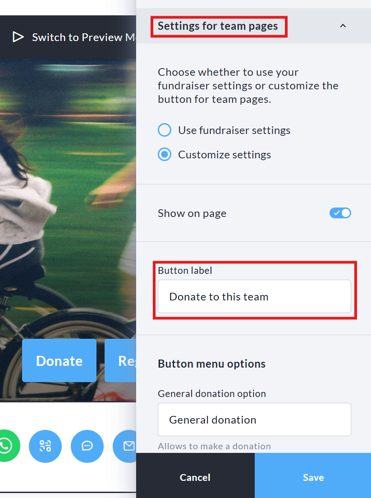
Adjusting the label on the "Donate" button on **Team fundraising pages**
