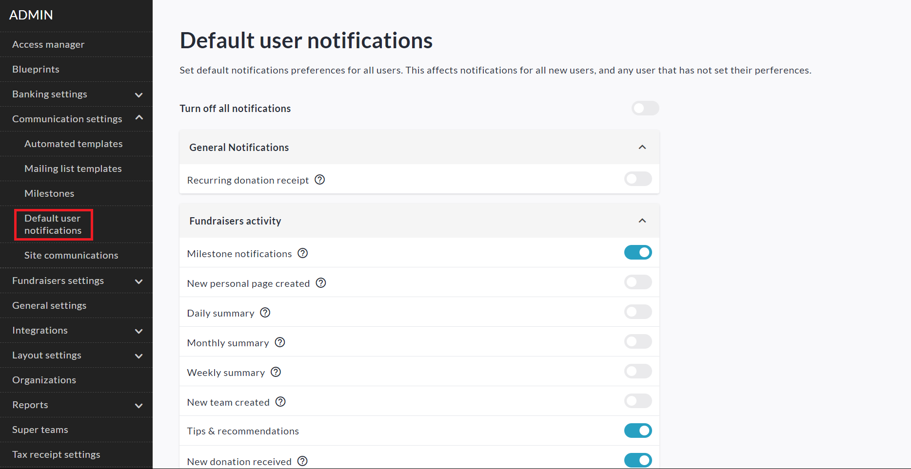

<!-- Source: https://chadmin.crowdchange.help/ct/default-user-notifications | Nav: Product Updates > Default User Notifications | Mirrored 2026-10-14 -->

# Default User Notifications

As an Admin on your CrowdChange site, you are able to set the default state of notifications preferences for all new fundraiser owners. To do so, follow the simple steps below.

1. From any where on your CrowdChange site, click **Profile → Admin** in the top right corner.

2. Click **Communication Settings** on the left sidebar, then **Default User Notifications**.

3. You will see a notifications menu identical to the one in your profile notifications menu. However, any changes made here will affect all new users and any user that has not yet set their own preferences.

Users who have already set their own personal notifications preferences will not be affected.  

