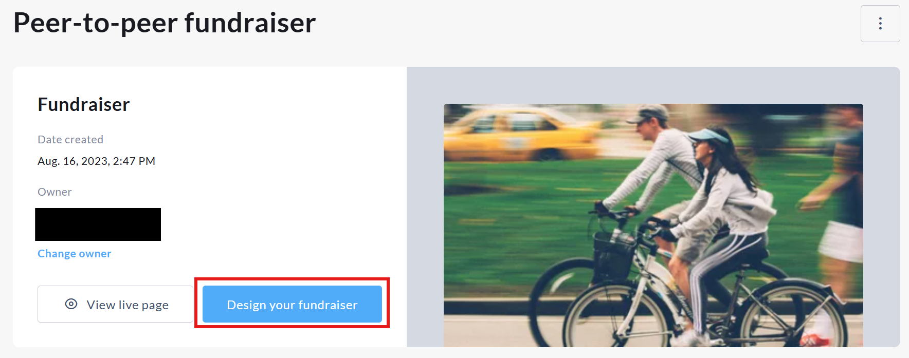

<!-- Source: https://chadmin.crowdchange.help/ct/design-your-fundraiser-how-to-adjust-the-front-end | Nav: Design your Fundraiser - How to adjust the front-end user interface of your campaign on CrowdChange | Mirrored 2026-10-14 -->

# Design your Fundraiser - How to adjust the front-end user interface of your campaign on CrowdChange

## Designing Your Fundraiser with Blocks

CrowdChange gives you full control over the look, feel, and structure of your fundraiser through our flexible **block-based design system**.

Every fundraiser page is built using individual content "Blocks." Each block represents a specific section or feature of your page, such as your donation progress, text content, leaderboard, registration options, or sharing tools. This modular structure allows you to fully customize the front-end experience without affecting the core functionality of your fundraiser.

Using the **Design Your Fundraiser** tool, you can:

* Add new blocks to highlight key content

* Edit existing blocks to update text, layout, or display settings

* Reorder blocks to control the flow of your page

* Hide or remove blocks that are not relevant to your campaign

* Customize layout styles, images, background settings, and button visibility

Because the page is built block-by-block, you can tailor your fundraiser to match your organization's branding, campaign goals, and audience needs. Personal and Team fundraising pages will automatically inherit the overall visual style of the main fundraiser, ensuring a consistent and professional appearance across your campaign.

This flexible structure makes it easy to create anything from a simple donation page to a fully featured event with tickets, registrations, merchandise, sponsorships, peer-to-peer fundraising, and more, all while maintaining complete design control.

*** ** * ** ***

## How to access **Design your fundraiser** functionality

To access the **Design your fundraiser** functionality, please follow the below steps:

* Go to your CrowdChange site and **Log in**

* Access your fundraiser and click **Manage fundraiser** in the upper right-hand corner of your campaigns' cover image

* Once on the **Fundraiser dashboard** , click **Design your fundraiser**

The **Design your fundraiser** button within the **Fundraiser dashboard**

*** ** * ** ***

## Fundraiser blocks overview

Below is an overview of the core blocks available within the **Design Your Fundraiser** tool, along with a brief description of each.

* **Cover Image Block** - Displays your fundraiser's main banner or hero image at the top of the page, allowing you to upload, edit, and customize the visual header that defines your campaign's look and feel.

* **Sharing Block** - Provides built-in sharing tools including social media options, QR code generation, and direct link copying, making it easy for supporters to promote your fundraiser.

* **Donation Progress Block** - Showcases your total amount raised, progress toward your goal, donor count, and optionally team and personal page totals, helping drive momentum and transparency.

* **Text Block** - Allows you to add custom headings and body content to share important details, storytelling, sponsor recognition, or calls to action.

* **Join Fundraiser Block** - Displays the option for participants to join the fundraiser and create personal or team fundraising pages, and provides quick access to pages already created by a logged-in user.

* **Purchase Option Blocks (Tickets, Registration, Apparel \& Merchandise, Sponsors, eCards, Tribute Cards)** - Highlights your enabled purchase options in dedicated sections, allowing supporters to quickly view and complete transactions related to event tickets, registrations, merchandise, sponsorship packages, and card purchases.

* **Leaderboard Block** - Displays Top or Recent Donations, Top Teams, and Top Personal Pages to encourage friendly competition and recognize supporter contributions.

* **Gallery Block** - Showcases multiple images in a gallery or slideshow format, helping you visually highlight your cause, past events, or campaign impact.

* **Customer Support Block** - Displays a "Contact Us" button that opens a support form, allowing visitors to quickly reach out with questions or inquiries related to your fundraiser.
