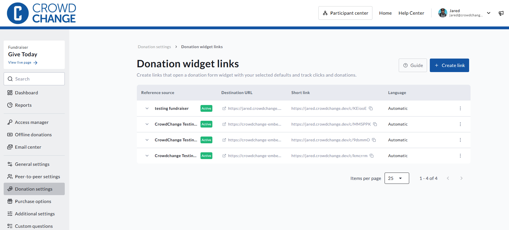
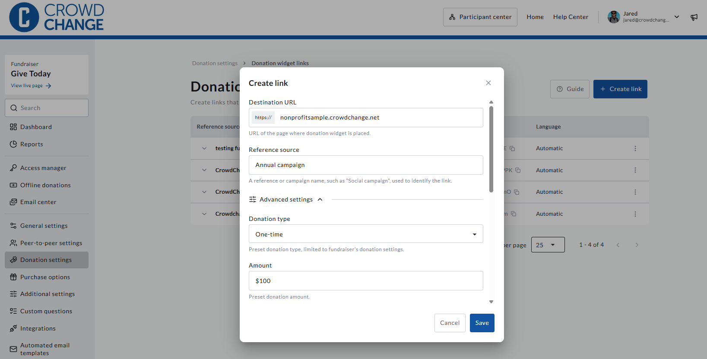
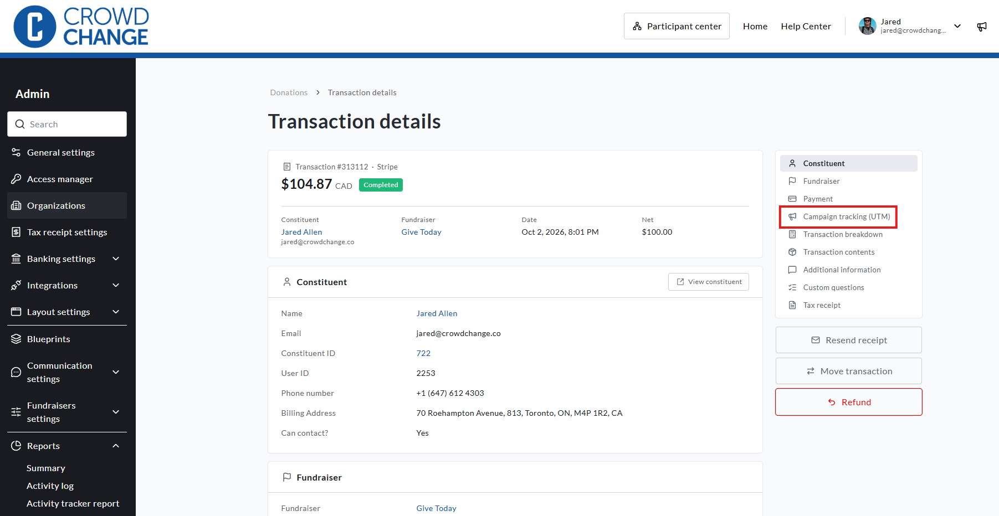
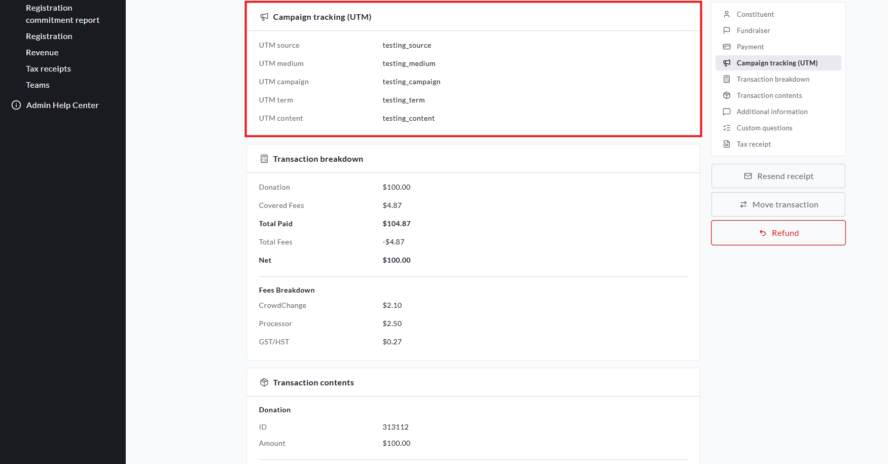

<!-- Source: https://chadmin.crowdchange.help/ct/donation-widget-links-utm-tracking-how-to-see-which-links-emails-and-campaigns-drive-your-donations | Nav: Donation Widget Links & UTM Tracking - How to see which links, emails, and campaigns drive your donations | Mirrored 2026-10-14 -->

# Donation Widget Links & UTM Tracking - How to see which links, emails, and campaigns drive your donations

CrowdChange now helps you answer a question every fundraiser asks: *which email, post, or campaign actually raised the money?*

You can build trackable **Donation Widget Links** that open your embedded donation form with the details you choose, tag them with standard **UTM** campaign parameters, and see exactly what each link produced. CrowdChange also automatically tags the links it creates on your behalf, including shares, emails, e-cards, tributes, QR codes, and more. That means you get attribution data even for traffic you never tagged yourself.

This article covers:

* How to create and manage Donation Widget Links

* How UTM tracking works in CrowdChange

* Which CrowdChange channels are tracked automatically

* How attribution is decided when a donor clicks more than one link

* Where to see your data in reports and exports

## What's Included

Three connected features work together:

* **Donation Widget Links:** a link builder in your Donation settings. Create a short, shareable link that opens your embedded donation form with presets, and track the clicks and completed donations each link produces.

* **UTM capture and reporting:** CrowdChange now captures UTM parameters from any traffic that reaches your site, not just links built with the link builder. UTM values appear in your reports, filters, and CSV exports.

* **Automatic channel tracking:** donations, registrations, and new fundraiser, team, and personal pages are tagged with the CrowdChange channel that drove them, in addition to any UTMs already on the link.

## Before You Begin

* The link builder appears once the embedded donation form feature is enabled on your fundraiser. This feature is not enabled by default. If you don't see it, reach out to your Partner Success Representative. See [How to Use Embedded Donation Forms](how-to-use-embedded-donation-forms.md) for setup.

* You'll need Admin access, or access to manage the fundraiser, to create links.

* You'll need the web address of the page on your own website where your embedded donation form lives. The link takes donors there and opens the form automatically.

## How to Create a Donation Widget Link

1. Go to your CrowdChange site and **Log In**.

2. Go to the fundraiser your embedded donation form is connected to and click **Dashboard**.

3. Click **Donation settings** in the menu on the left, then click **Donation widget links** . **\[VERIFY: exact menu path\]**

4. Click **Create link**.

5. Fill in the link details (see the table below).

   

6. Click **Save** to generate your link.

7. Copy the short link and share it anywhere: social posts, newsletters, ads, partner sites, QR codes, or text messages.

### Link Builder Fields

|              Field              | Required? |                                                                  What it does                                                                  |
|---------------------------------|-----------|------------------------------------------------------------------------------------------------------------------------------------------------|
| **Destination URL**             | Required  | The web address of the page on your website where your embedded donation form lives. Donors are sent here when they click your link.           |
| **Reference source**            | Required  | A name you choose to identify this link in your reports, for example `spring-newsletter`.                                                      |
| **Donation type**               | Optional  | Presets whether the form opens on a one-time, monthly, or annual donation. Only the options available on your fundraiser are shown.            |
| **Amount**                      | Optional  | Presets the donation amount when the form opens.                                                                                               |
| **In support of**               | Optional  | Presets the fund or purpose the donation supports. Shown only when donors can choose an "in support of" option at checkout.                    |
| **Language**                    | Optional  | Sets the language the form opens in: automatic, English, or French. Shown only if your fundraiser is bilingual.                                |
| **Campaign tracking**           | Optional  | `utm_source`, `utm_medium`, `utm_campaign`, `utm_term`, and `utm_content`, in their own section. See Using UTM Parameters in Your Links below. |
| **Additional query parameters** | Optional  | Any other parameters you'd like passed through to your page.                                                                                   |

### What Happens When Someone Clicks Your Link

1. CrowdChange records the click.

2. The donor is sent to your website, to the page you entered as the URL.

3. Your embedded donation form opens automatically with the presets you chose (amount, frequency, fund, and language), and your ref source is attached to the donation.

Any other parameters already on the link, such as tracking IDs added by a social platform, are preserved and passed along.

## How to Manage Your Links

The **Donation widget links** page lists every link you've created in one table. For each link you can see:

* The link's **ref source** name

* **Clicks** on the short link

* **Completed donations** attributed to the link. Only donations that were actually completed are counted, not abandoned checkouts.

You can also **copy** a link at any time and archive a link from the 3-dot menu in line with each link.

## Using UTM Parameters in Your Links

UTM parameters are a standard way to describe where traffic comes from. If you already use them with Google Analytics (GA4) or other marketing tools, you can use the same values in CrowdChange so the two stay in sync.  

|   Parameter    |              What it tells you              |         Example          |
|----------------|---------------------------------------------|--------------------------|
| `utm_source`   | Where the visitor came from                 | `newsletter`, `facebook` |
| `utm_medium`   | The type of channel                         | `email`, `social`        |
| `utm_campaign` | The campaign the link belongs to            | `spring-appeal`          |
| `utm_term`     | Optional keyword or audience detail         | `monthly-donors`         |
| `utm_content`  | Optional detail to tell similar links apart | `button-a`               |

A few things to know:

* `utm_source`**and** `utm_medium`**are the two that need values** for UTM tracking to work. `utm_campaign`, `utm_term`, and `utm_content` are optional.

* CrowdChange stores the five standard UTM parameters above, plus `ref_source`. Other parameters, such as `utm_id`, are ignored.

* If a link already includes UTM parameters, CrowdChange never changes them. Your own campaign tagging is always preserved, and values from two campaigns are never mixed.

* You don't have to use the link builder to benefit. UTM parameters on **any** link to your CrowdChange site, for example in an email sent from another tool, are captured and reported.

## What CrowdChange Tracks Automatically

You don't need to tag anything for the channels below. CrowdChange adds UTM parameters to the links it generates, so donations, registrations, and new fundraiser, team, and personal pages are attributed to the channel that drove them.

Tracked automatically:

* **Every share option:** Facebook, X, LinkedIn, WhatsApp, copy link, the native share menu, share QR codes (including the Instagram story QR code), and shares sent by email or SMS from CrowdChange. See [Sharing Block](sharing-block-social-media-qr-codes-email-sms-and-.md).

* **Every email sent by CrowdChange**, tagged by type: Email Center sends, custom milestone emails, e-cards, tributes, invitations (owner, user, team captain, and scanner invites), receipts and tickets, and all other automated emails.

* **E-cards and tributes**, including both the web view link and the SMS delivery link.

* **Printed auction item sheets**, through their QR codes.

* **Embedded donation forms**, which pick up UTM parameters from your own website's URL (see Embedded Donation Forms on Your Website below).

Not tracked: **payment-link SMS messages.** A payment link completes a transaction that already exists rather than creating a new donation, registration, or page, so there is nothing new to attribute.

### Reference: Values CrowdChange Uses

Use this table when you need to filter a report, or recognize a CrowdChange channel in Google Analytics.  

|                 Where the link appears                 |    `utm_campaign`    |     `utm_source` / `utm_medium`     |
|--------------------------------------------------------|----------------------|-------------------------------------|
| Share: Facebook, X, LinkedIn, WhatsApp                 | `share`              | the network / `social`              |
| Share: copy link                                       | `share`              | `copy_link` / `link`                |
| Share: native share menu                               | `share`              | `native_share` / `link`             |
| Share QR code (dialog, download, or emailed)           | `share`              | `qr_code` / `qr_code`               |
| Instagram story QR code                                | `share`              | `instagram` / `qr_code`             |
| Share by email or SMS from CrowdChange                 | `share`              | `email` / `email`, or `sms` / `sms` |
| Email Center send                                      | `email_center`       | `email` / `email`                   |
| Custom milestone email                                 | `milestone`          | `email` / `email`                   |
| E-card or tribute (web view)                           | `ecard` or `tribute` | `card_view` / `referral`            |
| E-card or tribute (SMS delivery)                       | `ecard` or `tribute` | `sms` / `sms`                       |
| Invitation emails (owner, user, team captain, scanner) | `invite`             | `email` / `email`                   |
| Receipts, tax receipts, and tickets                    | `receipt`            | `email` / `email`                   |
| Other automated emails                                 | `automated_email`    | `email` / `email`                   |
| Printed auction item sheets                            | `auction_item_sheet` | `qr_code` / `qr_code`               |

`utm_content` identifies the specific page the link belongs to: a fundraiser, team, personal page, or auction item, for example `fundraiser-12` or `team-34`. It never contains personal information.

**Using Google Analytics?** The `utm_medium` values match GA4's default channel groupings: `social` appears as Organic Social, `email` as Email, `sms` as SMS, and `link` and `referral` as Referral. `qr_code` has no default GA4 channel, so you may want to add a custom channel group for it.

## How Attribution Works

When a donor clicks more than one link before donating, CrowdChange needs to decide which one gets the credit. It uses **last-touch attribution**, the same model GA4 and most marketing tools use: the most recent campaign link the donor opened wins.

* **Saved in the donor's browser.** UTM values are stored in the visitor's browser, so every tab on that browser sees the same values.

* **The latest link replaces the previous one.** Opening any link with a UTM parameter or a `ref_source` replaces everything saved before it, even if the new link has fewer parameters. Values from two campaigns are never blended.

* **Direct visits keep the campaign.** If the donor returns by typing your web address, using a bookmark, or clicking between pages, the saved values stay in place.

* **30-day window.** Saved values expire 30 days after the original campaign click. A later direct visit doesn't extend the window.

* **Per browser only.** Attribution doesn't follow a donor to a different browser or device. A private browsing window, or cleared site data, starts with nothing saved.

* **Records never change.** Once a donation, registration, fundraiser, team, or personal page is created, its recorded UTM values stay the same.

### Example

| Step |                                  What the donor does                                  |                             What's recorded                              |
|------|---------------------------------------------------------------------------------------|--------------------------------------------------------------------------|
| 1    | Opens link A (`utm_source=facebook`, `utm_campaign=share`) and donates                | `facebook` / `share`                                                     |
| 2    | Opens link B (`utm_source=newsletter`, `utm_medium=email`) in another tab and donates | `newsletter` / `email`. Link A is fully replaced.                        |
| 3    | Returns 10 days later by typing your web address                                      | Still `newsletter` / `email`. A direct visit keeps the saved campaign.   |
| 4    | Opens link C, which has only `ref_source=partner-site` and no UTMs                    | Ref source `partner-site` with no UTMs. Link C replaces link B entirely. |
| 5    | Returns 31 days after clicking link C                                                 | Nothing is recorded. The 30-day window has expired.                      |

## Where to See Your Data

UTM values are captured on donations, registrations, fundraisers, teams, and personal pages, and appear in:

* **Reports:** filter the **Donations, Registrations, Teams, Personal Pages, Fundraisers,** and **Revenue** reports by UTM parameter.

  

  
* **CSV exports:** UTM values are included in the Transactions, Teams, Personal Pages, Fundraisers, and Registration report exports.

* **API:** the same UTM data is available through the API, following the same pattern as `ref_source`.

UTM filters match any part of the value, the same way the existing **Ref source** filter does. A registration uses the UTM values from its checkout transaction.

### Useful Report Filters

Use these filters to answer common questions. They work the same way across the Donations, Registrations, Teams, Personal Pages, and Fundraisers reports and their CSV exports.  

|               To see...               |                                     Filter by                                      |
|---------------------------------------|------------------------------------------------------------------------------------|
| Donations driven by any share         | `utm_campaign` = `share`                                                           |
| Donations from social shares only     | `utm_campaign` = `share` and `utm_medium` = `social`                               |
| Donations from an Email Center send   | `utm_campaign` = `email_center`                                                    |
| Donations from e-cards or tributes    | `utm_campaign` = `ecard` or `tribute`                                              |
| Donations driven by one page's shares | `utm_campaign` = `share` and `utm_content` = the page's ID (for example `page-56`) |

## Embedded Donation Forms on Your Website

If your donation form is embedded on your own website, CrowdChange also picks up UTM parameters from your site's URL. When a donor lands on your website from a campaign link, the embedded form saves those values using the same last-touch model and 30-day window described above, and carries them into the donation.

Your embedded donation form is recorded as the channel for the transaction, so the **Ref source** field only ever contains a value you set yourself.

## Things to Know

* **Links are for tracking and presets, not conditional logic.** UTM and URL parameters are used for tracking and reporting. They can't currently be used to fill in custom fields or trigger conditional questions on your donation form.

* **Payment-link SMS messages aren't tracked**, as described above.

* **Email links.** CrowdChange only adds tracking to links in its emails that point to your CrowdChange site or e-card pages, never to external websites. Only the underlying link is tagged. The text donors see in the email, such as a page link, still shows the clean web address.

* **Attribution is per browser.** If a donor clicks your link on their phone and donates later on their laptop, the donation won't be attributed to the link.

* **Ref source and UTMs work together.** Ref source is a label you type to name a link, while UTM values describe the channel and campaign. Use both for the clearest reporting.

## Frequently Asked Questions

**Do I need to use the link builder to track UTMs?** No. UTM parameters on any link to your CrowdChange site are captured and reported. The link builder simply makes it easy to create trackable links with presets for your embedded, and standard, donation forms.

**Can I still use Google Analytics or Google Tag Manager?** Yes. Nothing about your existing analytics setup changes. CrowdChange uses the same last-touch model as GA4, so the two should tell a consistent story. See [Analytics Connectors](analytics-connectors.md).

**Will existing donations show UTM values?** UTM values are recorded from the time this feature is released.

**Does tracking work on embedded forms, not just my CrowdChange pages?** Yes. The embed picks up UTM parameters from your own site's URL and carries them into the donation.

**Does this track SMS, e-cards, or tributes?** Yes. E-card and tribute sends are tracked (both the web view and SMS delivery link), as are shares sent by SMS from CrowdChange. The only exception is payment-link SMS messages.

**What if a donor clicks two different links before donating?** The most recent link wins. See How Attribution Works above.

**Can I deactivate a link?** Yes. You can archive a link from the Donation widget links page.

If you have questions or need help setting up tracking for an upcoming campaign, reach out to your Partner Success Representative.
