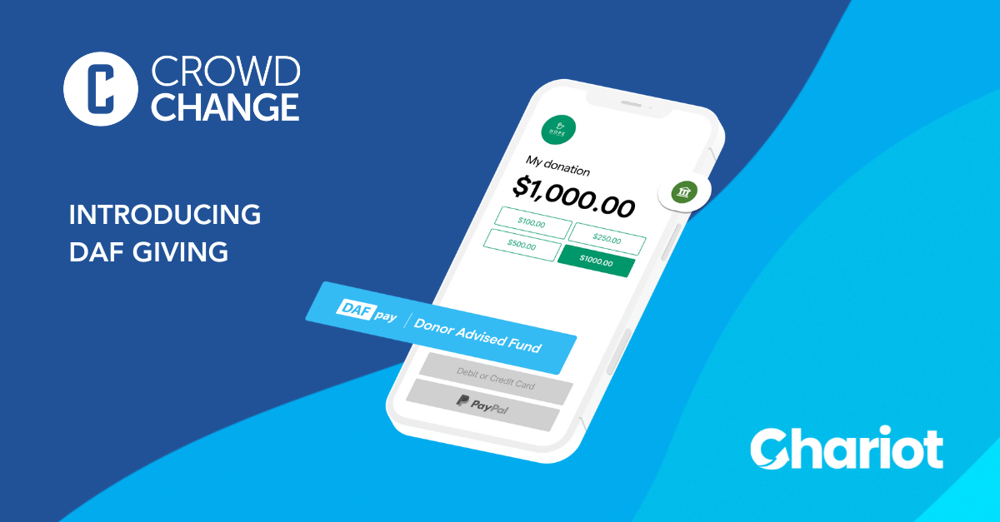
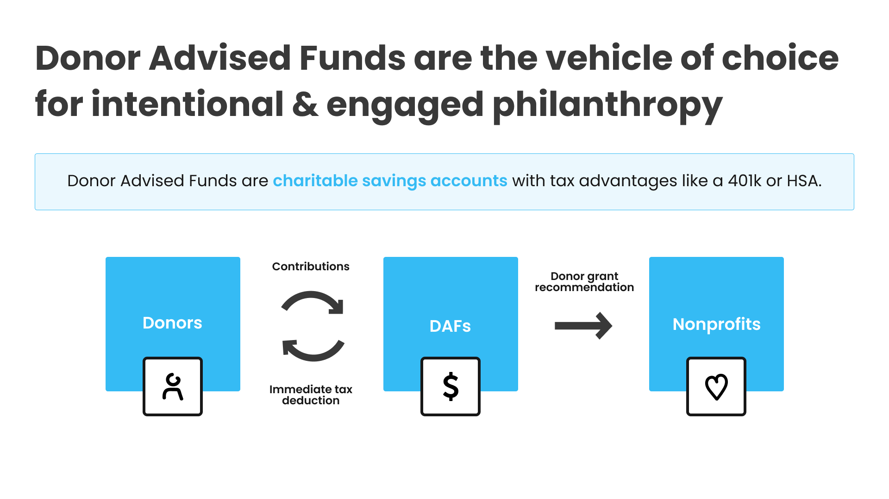
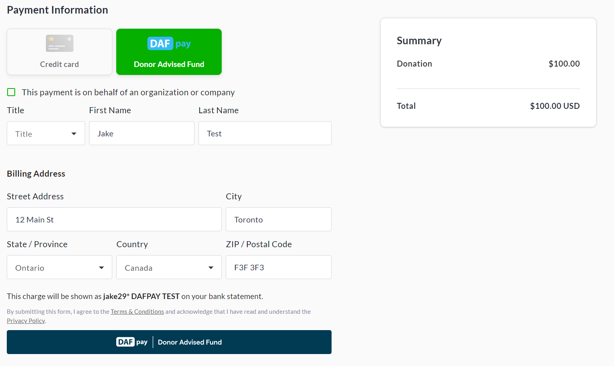
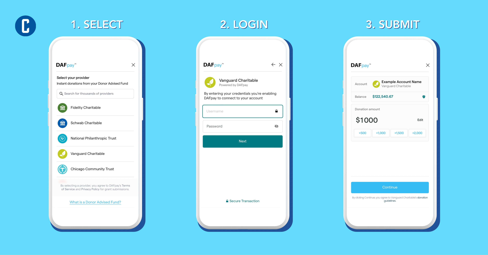

<!-- Source: https://chadmin.crowdchange.help/ct/donor-advised-funds-dafpay-by-chariot-integration | Nav: Donor Advised Funds - DAFpay by Chariot Integration | Mirrored 2026-10-14 -->

# Donor Advised Funds - DAFpay by Chariot Integration

DAFpay is a payment method powered by our partnership with[Chariot](https://www.givechariot.com/). It allows donors to make Donor Advised Fund (DAF) gifts directly within your CrowdChange donation forms. Major DAF providers are supported, including Fidelity, DAFGiving360, Vanguard, National Christian Foundation, and more.

## What is a Donor Advised Fund?

A Donor Advised Fund is a charitable savings account created solely to support nonprofit organizations that donors care about. When money, or more complex assets such as stock, crypto, or real estate, are deposited into a DAF, donors are immediately credited with a tax receipt and can then invest those funds, which grow tax-free. Donors can direct their DAF to make grants to 501(c)(3) nonprofit organizations at any time. Additionally, using DAFpay by Chariot, these DAF donations can be made instantly and seamlessly online within a nonprofit's own donation forms. Donor Advised Funds are a rapidly growing giving channel, with $326B set aside for giving in DAFs (2024 year-end).

### **Key Benefits of Donor Advised Fund (DAF) Payments**

1. **Larger donations:** DAF funds are already set aside for charitable giving, and DAF gifts are often larger than typical online card donations.

2. **Ideal donor experience:** DAFpay reduces friction by keeping the DAF gift flow embedded in your donation experience.

3. **Identify DAF donors:** DAF donors can self-identify at the time of giving, helping your team steward these donors more effectively.

We're excited to offer this Donor Advised Fund payment option, which we believe will support your fundraising efforts and provide a more streamlined experience for your donors. If you have any questions or need guided assistance, feel free to reach out to our support team.

## How to Manage Your Chariot DAFpay Integration

DAFpay is enabled by default for all US-based partners, and you can opt out at any time by contacting our Customer Support Team. Send an email to [support@crowdchange.co](mailto:support@crowdchange.co) and our team would be happy to assist.

### Important: Claim and verify your Chariot account (recommended)

To manage incoming DAFpay gifts and avoid potential delays or fees, we strongly recommend that nonprofits claim and verify their Chariot account. This creates a Chariot Deposit Account (CDA).

If you do not have a CDA:

* DAFpay gifts may be routed through the DAFpay Network (DPN).

* Gifts routed via DPN may be subject to DPN terms, including a 60-day holding period and a check handling fee, the lesser of $25 or 10%.

Claim your Chariot account (CDA) here - <https://dashboard.givechariot.com/signup?fp=crowd-change>

*** ** * ** ***

### Making a Donation with DAFpay

Once setup is complete, DAFpay will be available as a payment option at checkout within your CrowdChange donation forms.  

Example of DAFpay at checkout

Clicking the button at the bottom will launch the DAFpay checkout process.

The donor will be prompted to select their DAF provider and connect with their login credentials.  

Once logged in, they can quickly and seamlessly complete their DAF payment.  
**DAFpay is a fast, safe, and secure payment method.** When you donate through DAFpay, your data is always safe and secure. Chariot's servers run on Amazon Web Services (AWS), which means top-of-the-line protection that evolves with the latest universal industry standards. Third parties will never have access to any of your donors' data, and the information you pass is fully encrypted using industry-vetted protocols.

Chariot's technology follows the same standards utilized for linking bank accounts to financial applications such as Venmo. No grants will ever be submitted without donor verification and consent, ensuring that you are fully in control of all your activity through the modal. Chariot prides itself first and foremost on security and is constantly ensuring that its security measures keep to the highest standards.

### FAQ

**Do I need a Chariot Deposit Account (CDA) to use DAFpay?**

In most cases, a CDA is not required to offer DAFpay. However, claiming and verifying your Chariot account is strongly recommended to help ensure gifts arrive without added delays or handling fees.

**Where will DAFpay appear for donors?**

DAFpay appears within the donation experience at checkout, embedded in your donation form flow.

**What is "Gift Processing" and do I need it?**

Gift Processing is a separate Chariot product. Most Gift Processing functionality is only available to nonprofits that sign up for a Chariot subscription, typically designed for larger nonprofits. If you're interested, contact Chariot to learn more.

**Additional Resources**

For further information, check out the below articles which go deeper into the DAF market and DAF donors.

[Breaking Down the Donor Advised Fund Market In 2022](https://www.google.com/url?q=https://www.givechariot.com/post/breaking-down-the-donor-advised-fund-market-in-2022&sa=D&source=docs&ust=1718805807008163&usg=AOvVaw3sNECphlS1gWIkOxpc75kA)

[Top 9 Takeaways for Nonprofits from the 2024 National Study on Donor Advised Funds](https://www.google.com/url?q=https://www.givechariot.com/post/top-9-takeaways-for-nonprofits-from-the-2024-national-study-on-donor-advised-funds&sa=D&source=docs&ust=1718805807008328&usg=AOvVaw3_ki52TzI_HONRq7Jt8zxK)

[Who uses a DAF?](https://www.google.com/url?q=https://www.givechariot.com/post/who-uses-a-daf&sa=D&source=docs&ust=1718805807008367&usg=AOvVaw3ug7oz6LwBG5g9B-IP_7MD)

[So... What is a DAF? Donor Advised Funds 101 for Fundraisers](https://www.google.com/url?q=https://www.givechariot.com/post/so-what-is-a-daf&sa=D&source=docs&ust=1718805807008399&usg=AOvVaw2RlxXel15DP4MboDs0ZTpw)

[The 15 top takeaways from Fidelity Charitable's 2024 DAF report](https://www.google.com/url?q=https://www.givechariot.com/post/the-15-top-takeaways-from-fidelity-charitable-s-2024-daf-report&sa=D&source=docs&ust=1718805807008441&usg=AOvVaw2KGOajImKAkwQizyDnfIBo)
