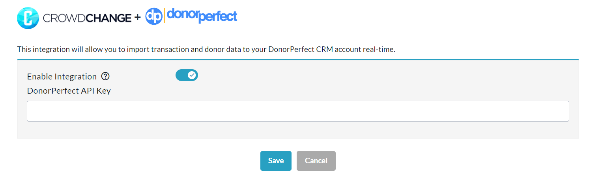
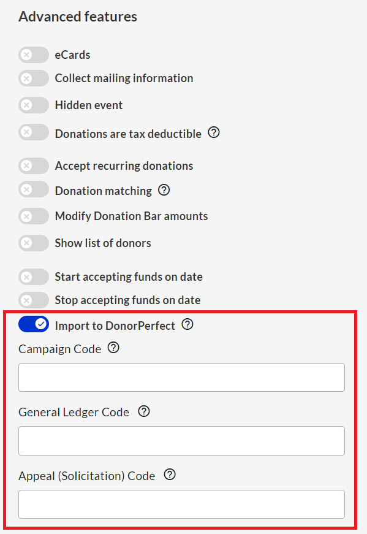
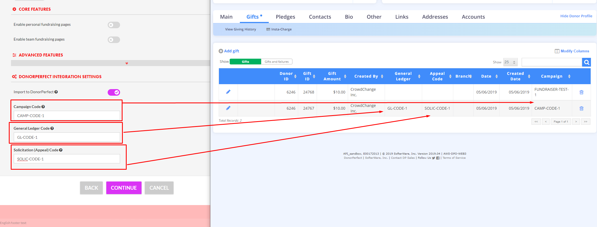
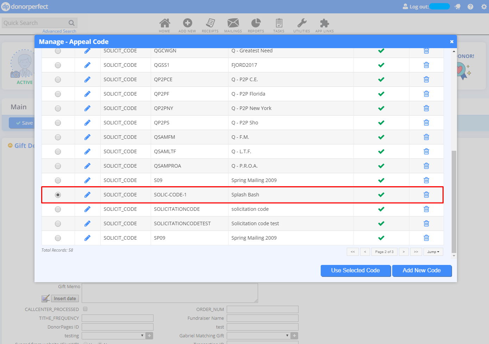

<!-- Source: https://chadmin.crowdchange.help/ct/donorperfect-integration-with-crowdchange | Nav: DonorPerfect Integration with CrowdChange | Mirrored 2026-10-14 -->

# DonorPerfect Integration with CrowdChange

CrowdChange is able to connect with your organization's DonorPerfect account, and automatically upload relevant data to DonorPerfect instantly on a transaction-by-transaction basis.  
Is your organization using DonorPerfect, but has not been set up for integration with CrowdChange? For a one-time fee, we can connect your site to DonorPerfect. This cost goes towards the creation and maintenance of the connection between CrowdChange and DonorPerfect.

For details, feel free to contact your Partner Success Manager!

## **What do you need from DonorPerfect?**

In order for you to connect your CrowdChange site to DonorPerfect, you need to request an API key (which is a long series of letters, numbers, and special characters) from them directly. This is then generated in your DonorPerfect account. Reach out to your contact at DonorPerfect to ask for an API key to connect to your CrowdChange account, and they can set this up for you.

### **Setting the connection up on your CrowdChange site**

Once you have secured the API key from DonorPerfect, this needs to be entered into your CrowdChange site. Please follow these steps to do this:

1. Go to your CrowdChange site and log in to your account.

2. In the upper right-hand corner of your screen, click **Profile → Admin.**

3. In the sidebar of the **Admin** dashboard, click **Integrations** → **DonorPerfect Integration**.

4. Toggle on **Enable Integration** and paste the API key into the text box. Be sure to click **Save** once these steps are completed.

  
Your API key must match **exactly**with what has been provided to you by DonorPerfect. Please use the copy and paste function to input your API key in order to avoid errors.

### **Applying the connection to your campaigns**

Once your site has DonorPerfect Integration enabled, and you have entered your API Key, when creating or editing fundraisers you will now have an option called **Import to DonorPerfect** under the **Advanced Features** section of the **Additional Settings**page.  

When creating a fundraiser you will have the option to enter in the following codes:

* Campaign Code

* General Ledger Code

* Appeal (Solicitation) Code

If any of these codes are set, there will be a check if it already exists in DonorPerfect when a transaction is imported. If a code already exists, it will be used to import the transaction with that value. If it does not exist, a new code will be created in DonorPerfect that will have Fundraiser's Name as `DESCRIPTION`, and Campaign Code as `CODE`.  

This can be updated later by clicking "Manage Codes" in DonorPerfect:  

If `Codes` are **not set**, they will be set to empty field in the DonorPerfect system.

### **Data Passed to DonorPerfect**

#### Donor

Donor is only created when we cannot find a match to an existing donor in DonorPerfect. CrowdChange will initially look for donors by matching their email address to your DonorPerfect account, then by first name, last name, city, and ZIP/Postal Code. If all fail, then a new donor will be created with the following fields:

* Salutation (Title)

* First Name

* Last Name

* Address (street, city, state, zip, country)

* Email

* No Mail (subscription status)

* Address Type = HOME

* Donor Type = Individual

* Created By = CrowdChange Inc.

#### Gift

Gift is a transaction on your CrowdChange site. Gifts are created with the following fields:

* Donor (links to either existing or newly created donor)

* Amount (full transaction amount, including fees)

* Currency

* Campaign (if was set in Fundraiser settings)

* General Ledger (if was set in Fundraiser settings)

* Appeal Code (if was set in Fundraiser settings)

* Receipt = Yes if tax receipt was issued, otherwise No

* Tax Receipt Number

* Tax Receipt Status

* Tax Receipt Date

* Pledge Payment = No

* Split Payment = No

* Do Not Calculate = No

* Batch Number = 0

* Reference Number = Transaction ID in CrowdChange

* Receipt Delivery = Email

* Record Type = Gift

### **Refunds**

When a refund or dispute happens, three things occur in DonorPerfect:

1. **Original Gift is modified**

   * Record Type = A (Adjustment)

   * Modified By = CrowdChange Inc.

   * Modified Date

2. **New Adjustment Gift is created**

   * Amount = Negative amount of original transaction (\[amount\] x -1)

   * Record Type = H

   * Gift Date = refund date

3. **New Resulting Gift is created**

   * Amount = 0

   * Record Type = C

   * Gift Date = refund date

### **Looking for Support?**

You can always reach out to CrowdChange Support at [support@crowdchange.co](mailto:support@crowdchange.co) with any technical requests. Or simply click the blue **Help**button at the bottom right of this page!
