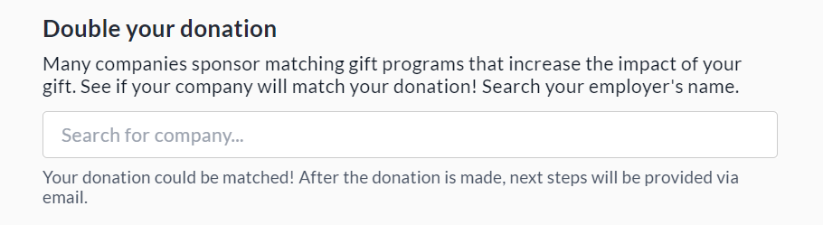
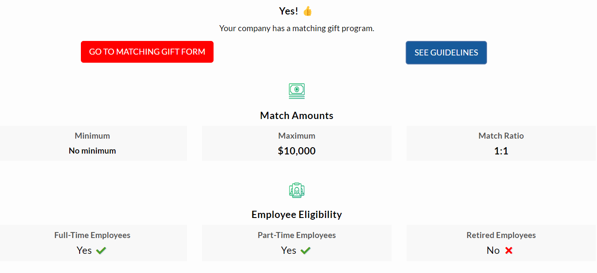
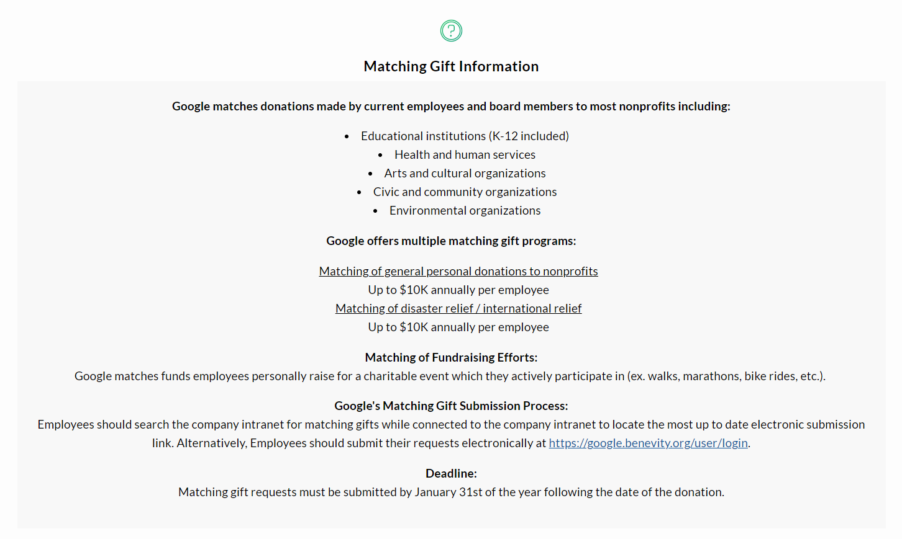
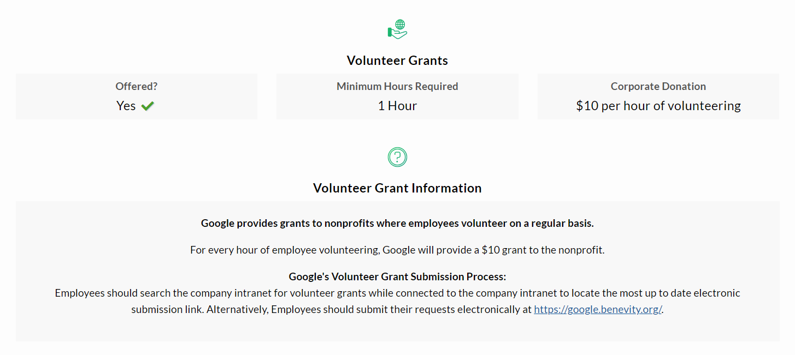
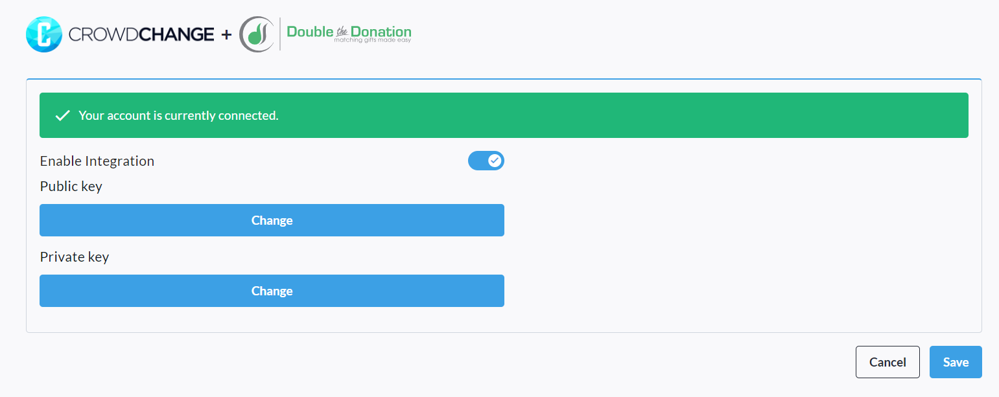
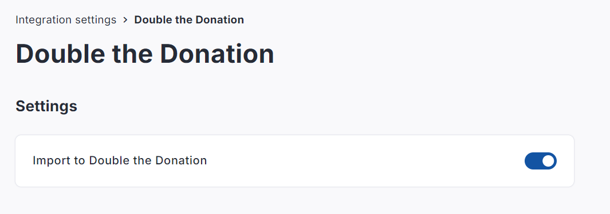

<!-- Source: https://chadmin.crowdchange.help/ct/double-the-donation-integration | Nav: Double the Donation Integration | Mirrored 2026-10-14 -->

# Double the Donation Integration

CrowdChange now integrates with the '**Double the Donation**' donation matching platform.

Double the Donation helps nonprofits increase revenue by providing technology and resources to take advantage of matching gift programs in the corporate space. Many nonprofits miss out on revenue simply because donors are unaware of their employers' matching gift programs.

This integration allows donors to your CrowdChange fundraisers to select their company before checkout, learn whether or not they have a matching gift program, and find out how to apply for it.

Here is the prompt donors will see at checkout **before**completing their donation:  

And here is an example of company donation matching information they could see **after**checkout:  
  
  
  

## How to Set Up 'Double the Donation' on your CrowdChange Site

**Please Note:** This integration is **NOT**available by default and must first be enabled on your site by your CrowdChange Partner Success Representative. You will also be required to set up a Double the Donation account in order can use this integration. Please reach out to your Partner Success Representative today to be connected.

Once the integration has been enabled on your CrowdChange site, follow the steps below:

1. From anywhere on your CrowdChange site, click**Profile \> Admin**in the top right corner.

2. On the left sidebar that appears, click**Integrations \> Double the Donation Integration**

3. Toggle on '**Enable Integration** ' and enter your **Public** \& **Private**API keys, which you will receive from your Double the Donation representative.

4. Click **Save** to confirm. Once everything is correct, you should see the below:

   

### Enabling 'Double the Donation' at the fundraiser level

'Double the Donation' integration must next be enabled at the individual fundraiser level.

This can only be done by Admin users on your CrowdChange site.

1. Go to your specific fundraiser on CrowdChange while logged in.

2. Click '**Manage Fundraiser** ', then **Integration Settings** on the left sidebar.

3. Click **Double the Donation** , then enable **Import to Double the Donation**.

   
4. Once completed, your checkout page will have the 'Double the Donation' prompt and functionality.

This setting can also be toggled on within Blueprints in the same way.
