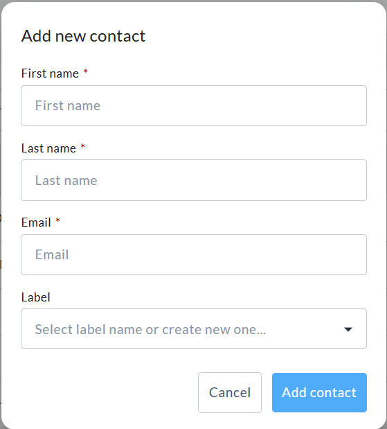
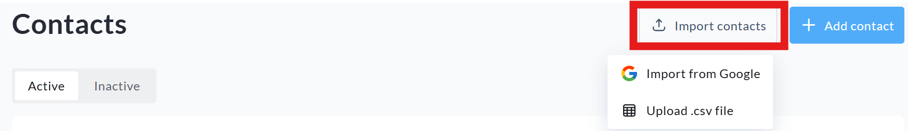

<!-- Source: https://chadmin.crowdchange.help/ct/email-center-how-to-send-emails-from-crowdchange | Nav: Email Center - How to send emails from CrowdChange | Mirrored 2026-10-14 -->

# Email Center - How to send emails from CrowdChange

The **Email center** allows you to communicate directly with your supporters by managing contacts, creating reusable templates, and sending emails from within your CrowdChange site.

The Email Center is available at the site-wide, fundraiser, team, and personal page levels, making it easy to reach the right audience based on your role.

*** ** * ** ***

## Accessing the Email Center

You can access the Email Center from multiple areas of your dashboard:

* **Fundraiser level** : Click **Manage fundraiser** , then select **Email center** from the left-hand menu.

* **Team or Personal page level** : Click **Manage page/team** , then select **Email center**.

*** ** * ** ***

## Overview

Once inside the Email Center, you will see three main options:

* **Manage contacts**

* **Templates**

* **Send emails**

Each section is designed to help you organize your audience and streamline your communication.

*** ** * ** ***

## Manage Contacts

The **Manage contacts** section allows you to build and organize your email recipient list.

### Adding Contacts

You can add contacts in several ways:

* **Manually**: Add contacts one at a time by entering:

  * First name

  * Last name

  * Email address

  * Preferred notification language (for bilingual sites)

  * Label (if you want to categorize contacts by group)

* **Import from Google**: Connect your Gmail account to import contacts directly.

* **Upload a CSV file**: Upload a contact list using the provided CSV template. Include each contact's first name, last name, email address, and preferred notification language (enter EN for English or FR for French on bilingual sites).

### Contact Labels

Contacts may include pre-existing labels to help you organize and filter recipients. These can include:

* Donors

* Previous donors

* Team captains

You can use these labels when selecting recipients for your emails. Custom labels can be added when adding contacts manually.

*** ** * ** ***

## Templates

The **Templates** section allows you to create and reuse email templates for consistent communication.

### Template Availability

Templates can be created at different levels, which determines who can access them:

* **Site-wide templates**: Available across all fundraisers, teams, and personal pages.

* **Fundraiser-level templates**: Available to the fundraiser owner, as well as all teams and personal pages within that fundraiser.

* **Team-level templates**: Available to the team captain and all personal pages within the team.

* **Personal page templates**: Available only to the page owner.

Templates help save time and ensure consistent messaging across your campaign.

*** ** * ** ***

## Send Emails

The **Send emails** section allows you to compose and send messages to your contacts.

### Step 1: Set Sender Information

Before composing your email, you will need to confirm your sender details:

* If your account email is already verified, it will be selected by default.

* If not, you will be prompted to verify your email address.

* You can also add and verify a different sender email if needed.

### Step 2: Create Your Email

You can either:

* Start from scratch, or

* Select an existing template (if available)

You will then be able to:

* Enter a subject line

* Write your message content

If a template is selected, this will also be editable.

If you have created a new email, you can optionally save it as a **Template** for future use.

### Dynamic Tags

Dynamic tags allow you to personalize your emails. For example:

* `{first-name}`

* `{last-name}`

* `{full-name}`

To view all available tags, click **See all available tags** below the message editor.

### Step 3: Select Recipients

After creating your message, click **Next** to choose your recipients.

You can:

* Filter contacts by label (for example, Donors or Team Captains)

* Select individual contacts

* Use the checkbox at the top of the list to select all visible contacts, with the option to select all contacts in your list

### Step 4: Preview and Send

You will be taken to a preview screen where you can:

* Review your message

* Confirm your recipient list

Once ready:

* You can **Schedule**when your email is sent, or leave this toggle off if you want to send instantly

* Complete the reCAPTCHA verification

* Click **Send** to deliver your email

*** ** * ** ***

## Bilingual Behavior

If your CrowdChange site is set to bilingual, the Email Center includes language-specific functionality to ensure recipients receive communications in their preferred language.

* When adding contacts manually or uploading a CSV file, you will be prompted to select a preferred notification language for each contact.

* The **Send preview email** function will always send both the English and French versions of your message to you.

* Recipients will only receive the version of the email that matches their selected language preference.

* Contacts such as Donors, Previous Donors, and Team Captains will have their language set automatically based on the language used when they created their account or made their first donation.

* If a user would like to update their language preference, they can do so through the **Notifications** section of their profile.
