<!-- Source: https://chadmin.crowdchange.help/ct/event-blueprints | Nav: Event Blueprints | Mirrored 2026-10-14 -->

# Event Blueprints

The **Event Blueprints** feature allows you to create templates and use them in several ways:

* Manage locations across your signature event from one centralized space, and push changes to your locations post-launch.

* Generate many fundraisers instantly from a single blueprint (template).

* Make blueprints available or required for use by fundraiser creators on your site.

* Control what level of access fundraiser creators have to alter the created fundraisers.

It is a very powerful tool for fundraising at scale and is excellent for:

1. **Signature Event Management** - Event Blueprints makes it simple to set up large scale, multi-location fundraising campaigns. For example, a nation-wide event with satellite locations in all provinces or cities. You can generate all your location pages instantly using our CSV upload option, and add more manually at any time entering just the basic information required by your blueprint.

2. **Community Fundraising** - If you manage community fundraising, Event Blueprints can be a great tool to streamline the fundraising process for your community fundraisers. You can create templates for your community fundraisers to use, and make it required or optional to use them. You can also set the level of flexibility your community fundraisers will have with regards to fundraiser configuration and customization.

*Please note tha* t this feature is **NOT**enabled by default - Reach out to your Partner Success Representative if you would like to use it.

**When setting up an Event Blueprint:**

1. You control which fields fundraiser creators will be allowed to edit, and which fields will be locked.

2. You have the ability to instantly generate multiple fundraisers - as many as you need, based on the Blueprint, and assign fundraiser owners in the same process. This is very useful for large scale, or national events, where a single CrowdChange fundraiser page would be used for one location of an event. For example: One for each city in Canada.

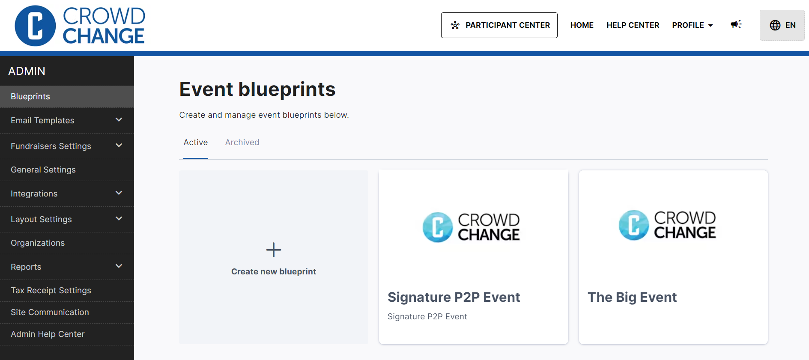

## Setting up an Event Blueprint in Admin Settings

Once **Event Blueprints**have been enabled on your CrowdChange site, you can go ahead and set up your first one! Follow these simple steps to get started:

1. From anywhere on your CrowdChange site, click **Profile → Admin**in the top right corner.

2. Click **Blueprints**on the left sidebar.

3. Click **Create New Blueprint**.

4. Fill out the event information in the same way you would for a single fundraiser, however, **note the additional permissions sections** which allow you to give fundraiser creators/owners the ability to edit a given field. *Set to 'Anybody' if fundraiser owners/creators should be able to adjust this setting.*

   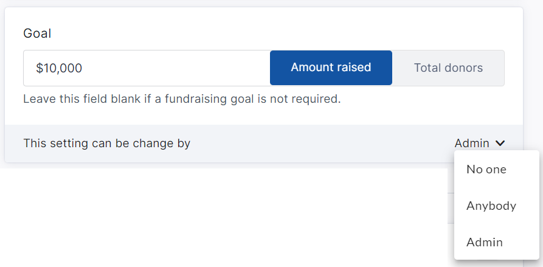
5. Toggle on your desired**Purchase Options** (Tickets, Apparel/Merch, Registration, Sponsorships, Custom Questions etc), and click **Next**.

   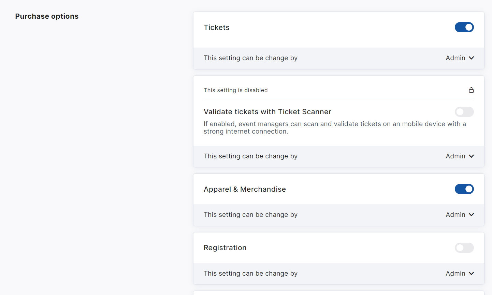
6. Set up **Personal** and **Team** fundraising pages if desired, configure their settings, and click **Next**.

   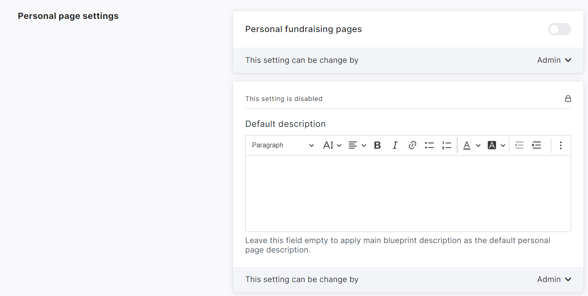  
   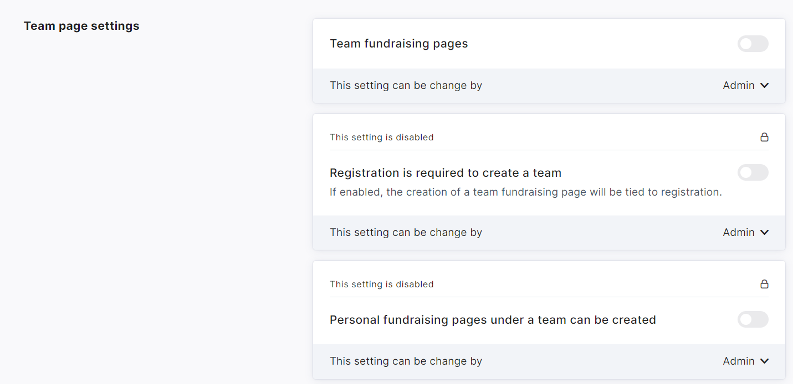
7. On the last page, you can configure**Donation Settings** and other advanced features, as desired.

   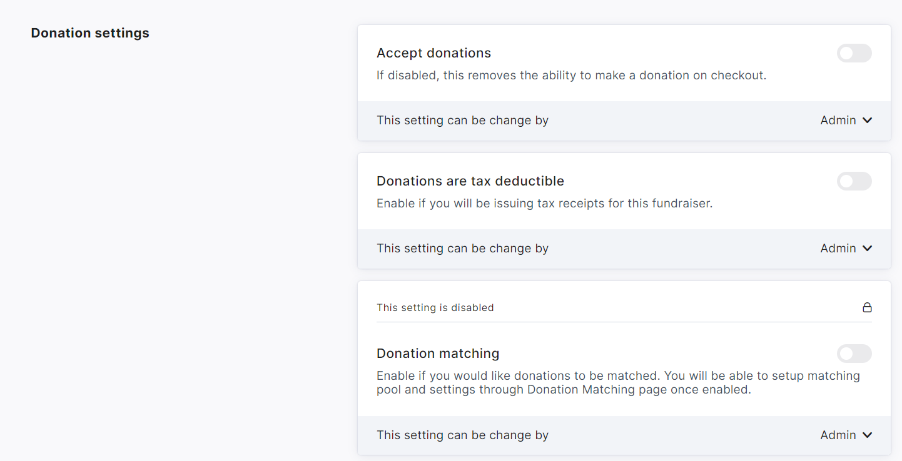
8. At the bottom of the page, click **Save** to finalize and create the blueprint.

You can return to the **Profile → Admin → Blueprints** menu at any time and click on a blueprint to **Edit** it,**Archive** it, adjust its **Purchase Options** , **Donation Amounts** , **Email Templates** , **P2P settings** , and set up the **fundraiser blocks** for it's connected child events.

You can also make the blueprint **private** (Only accessible by Admins) or **public** (Accessible to any fundraiser creator) using **Set to public** or **Set to private** within the **triple-dot icon**menu (top-right).

See an example blueprint below with all of these options available:  
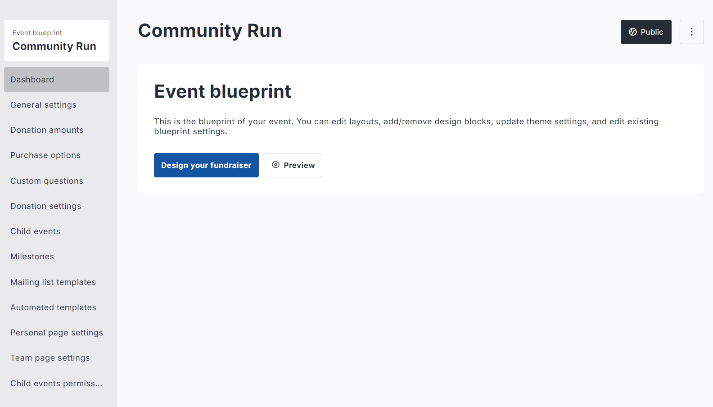  
If you want to make it **mandatory** for fundraiser creators on your site to use an Event Blueprint, you can go to **Profile → Admin** (**General Settings** page), and toggle on **Users can start fundraisers only from templates** . *Note that at least one blueprint must be set to* ***Public*** *for this option to show.*

## Setting up Fundraiser Blocks within a Blueprint

When setting up a Blueprint you can also choose how the fundraiser blocks will appear on the individual fundraisers, and what permissions fundraiser owners will have to make changes to them.

To do so, follow the steps below:

1. From anywhere on your CrowdChange site, click **Profile → Admin** in the top right corner.

2. Click **Blueprints** on the left sidebar.

3. Click the Blueprint you would like to set this for.

4. Click **Design your fundraiser**.

   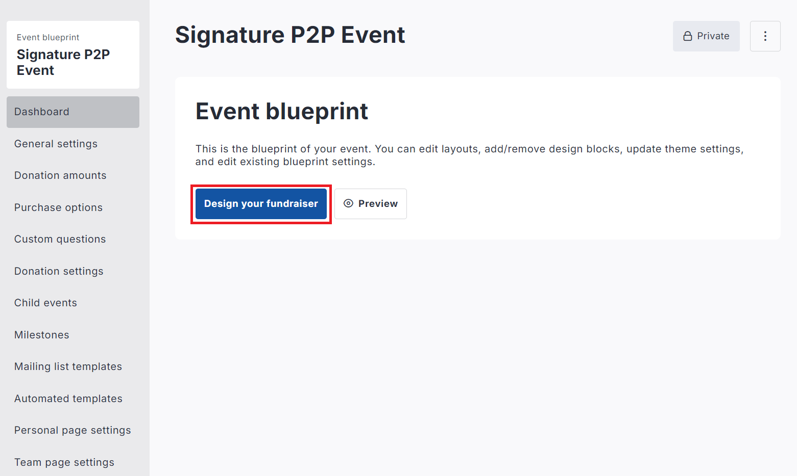
5. You will be taken to a preview in Manage Fundraiser Mode, where you can add, edit, or remove the blocks, adjust the Hero image, theme settings, and set access permissions for fundraiser owners.

   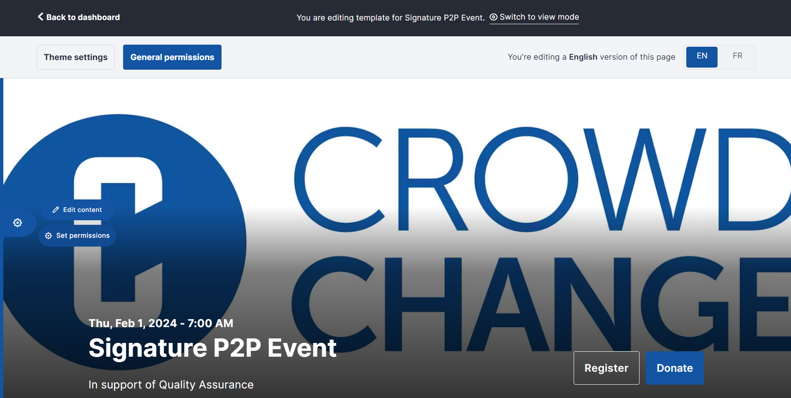  
   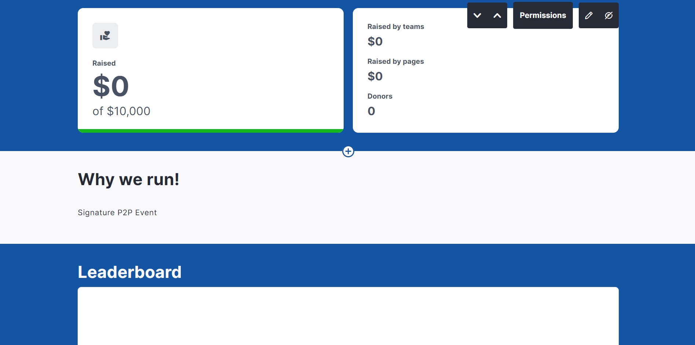
6. Click **General Permissions**in the top left of the page to adjust the overall block and theme permissions.

   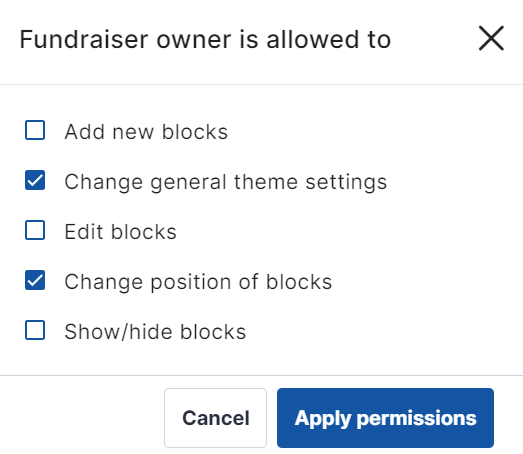
7. Within each block, and the Hero image, you will see a **Permissions**option which lets you decide if the fundraiser owner should be able to make changes to these components.

   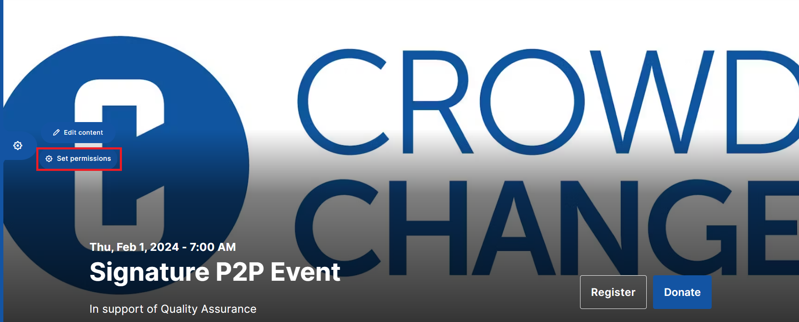  
   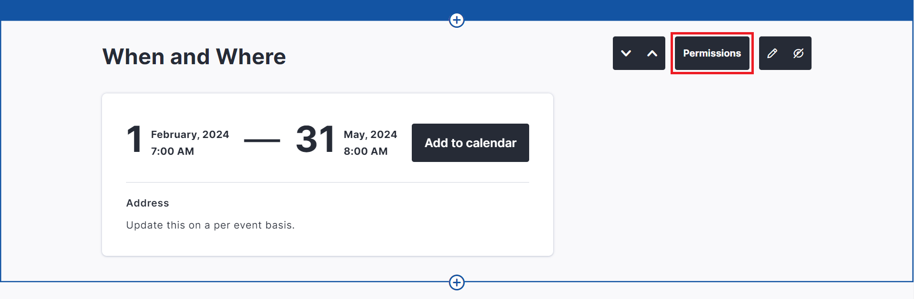
8. When finished, scroll to the top and click**Back to Dashboard** , or if you'd like, you can click **Switch to view mode**first to see a preview of how the fundraisers will look live.

   :back:

## Generating Fundraisers from a Blueprint

You have the ability to generate fundraisers instantly from the Blueprint you have just created.

This is done quickly and efficiently via a **CSV upload** with all of the basic information for each fundraiser.

Once you've set up your Blueprint, to generate multiple fundraisers at once, follow these steps:

1. From anywhere on your CrowdChange site, click **Profile → Admin**in the top right corner.

2. Click **Blueprints**on the left sidebar.

3. Click on a blueprint, then click **Fundraisers management** on the left sidebar.

4. Click the **Manage**button in the top right corner.

   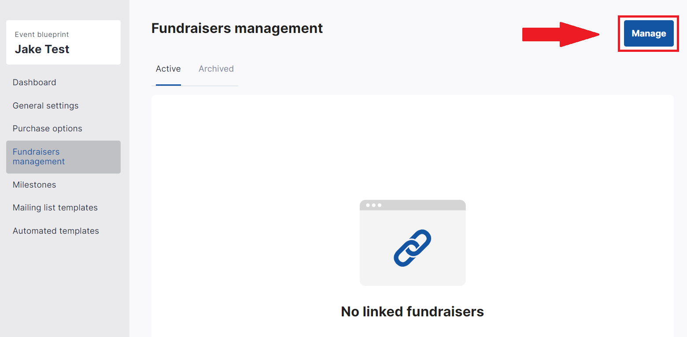
5. Download the .CSV template file which already contains the required headers for your .CSV upload.

   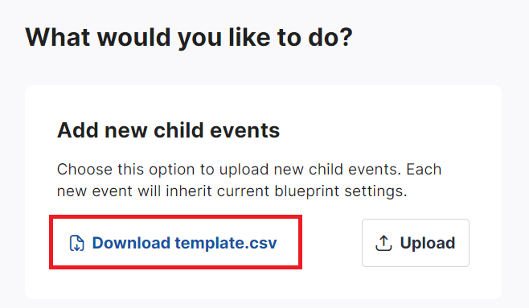
6. Upload your .CSV file with the required headers and information.

   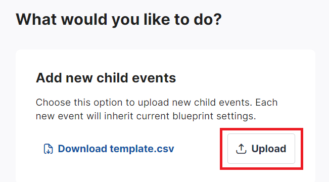
7. Click **Proceed with uploaded file** when ready.

   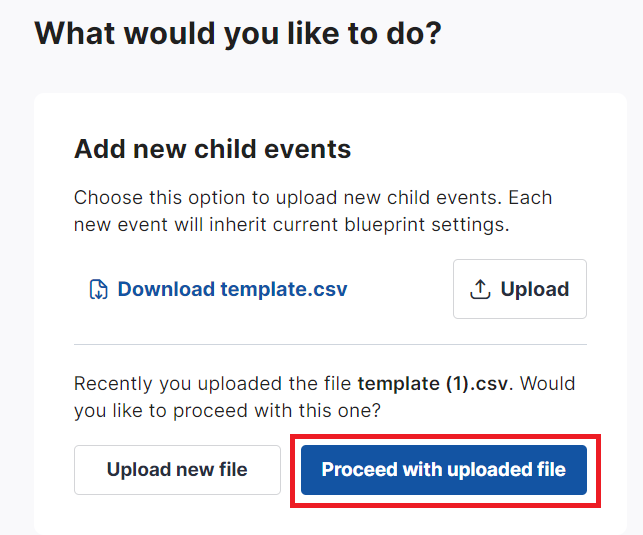
8. Confirm the creation of the fundraisers in your CSV by clicking **Add new events**.

   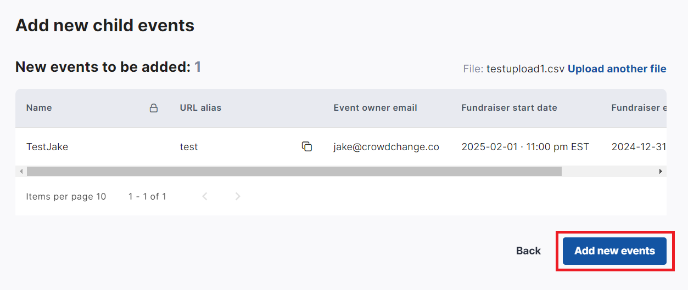

## Fundraiser Creators using Blueprints

For fundraiser creators on your site, the process of using Blueprints is easy!

Here are instructions you can give them:

1. From the home page, click **Start a Fundraiser**.

2. Select an existing **Blueprint**.

3. Fill out all required, editable information and click **Create Fundraiser**.

## Editing an Individual Fundraiser created from a Blueprint

A fundraiser created from a Blueprint can be edited just like any other fundraiser, however, fields or blocks which were locked for editing when the Blueprint was created will be locked, unless the Blueprint is changed.

To edit the individual fundraiser's settings:

1. Go to the fundraiser and click **Manage Fundraiser → General settings.**

2. Make any updates needed, scroll down and click **Save**.

3. Click **Additional Settings** on the left sidebar.

4. Make any updates needed, scroll down and click **Save Changes**.

The fundraiser blocks can be edited in the same way, according to the access provided at the blueprint level.

## Editing a Blueprint and pushing changes to all its fundraisers

You have the ability to edit a Blueprint at any time, and by enabling the **Force update on all fundraisers** toggle next to each option / field within the edit menu, your changes will be pushed to all connected fundraisers immediately after clicking **Save Changes**.

To make and push changes, follow these steps:

1. From anywhere on your CrowdChange site, click **Profile → Admin**.

2. Click **Blueprints**on the left sidebar.

3. Click the blueprint you would like to edit.

4. Click **General Settings** , make all desired changes, and for changes you want to push out to connected fundraisers, ensure to enable the **Force update on all fundraisers**toggle underneath that field.

   1. *For features that were not previously enabled, you must also set the access permissions so that the fundraiser owner may toggle the new feature on ("This setting can be changed by 'Anybody'").*

      
5. Scroll down and click **Next** on each page, then **Save**on the last, and your changes will be pushed out.

All settings and features of your Blueprint (Purchase options, Donation Settings, Email Templates, Team \& Personal Page Custom Questions, etc) can be adjusted at your convenience within the Blueprint dashboard.
