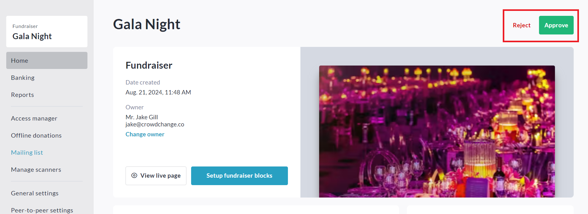

<!-- Source: https://chadmin.crowdchange.help/ct/fundraiser-approval-admins | Nav: Fundraiser Approval (Admins) | Mirrored 2026-10-14 -->

# Fundraiser Approval (Admins)

CrowdChange is strictly an online fundraising platform, and therefore we cannot approve or reject fundraisers. It is the responsibility of the relevant Charity or Organization to do so.

If you are an Admin on the site of your Charity or Organization, please follow the steps below:

1. Go to the home page of your CrowdChange site. (Browse Fundraisers page).

2. Below the 'Start A Fundraiser' button, click **Show All** on the right-hand side, then **Pending Approval**.

3. Click on the fundraiser which is pending approval.

4. Click**Manage Fundraiser**in the top right corner.

5. *Optional: You are able to view and update fundraiser settings before approval if necessary\*.*

6. When everything looks good, click the green **Approve** button in the top right corner.

   *If necessary, you can reject the fundraiser using the 'Reject' button adjacent. This will essentially delete it.*

   

**Please note:** Once a fundraiser has been approved, it can then accept donations.

If a fundraiser has been mistakenly approved, please click here for steps to close a fundraiser: [**How to Reopen or Close a Fundraiser**](https://chadmin.crowdchange.help/ct/How-to-Reopen-or-Close-a-Fundraiser.1993867341.html)  
**\*** In some cases, fundraisers can only be edited from the site where they were created.

For example, if you have a child site (sub-site), and that child site has "Fundraiser Custom Questions" enabled and setup, when you create a fundraiser on the child site and try to edit it from the parent site (pre or post approval), you will get a prompt re-directing you to the child site to make your edits.
