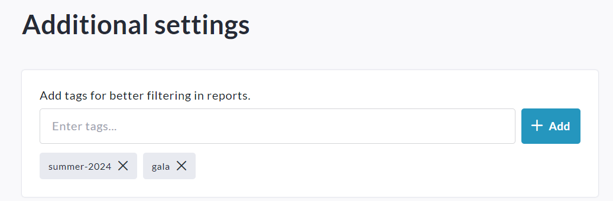
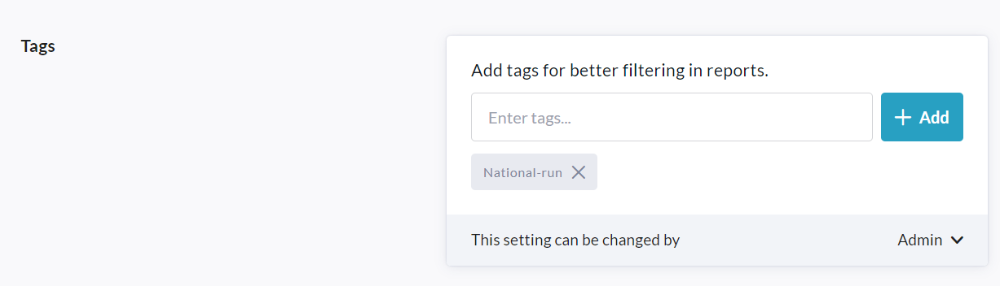
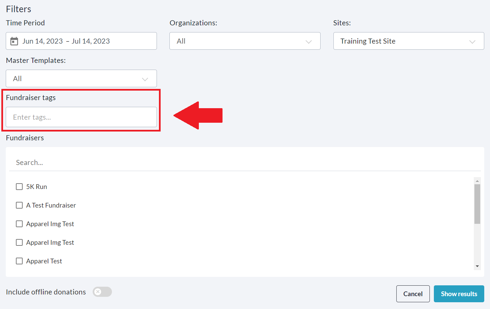

<!-- Source: https://chadmin.crowdchange.help/ct/fundraiser-blueprint-custom-tags | Nav: Fundraiser & Blueprint Custom Tags | Mirrored 2026-10-14 -->

# Fundraiser & Blueprint Custom Tags

For Admins managing CrowdChange sites with many Fundraisers and/or Blueprints in use, we offer the ability to add **Custom Tags**, for easier identification and filtering in Admin Reports.

For example, using this functionality you may tag all fundraisers created in the Summer of 2022 as "**summer-2022** ", then, in the Admin Reports, filter fundraisers based on this tag. Or you could create a tag with the event name and year, example format: `[event-name][year]`*.*

You may apply multiple tags to one fundraiser or Blueprint, as desired.

If a Blueprint is given a tag, then all connected fundraisers will inherit that tag.  
**Please Note:** This feature is **NOT**enabled by default - Reach out to your Partner Success Representative to request it be activated on your CrowdChange site.

## How to Add a Custom Tag to a Fundraiser

To add a custom tag to an individual fundraiser, follow the steps below:

1. Navigate to the fundraiser in question and click **Manage Fundraiser**.

2. On the left sidebar, click **Additional Settings**.

3. Enter your desired tag(s). Press **Enter**to add each tag.

   
4. Scroll down to the bottom and click **Save**.

## How to Add a Custom Tag to a Blueprint

To add a custom tag to a Master Template, follow the steps below:

1. From anywhere on your CrowdChange site, click **Profile** then**Admin**.

2. Navigate to**Blueprints**using the left sidebar.

3. Find the Blueprint in question and click on it.

4. Click the **General Settings** tab.

5. Scroll down and click **Next**. Do this again on the next page.

6. On the last page, scroll down to **Tags**.

7. Enter your desired tag(s). Click **Add**to input each tag.

   
8. Set your desired permissions via the '**This setting can be changed by**' dropdown.

9. Scroll down to the bottom of the page and click **Save**.

## Filtering by Custom Tags

Once custom tags have been added to your fundraisers and/or Blueprints, you will be able to filter by these tags within Admin Reports. For the majority of Admin Reports, in the web version you will see a new field within **Filters** called **Fundraiser tags.**Here you can enter the specific tags you'd like to filter for:  

Click **Show Results** in the bottom right corner, and then only data connected to fundraisers or Blueprints with your specified tags will be shown.  
Note that the **Payout Report** will not show this filter in the web version, however when you download the Excel report, you will be able to filter by custom tags (in the final column of the '**Detailed**' tab).
