<!-- Source: https://chadmin.crowdchange.help/ct/how-email-templates-work | Nav: How Email Templates Work | Mirrored 2026-10-14 -->

# How Email Templates Work

## Overview

There are 3 types of Email Templates which can be set up and used:

1. Automated (preset) email templates - These include donor receipts, and certain automated actions like "Fundraiser reached the goal".

2. Custom templates for Mailing List emails.

3. Custom templates for Milestone Notifications.

These emails can be setup in 2 ways:

1. From your Admin Dashboard - **Profile → Admin → Communication Settings** - These templates will be applied to all fundraisers on your CrowdChange site.

2. From a specific fundraiser - **Manage Fundraiser → Automated email templates** / **Milestones** - These templates will be applied only to the fundraiser in question. Mailing List templates are at **Manage Fundraiser → Mailing List → Templates**.

### Email Template Hierarchy

When an email is sent, the template is determined in the following way:

* If the Fundraiser-specific email template has been updated, it will be applied to the associated action.

* **Otherwise**,

  * If a site-wide (Admin) email template has been updated - this will be used.

* **Otherwise**,

* The default CrowdChange template will be used.

For example, when a donor makes a donation to "**Fundraiser A** " on a site called "**My CrowdChange Site**":

1. We check if "**Fundraiser A** " has its own Donor Receipt email template. If yes, we send the email receipt using the "**Fundraiser A**" template.

2. If "**Fundraiser A** " does not have it's own template, we check if "**My CrowdChange Site** " site has a template set up through **Profile →** **Admin → Communication Settings**. If yes, we send the email using this template.

3. If neither "**Fundraiser A** ", nor "**My CrowdChange Site**" site have customized templates → we send the receipt with the default CrowdChange template.

## Automated Emails

Automated emails are the most basic email templates and are used by preset automated actions.

For example:

* When a user makes a donation → the 'Donor Receipt' template is sent out.

* When a fundraiser raises 100% of it's goal → the 'Fundraiser Goal Reached' template is sent out.

### Conditional Blocks in Automated Emails

Some automated emails support conditional blocks. This allows you to have specific text inserted in the email if for example, tickets are purchased, or a registration is completed.

Conditional blocks can be found within the dynamic tags list accessed via the link highlighted below:  
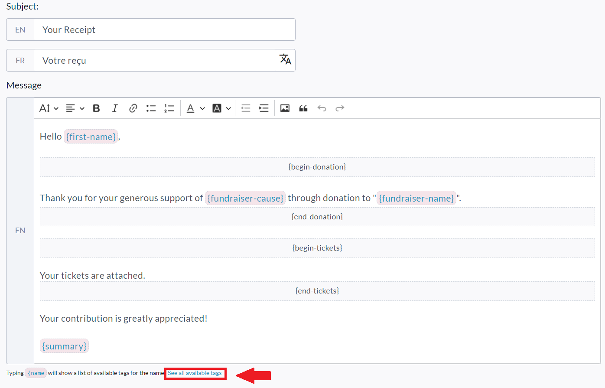
To view the list of tags, click 'See all available tags' or type `{name`  
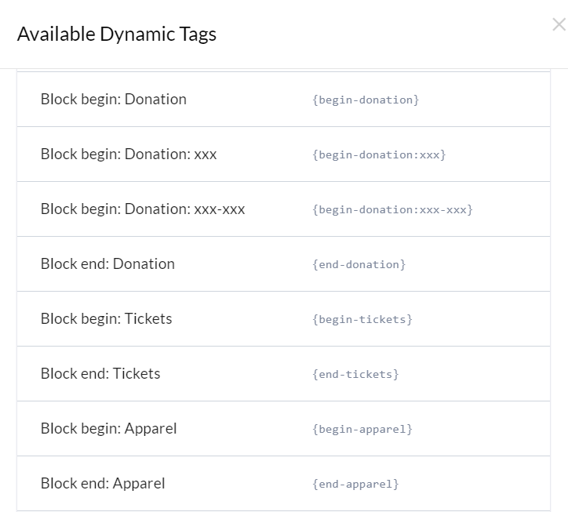

These blocks start with `{begin-...}` and end with `{end-...}` tags. The content between these tags will be added conditionally to the email text.

**For example:**

If 'Donor Receipt' email template includes `{begin-tickets}Your tickets are attached to this email{end-tickets}` in the content, this text will only be included in the email if the donor purchases at least one ticket.

#### Amount-Specific Conditional Blocks

If you would like to send specific text, or a bigger 'Thank You' depending on the **amount** that was donated, you can do so using the example syntax shown below:  
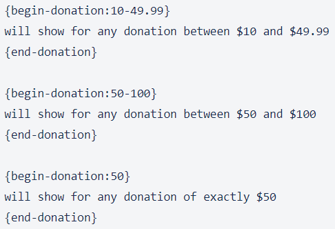

#### Supported Templates

At the moment of writing, the following templates support conditional blocks:  

|         Template          |                      Block                      |                    Rendered on Condition                     |
|---------------------------|-------------------------------------------------|--------------------------------------------------------------|
| **Fundraiser Created**    | `{begin-pending}` ... `{end-pending}`           | If fundraiser is pending approval.                           |
| **Donor Receipt**         | `{begin-donation}` ... `{end-donation}`         | If donation amount was over $0.                              |
| *(Amount Specific Ex 1):* | `{begin-donation:10-49.99}`... `{end-donation}` | If donation made was between $10 and $49.99                  |
| *(Amount Specific Ex 2):* | `{begin-donation:50-100}` ...`{end-donation}`   | If donation made was between $50 and $100                    |
| *(Amount Specific Ex 3):* | `{begin-donation:50}` ... `{end-donation}`      | If donation made was exactly $50                             |
|                           | `{begin-tickets}` ... `{end-tickets}`           | If at least one ticket was purchased.                        |
|                           | `{begin-registration}` ... `{end-registration}` | If at least one registration was purchased.                  |
|                           | `{begin-apparel}` ... `{end-apparel}`           | If at least one apparel (or merchandize) item was purchased. |
|                           | `{begin-sponsorship}` ... `{end-sponsorship}`   | If at least one sponsorship package was purchased.           |

## Mailing List Emails

Mailing List email templates are used when sending out email communication to Imported Contacts, Donors and Team Fundraising Captains from the Mailing List of a specific Fundraiser.

After creating a Mailing List template at the Admin level, it will be available whenever a fundraiser owner goes to **Manage Fundraiser → Mailing List** and creates an email campaign.

Additionally, these templates can be used by Personal Page Owners when they go to their Personal Page level **Manage Fundraiser → Mailing List**and create an email / campaign.

### How to use Mailing List Templates

1. Create a new Mailing List template by going to **Profile → Admin → Communication Settings → Mailing List Templates** , scrolling down to the bottom (if there are already entries) and clicking the '**Create Template** ' button.

   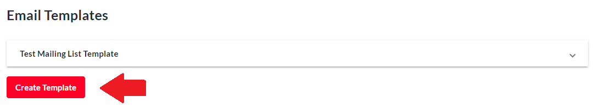

   Once clicked, you will see the below fields appear. Ensure to click the '**Save** ' button when finished.

   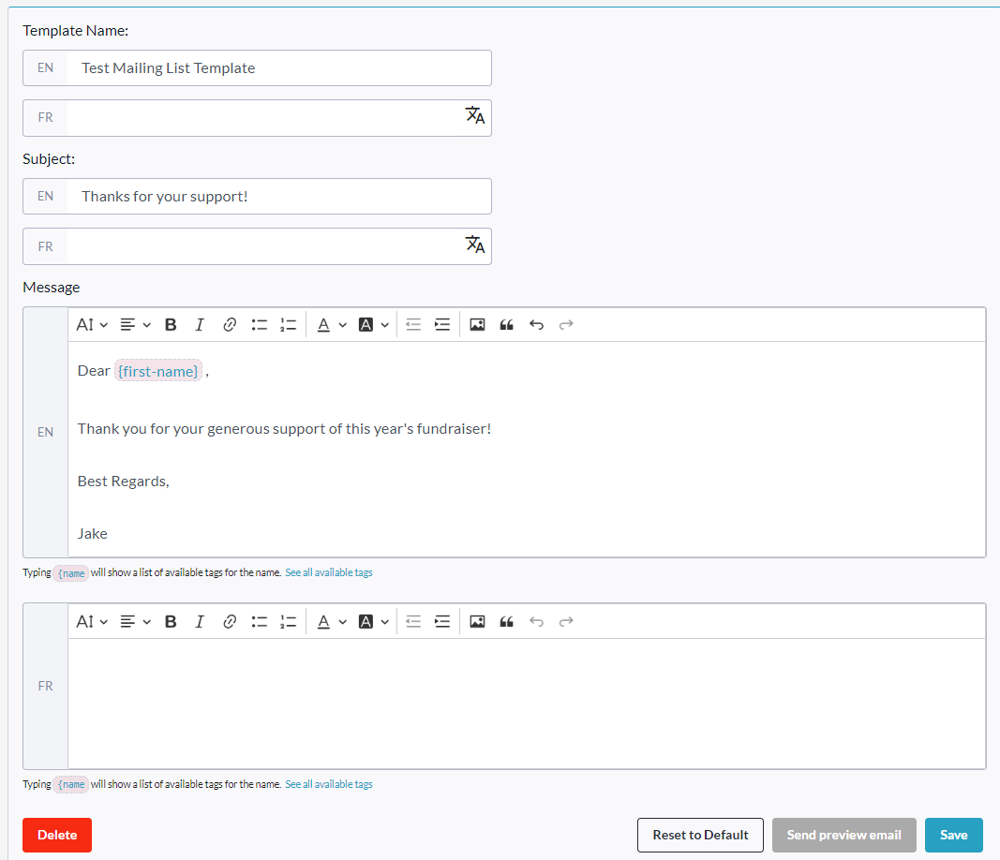
2. Once you save the template, it will be available for fundraiser owners to use (via **Manage Fundraiser → Mailing List** ). From a fundraiser's mailing list, they can simply click '**New Campaign** ', and select the template they want to use via the '**Select email Template** ' dropdown. See screenshots below.

   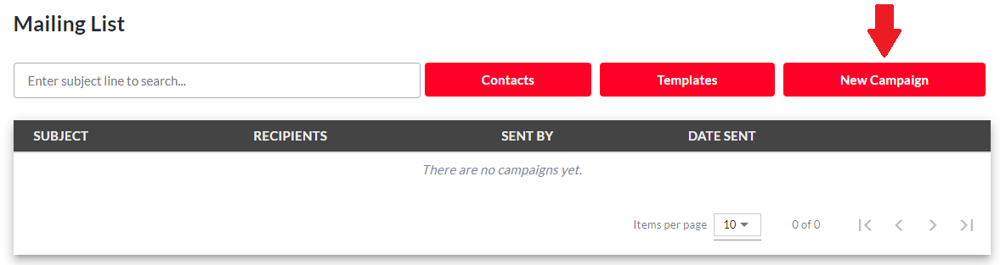  
   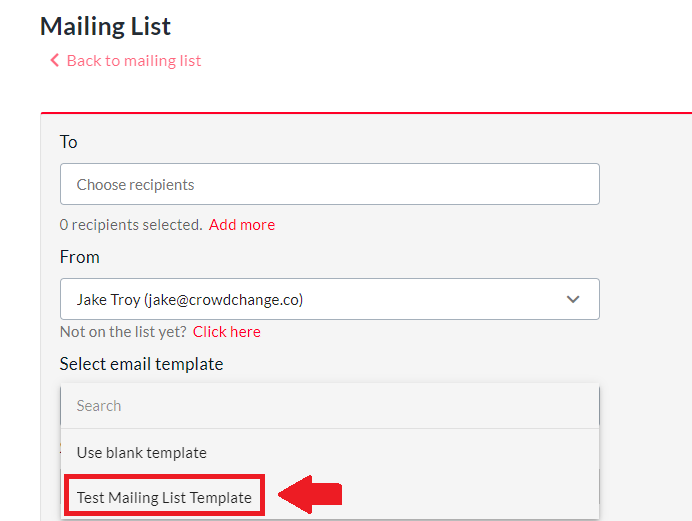

   **Please Note:** Fundraiser owners can also save and delete their own templates. To do so, they can check the "**Save this message as a template** " checkbox when sending out an email campaign, and the next time they will be able to select it from the "**Select Email Template** " menu.

   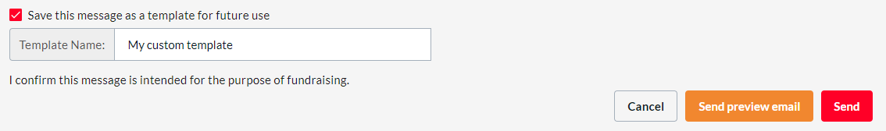

## Milestone Notification Emails \& Badges

Milestone Notification Emails are sent when a Fundraiser, Team or Personal Page reaches certain goals.

For example, when a Fundraiser reaches 50% of it's goal or raises it's first $1,000.  
These emails are sent to the Fundraiser Owner and Personal / Team Page Owners, **NOT** to donors.

To customize and provide pre-built templates for these emails, follow the steps below:

1. Go to **Profile → Admin → Communication Settings → Milestones**.

2. Click **Create milestone**.

3. Name the milestone and **select a trigger** from the '**When**' dropdown (Eg: Page Created, End of an event, Certain amount raised, Certain number of donations reached, etc).

   * If '**Upcoming event** ' is selected, the event **start** date/time is used as the trigger point to send the email. If '**After event** ' is selected and the fundraiser has both a start and end date/time, the **end** date/time is used as the trigger. If an end date/time is not set, **start**date/time is used as the trigger.

4. Select the Group which this milestone applies to (Eg: the Fundraiser owner, a page owner, registrant etc)

5. Enter a specific value which should trigger the milestone.

See the example milestone below which will be sent to page owners when they reach $1000 raised.  
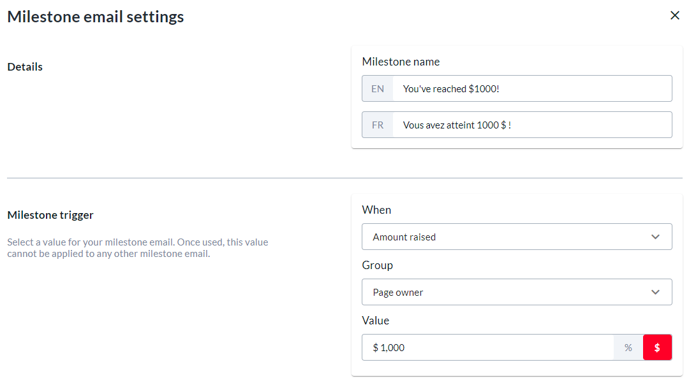

You will also have the option of adding a **Badge**to the milestone email. See example screenshot below. This is an awesome way to reward fundraisers for their hard work and support of your cause! You can select from our pre-built badges, or upload your own custom badge image using the pencil icon.  
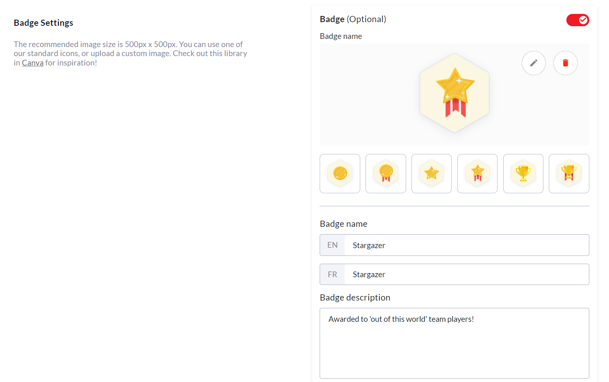

Finally, ensure to fill out the **Message Body** section which sets what text will appear in the milestone notification email. See example below.  
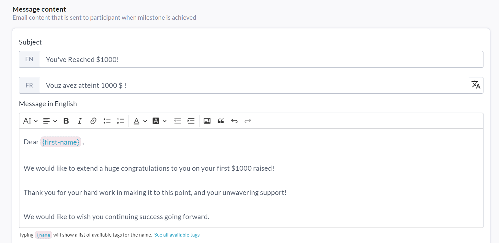

When you are finished creating your milestone email template, click the **Save**button.  
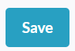  
Now, when a Fundraiser Owner goes to **Manage Fundraiser → Milestones** , they will be able to click **Create Milestone**and create their own milestones. The templates set at the Admin level are only changeable by Admin users.
