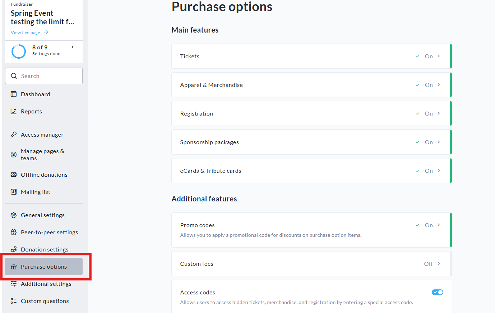
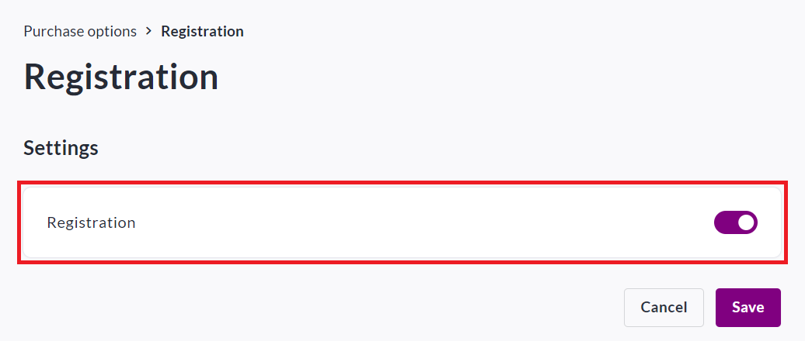
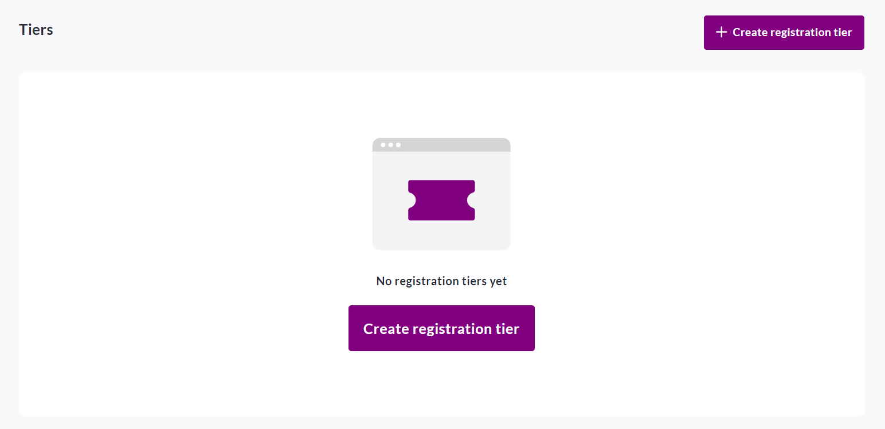
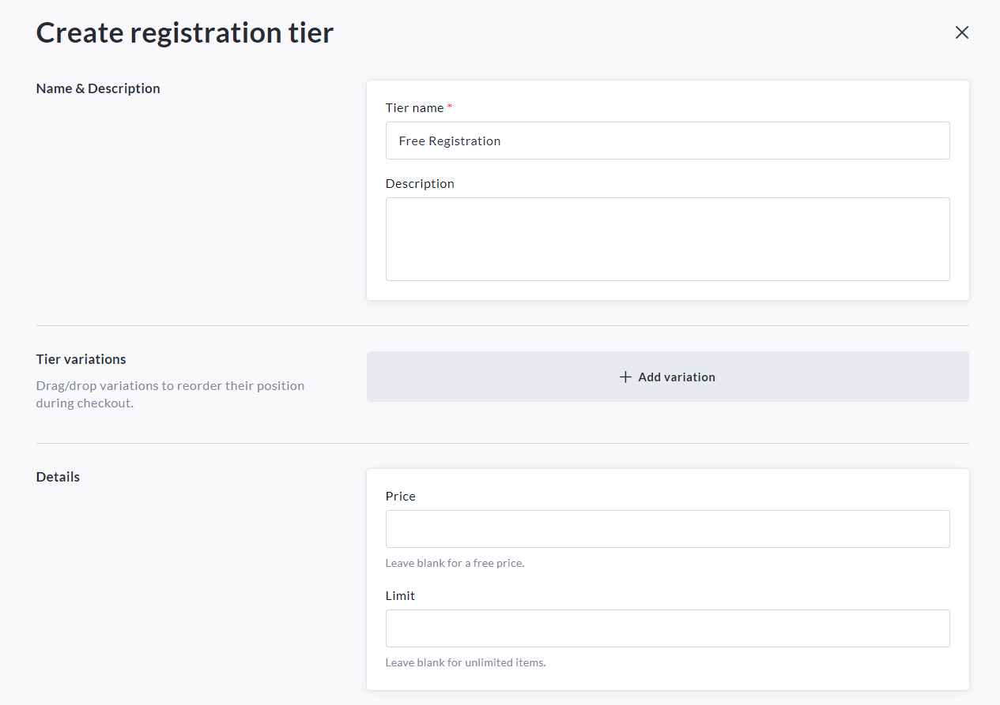
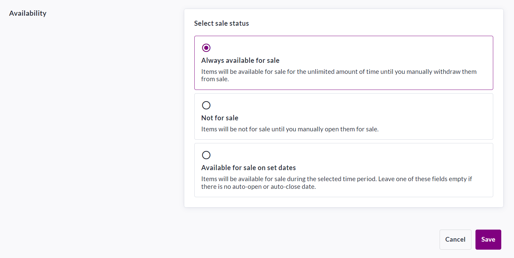

<!-- Source: https://chadmin.crowdchange.help/ct/how-registration-works | Nav: How Registration Works | Mirrored 2026-10-14 -->

# How Registration Works

For events where you need to offer **registration**options, whether paid or free, we've made it easy!

You can create as many registration tiers as desired, and participants can pay and register directly online.

All participant information can be downloaded, with one click, right to Excel.  
For peer-to-peer campaigns where registration is **required** to fundraise, click [**here**](how-to-link-registrations-to-personal-team-pages.md) to learn how you can set this up on your CrowdChange site.

To set up simple registration within your fundraiser, follow these steps:

1. Go to your fundraiser, **Log In** , and then click **Manage Fundraiser**.

   
2. On the left sidebar, click **Purchase Options** .

   
3. On the **Purchase Options** page, click **Registration**and toggle the feature on.

   
4. Click **Save**.

5. To begin setting up registration, scroll down and click **Create Registration Tier**.

   
6. Set a **name** , **description** , add **variations** if needed, set a **price** (if desired) and a **limit** (if desired).

   \**All variations will carry the same price and be part of the same limit.\**

   
7. Set your desired **availability** for the new registration tier.

   *\*If desired, you may set a date to automatically close sales.\**

   
8. Click **Save** in the bottom right cornerwhen finished.

As the owner of a fundraiser, you will have access to all registrant details in your **Donations Report**. To access it, refer to the below:

[How to Access the Donations Report (Fundraiser Level)](how-to-access-the-donations-report-fundraiser-leve.md).

Donors will receive a **confirmation email** once their purchase is complete.

Please refer to [How Email Templates Work](how-email-templates-work.md) when confirming the Automated Trigger Emails within your fundraiser.
