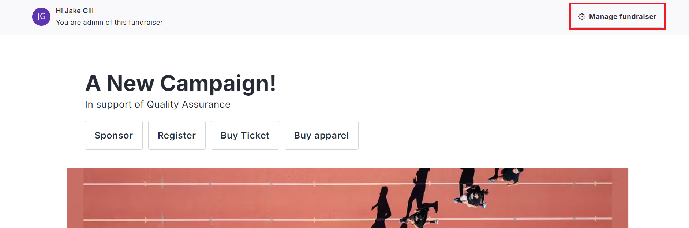
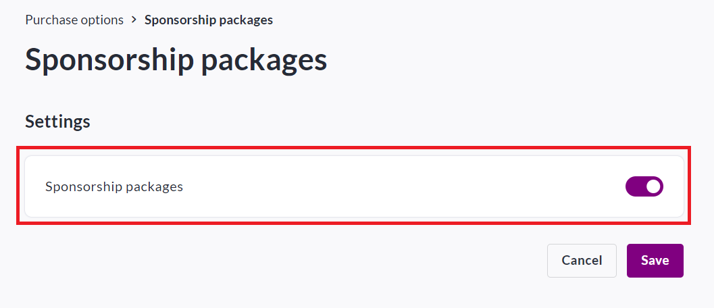
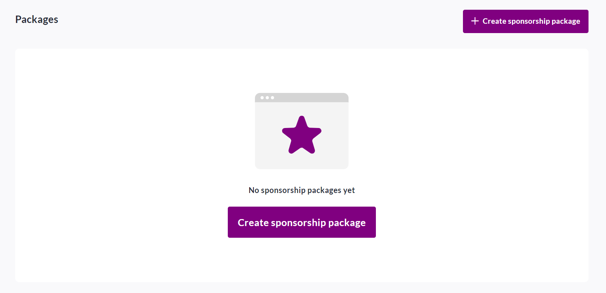
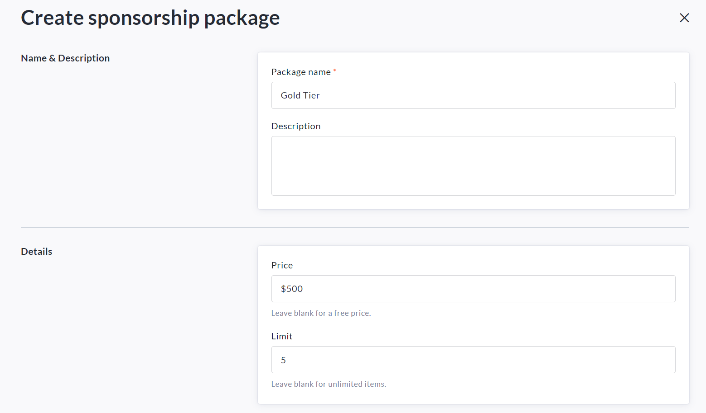
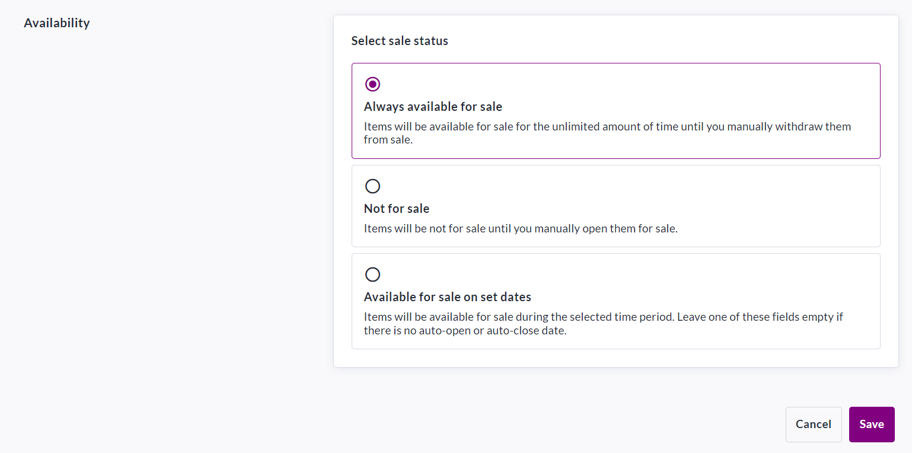

<!-- Source: https://chadmin.crowdchange.help/ct/how-sponsorship-works-sponsorship-packages | Nav: How Sponsorship Works (Sponsorship Packages) | Mirrored 2026-10-14 -->

# How Sponsorship Works (Sponsorship Packages)

Offering **Sponsorship Packages** is a great way to attract large donations to your fundraiser!

You can create as many Sponsorship Packages/Tiers as desired, and participants can pay directly online.

Upon completing checkout, the sponsor will receive email confirmation of their purchase.

See a demo fundraiser with Sponsorship enabled here: [**Demo Fundraiser**](https://charitiesknowledgebase.crowdchange.dev/13986)

Follow these simple steps to set up sponsorship on your fundraiser:

1. Go to your fundraiser, **Log In** , and then click **Manage Fundraiser**.

   
2. On the left sidebar, click **Purchase Options**.

   
3. On the **Purchase Options** page, click **Sponsorship Packages**and toggle the feature on.

   
4. Click **Save**.

5. To begin setting up your sponsorship packages, scroll down and click **Create sponsorship package.**

   
6. Set a **name** , **description** , **price** (if desired) and a **limit**(if desired).

   
7. Scroll down and select your desired **availability** for the new sponsorship package.

   *\*If desired, you may set a date to automatically close sales.\**

   
8. Click **Save**in the bottom right to confirm.

As the owner of a fundraiser you will have access to all sponsor details in your **Donations Report** . See the following article \& video on how to access it: [How to Access the Donations Report (Fundraiser Level)](how-to-access-the-donations-report-fundraiser-leve.md)  
Sponsors will receive a **receipt / confirmation email** once their purchase is complete.

Please refer to this article - [How Email Templates Work](how-email-templates-work.md) when confirming the Automated Trigger Emails within your fundraiser.
