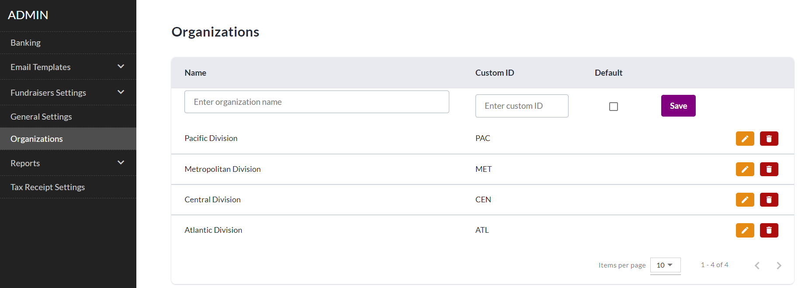
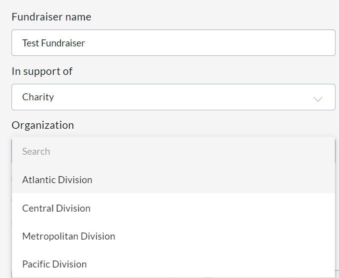
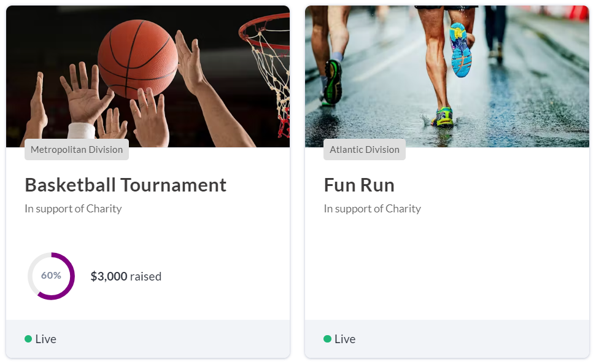

<!-- Source: https://chadmin.crowdchange.help/ct/how-the-organizations-feature-works | Nav: How the Organizations Feature Works | Mirrored 2026-10-14 -->

# How the Organizations Feature Works

If your charity segments its fundraising regionally or has multiple groups operating under one umbrella, the **Organizations** feature is a great way to ensure that your back-end reporting reflects this, while still allowing all donations to flow to the same holistic source.

**Organizations**is a feature that must be enabled site-wide and can be enabled by a CrowdChange support admin at any time. This feature allows users to select their organization when creating a fundraiser.

Once enabled, **Organizations** can be added from the admin menu (**Profile → Admin → Organizations**).  

There is no limit to the number of Organizations you can add. The **Custom ID**field is used to create a shorthand identifier for reporting purposes.

With this feature enabled, when creating a fundraiser, a user will be prompted to select their organization. Using the Admin menu, site-wide administrators are able to set a default Organization if there is a specific one that is used more than the others.  

Once a fundraiser is live on your CrowdChange site, when using the Organizations feature, the fundraiser card will indicate at the bottom which Organization is running the fundraiser.  

Organization shown on Fundraiser Cards on site home page  
**Admin Reports** can be filtered by Organization to allow for easier sorting and data analysis.  
The **Site-Level Access Manager** can be used in conjunction with the **Organizations** feature, allowing a Site-Wide administrator to set administrative permissions for new or existing CrowdChange users across specific Organizations within your CrowdChange site. See our article on the [**Site-Level Access Manager**](how-to-use-the-site-level-access-manager.md)
