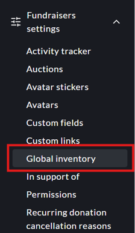
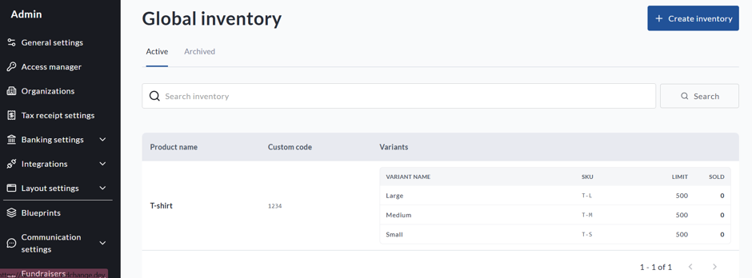
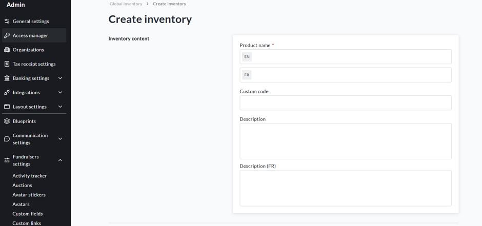
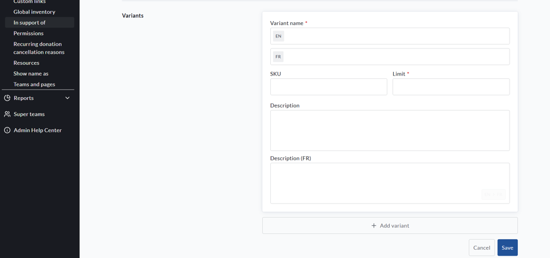

<!-- Source: https://chadmin.crowdchange.help/ct/how-to-access-and-set-up-the-global-inventory-admin-level | Nav: How to Access and Set Up the Global Inventory (Admin Level) | Mirrored 2026-10-14 -->

# How to Access and Set Up the Global Inventory (Admin Level)

The **Global Inventory Report** allows you to monitor shared inventory across multiple fundraisers from one central location.

For example, if the same t-shirt is sold through several fundraisers, global inventory allows those fundraisers to draw from the same available stock.

This article explains how to access the **Global Inventory Report** and how to create a global inventory item.

**How to Access the Global Inventory Report**

1. Go to your CrowdChange site and **Log In**.

2. Click your **Profile** in the top-right corner, then **Admin**.

3. From the left sidebar, go to **Fundraisers settings \> Global inventory** .

   
4. The Global Inventory Report can include the following information:

* **Item**

* **Variant**

* **SKU or custom code**

* **Limit**

* **Sold**

5. Use the available search and filtering options to find specific inventory items.

6. To export the report, click **Download**. The report can be exported as a CSV file.

**Fundraiser Items vs. Global Inventory**

The **Inventory Report** allows you to review two types of inventory:

**Fundraiser items**

Use this view for inventory that belongs to an individual fundraiser.

**Global inventory**

Use this view for shared inventory that is used across multiple fundraisers.

If the same physical stock is shared across multiple fundraisers, use the **Global inventory** view.

**How to Set Up Global Inventory**

Before setting up global inventory:

* Global inventory must be enabled for your entire site.

* You must have the **Global inventory** permission to create and manage shared inventory items.

To add a Global Inventory Role, go to:

1. **Admin \> Access Manager \> Manage roles \> Add role**

Enter the Name and a Short Description

2. In the drop-down menu for**General permissions,** select**Global inventory**

<!-- -->

3. Click**Save**

You can then assign this role to current or new users.

**Create a Global Inventory Item**

1. Go to your CrowdChange site and **Log In**.

2. Click your **Profile** in the top-right corner, then **Admin**.

3. From the left sidebar, go to **Fundraisers settings \> Global inventory**.

<!-- -->

4. Create a new global inventory item.

5. Enter the Inventory content and Variants for the item:

· **Product name**

· **Internal custom code**

· **Product Description**  

6. Add one or more variants to the inventory item. For each variant, enter:

· **Variant name**

· **Variant description**

· **SKU**

· **Limit**  

7. Save the global inventory item.

**Important:** The **variant** is the unit used to track inventory. Even if your item does not have multiple options, it should have at least one variant so CrowdChange knows which inventory count to update.

For example:

**Item:** T-shirt

**Variants:**

* Small

* Medium

* Large

Or:

**Item:** Meal Ticket

**Variants:**

* Vegetarian

* Regular

Once the global inventory item has been created, it can be linked to purchase options on your fundraisers or Blueprints.

**How Inventory Quantities Are Updated**

The **Sold** quantity does not need to be updated manually.

When a linked purchase is completed, CrowdChange automatically updates the sold and remaining quantities for the associated global inventory variant.

If a linked purchase is refunded or rolled back, the sold and remaining quantities are also updated automatically.

**Archived or Deleted Inventory**

Archived or deleted global inventory is no longer available when linking new purchase options.

However, inventory with previous sales may continue to appear in the **Inventory Report**. This preserves historical sold quantities and inventory information for reporting and reference.
