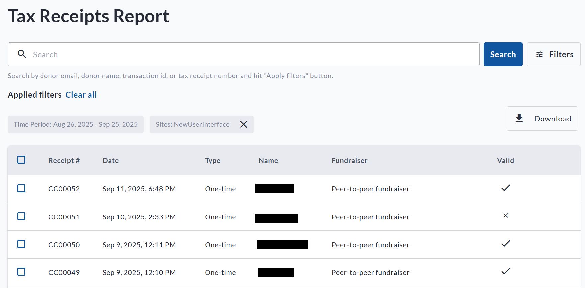
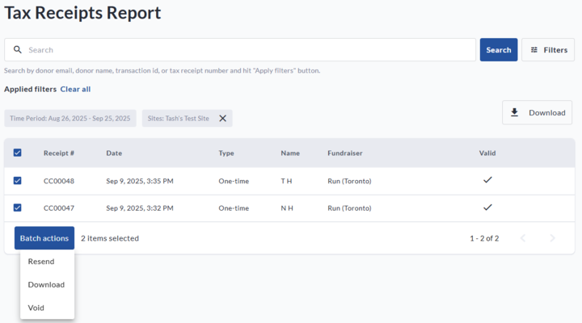

<!-- Source: https://chadmin.crowdchange.help/ct/how-to-access-and-use-the-tax-receipts-report | Nav: How to Access and Use the Tax Receipts Report | Mirrored 2026-10-14 -->

# How to Access and Use the Tax Receipts Report

The **Tax Receipts Report** allows Admin users to view, manage, and take action on all issued tax receipts across your CrowdChange site. This report is designed to help you quickly find receipts, re-send them to donors, void them, or issue replacements.

*** ** * ** ***

## Accessing the Tax Receipts Report

To access this report:

1. Log in to your CrowdChange site.

2. Click **Profile** in the top right corner, then select **Admin**.

3. In the left-hand menu, click **Reports** , then **Tax Receipts Report**.

A view of the Tax Receipts Report within the Admin Dashboard

*** ** * ** ***

### What You Can Do in the Tax Receipts Report

Once inside the report, you'll be able to:

* **Search** for specific receipts using filters such as date range, fundraiser, donor name, or email.

* **Download**:

  * A detailed **CSV file** of all issued tax receipts within your selected date range.

  * A **ZIP archive** containing all PDF copies of the receipts in your filtered view.

* **Re-send Receipts** to the original recipient or to a new email address.

* **Void** a tax receipt (for example, if a donation was refunded or incorrect).

* **Re-issue** a corrected version of a receipt if any donor details need updating.

> For more details on re-issuing tax receipts, see our article: How to Re-Issue a Tax Receipt .

*** ** * ** ***

#### Batch Actions

You can also take action on multiple receipts at once using the checkboxes in the report:

* **Resend multiple receipts** to their original recipients.

* **Download selected receipts** as a bulk ZIP archive.

* **Void multiple receipts** at once if needed.

This makes it easy to handle year-end summaries, campaign follow-ups, or corrections in bulk.  

Available Batch Actions in the Tax Receipts Report

*** ** * ** ***

#### Important Notes

* This report only displays **receipts that have already been issued**. Transactions that have not yet generated a receipt (due to ineligibility, minimum threshold not met, or being in a pending state) will not appear.

* Voided receipts are marked as such in the system and on the PDF itself.

* Re-issuing a receipt will **automatically void** the original version.
