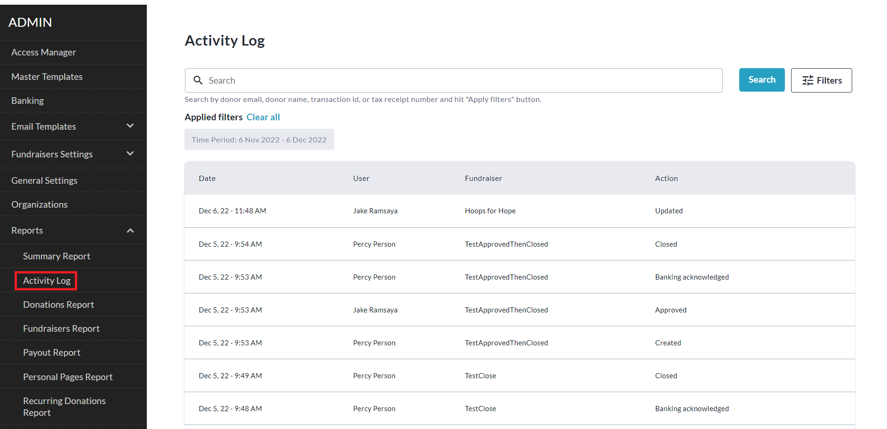

<!-- Source: https://chadmin.crowdchange.help/ct/how-to-access-the-activity-log | Nav: How to Access the Activity Log | Mirrored 2026-10-14 -->

# How to Access the Activity Log

The **Activity Log**gives you a list of all recent administrative actions taken by users on your site.

To access it, follow these simple steps:

1. Go to your CrowdChange site and **Log In**.

2. Click **Profile** in in the top right corner, then**Admin**.

3. Go to **Reports** **\> Activity Log**using the left sidebar.

   

You can filter for specific fundraisers using **Filters \> Fundraisers** **\> Show Results**.
