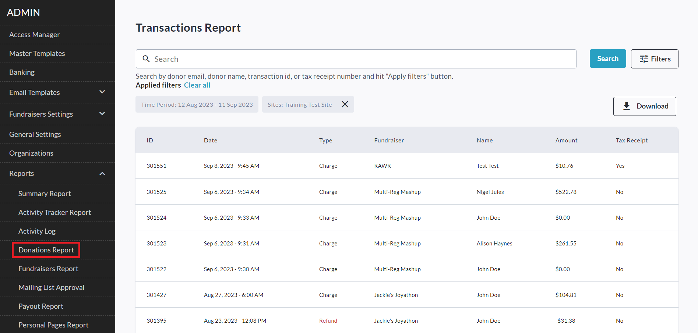
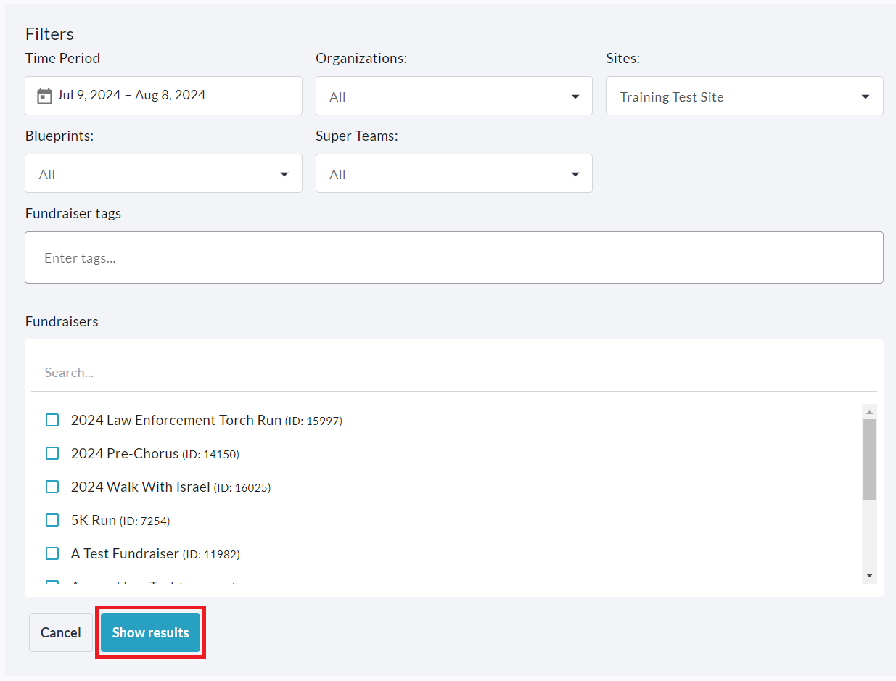

<!-- Source: https://chadmin.crowdchange.help/ct/how-to-access-the-admin-donations-report | Nav: How to Access the Admin Donations Report | Mirrored 2026-10-14 -->

# How to Access the Admin Donations Report

The **Admin** **Donations Report**allows you to:

* View detailed information for all transactions across your CrowdChange site.

* Edit public-facing donation information (Displayed name, comment, and whether amount is shown).

* Edit donor's answers to custom checkout questions (on their request).

* Issue, re-issue, re-send, and download Tax Receipts.

* Refund transactions (fully or partially).

Please note that the report's default date range filter is set to **one month**.

Transactions are sorted by `fundraiser + id` in descending order. If you need to view all transactions by date for all fundraisers - you would need to manually sort them after opening the CSV file in Excel.

Larger datasets (10,000+ records) may take longer to generate. If you have not received exported data from your CrowdChange site after a few hours, please contact customer support.

To access this report, follow these simple steps:

1. Go to your CrowdChange site and **Log In**.

2. Click **Profile** in in the top right corner, then**Admin**.

3. Go to **Reports** **\> Donations Report**using the left sidebar.

   
4. To find a specific transaction, you can use the search bar to search by email, name, or transaction ID.

5. Click **Filters** in the top right corner to filter for a specific Time Period, Organization, Subsite, or Fundraiser. If you are using a site with Blueprints enabled, you will be able to filter by Blueprint as well. Be sure to click **Show results** to apply these filters.

   
6. Clicking on a specific transaction will take you to the **transaction page** where you can see it's full details including purchase options, answers to custom questions, covered fees and more. From here you can:

   1. **Issue, Download, Re-send, or Re-issue Tax Receipts** within the **Tax Receipt** section.

      
   2. [**Edit Display Name, Comment and Show or Hide Amount on a Donation**](how-to-edit-display-name-comment-and-show-or-hide-.md) by clicking **Edit** within the **Additional Information**section.

      
   3. **View** and **Edit** answers to custom questions within the **Custom Questions** section.

      
   4. [**Issue a Full or Partial Refund**](how-to-issue-full-and-partial-refunds.md) by clicking **Refund** in the bottom right.

      
7. Download the Excel CSV versions of this report by clicking **Download** and selecting either:

   1. **Summary Only** - Downloads a ZIP archive containing the Summary CSV file only.

   2. **Summary and transactions** - Downloads a ZIP archive containing the Summary, (all) Transactions and (all) Registrations CSV files.

   3. **Full detailed report** - Downloads a ZIP archive containing the Summary, (all) Transactions, (all) Registrations, and Failed transactions CSV files, as well as individual CSV files for each fundraiser's transactions which are named as follows: `f - {fundraiser ID}`.

      

**IMPORTANT:** If you are looking for the answers to**Custom Checkout Questions** in the Excel CSV reports, download the 'Full Detailed Report' and open your fundraiser's specific CSV file (Eg: f-7246).

The fundraiser ID is the number at the end of your main fundraising page's URL.

Once in the Excel CSV file, you must scroll horizontally all the way to the right. The answers to custom checkout questions will be in the last few columns.  
Re-issuing a tax receipt will **VOID** the initial receipt. This will be displayed within the Admin Tax Receipts report and a **VOID**stamp will be added to the PDF copy of the original receipt.

The donor will receive notification of this and the re-issued receipt will communicate that it is a replacement for the original receipt.
