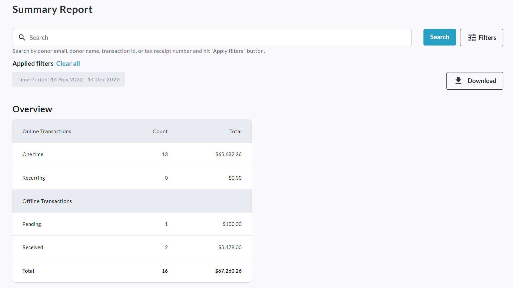
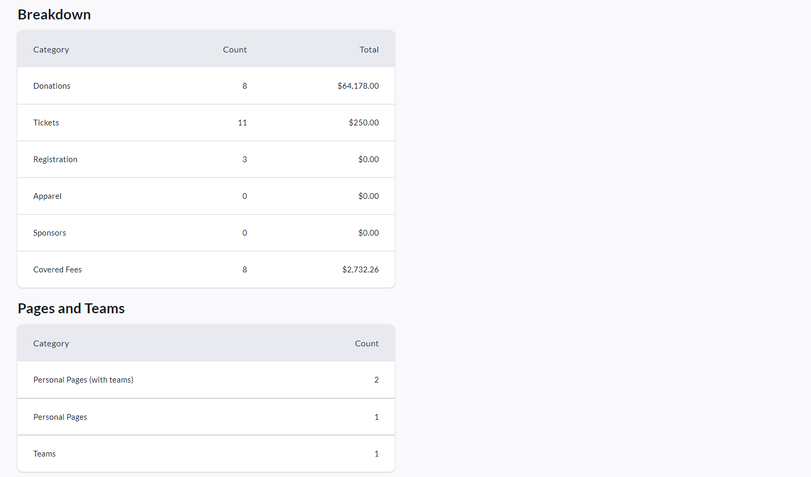

<!-- Source: https://chadmin.crowdchange.help/ct/how-to-access-the-admin-summary-report | Nav: How to Access the Admin Summary Report | Mirrored 2026-10-14 -->

# How to Access the Admin Summary Report

The **Admin** **Summary Report**is a high-level breakdown of all transactions and transaction types across your fundraisers, including a count of Personal \& Team Pages created.

To access it, follow these simple steps:

1. Go to your CrowdChange site and **Log In**.

2. Click **Profile** in the top right corner, then**Admin**.

3. Go to **Reports** **\> Summary Report**using the left sidebar. Once there you will see the following sections:

     
   

You can filter for a specific date range, organization, subsite and/or fundraiser using the **Filters** button. To set the date range, click **Filters** and then the dates under **Time Period**.

Be sure to apply the filters by clicking the **Show results**button at the bottom.

Download the Excel version of this report by clicking **Download**button.
