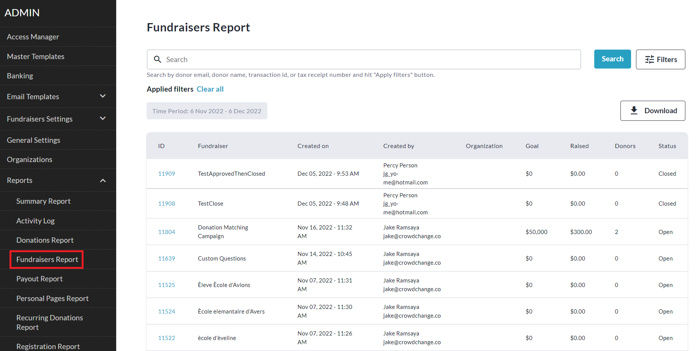
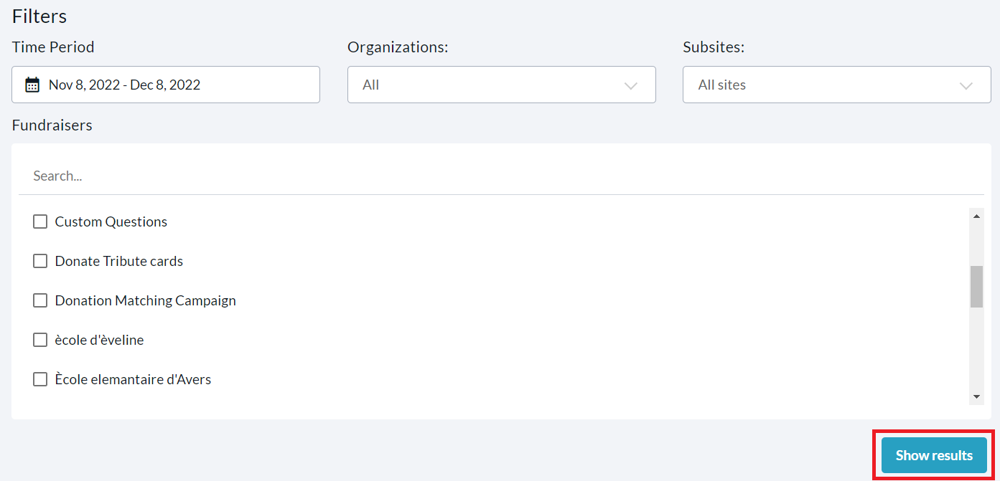
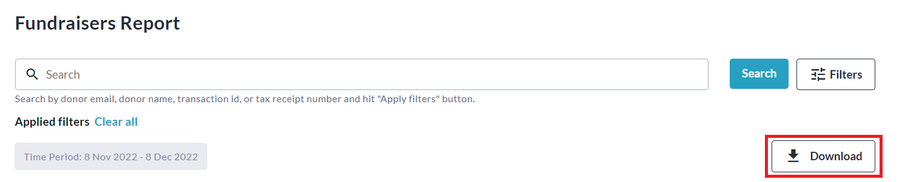

<!-- Source: https://chadmin.crowdchange.help/ct/how-to-access-the-fundraisers-report | Nav: How to Access the Fundraisers Report | Mirrored 2026-10-14 -->

# How to Access the Fundraisers Report

The **Fundraisers Report**provides you with detailed information on all fundraisers that have been created, as well as links to each one, and the option to download an Excel spreadsheet of all fundraisers.  
Please note that the default date range filter is set to **one month**.

You will need to change this to see fundraisers created more than one month ago.

To access this report, follow these simple steps:

1. Go to your CrowdChange site and **Log In**.

2. Click **Profile** in in the top right corner, then**Admin**.

3. Go to **Reports** **\> Fundraisers Report**using the left sidebar.

   
4. To find a specific fundraiser, you can use the search bar and/or click **Filters** in the top right corner to filter for a specific Time Period, Organization, Subsite, or Fundraiser. Be sure to click **Show results** to apply these filters.

   
5. Download the Excel version of this report by clicking **Download**!

   
