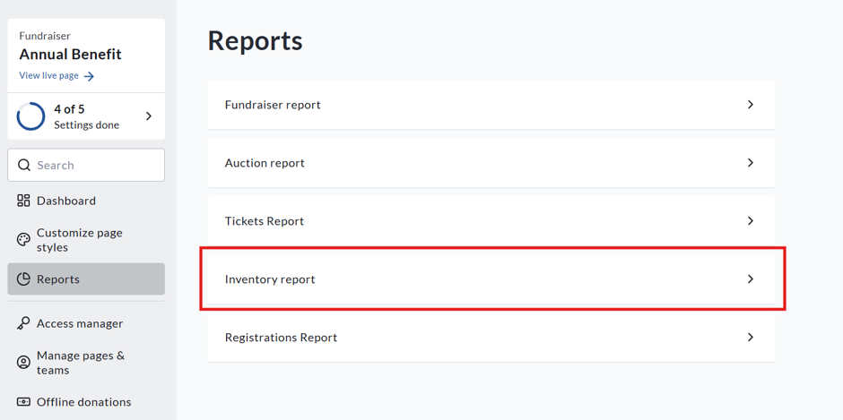
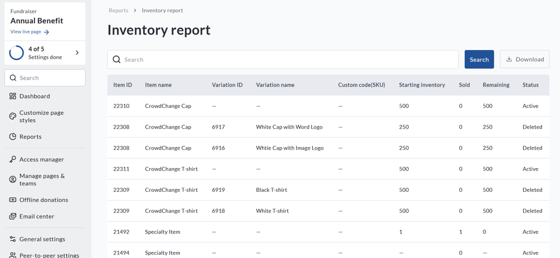
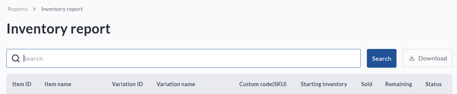

<!-- Source: https://chadmin.crowdchange.help/ct/how-to-access-the-inventory-report-fundraiser-level | Nav: How to Access the Inventory Report (Fundraiser Level) | Mirrored 2026-10-14 -->

# How to Access the Inventory Report (Fundraiser Level)

The **Inventory Report**offers a quick and easy way to find information on inventory information for apparel and merchandise available through your fundraiser.

To access it, follow the simple steps below:

1. Go to your CrowdChange site and**Log In**.

2. Go to your fundraising page and click **Dashboard**.

3. On the left sidebar, click **Reports** , then **Inventory Report**.

How to access the **Inventory report** from the **Fundraiser dashboard**

4. You will be shown an **Overview**:

View of the **Inventory report**

5. To find a specific item, search by **Item Name** . You can also download a detailed version of the report by clicking **Download**.

6. Once the report is ready, you will receive an email. Click **Download Report** in the email to access it.

7. The downloaded report contains two sections:

*
  * **Summary:** Includes item and inventory details, such as quantities sold and remaining, as well as the item's status.

  * **Purchases:** Includes item details, donor details and transaction information such as where the purchase was made (personal or team page).
