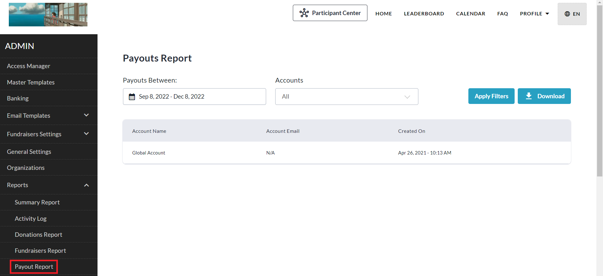
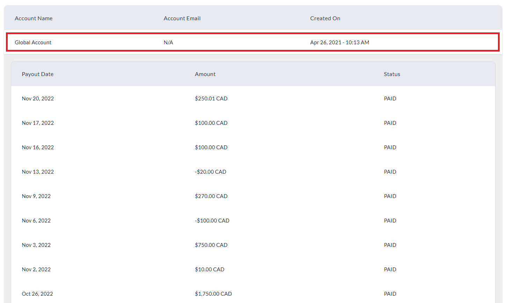
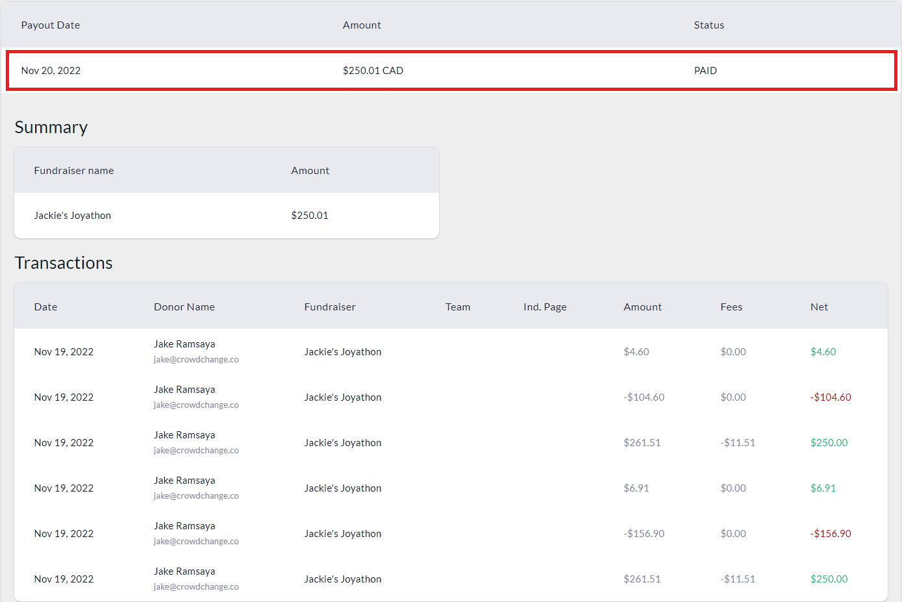

<!-- Source: https://chadmin.crowdchange.help/ct/how-to-access-the-payouts-report | Nav: How to Access the Payouts Report | Mirrored 2026-10-14 -->

# How to Access the Payouts Report

The **Payouts Report**shows you the details of all money paid out to your connected bank account as well as transaction specific amounts. Ensure to select the correct date range and use the Excel version of the report for best results.  
This report is only available for partners using Stripe as their payment gateway.

To access this report, follow these simple steps:

1. Go to your CrowdChange site and **Log In**.

2. Click **Profile** in the top right corner, then**Admin**.

3. Go to **Reports** **\> Payout Report**using the left sidebar.

   
4. Select your desired date range under 'Payouts Between' and click**Apply Filters** (You also can filter for a specific account using the dropdown menu under 'Accounts').

5. Click **Download** to get the Excel version sent to your email (highly recommended).

6. If viewing the web version,**click** the account row you would like to view payout details for.

   
7. Then**click**on a payout row to view its summary and individual transaction details.

   

Please note that within the Excel Payout Report, refunds and chargebacks are currently shown as positive numbers rather than negative, which may result in an apparent discrepancy between the Summary and Detailed tabs of the report.

To clarify, the**Global Account Summary**tab will reflect the actual/true payout amounts.
