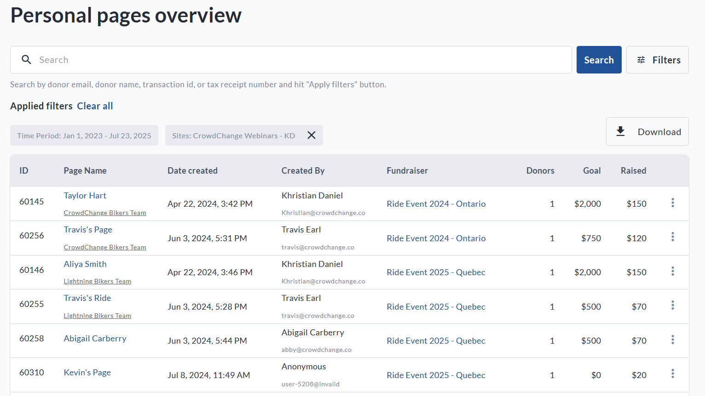
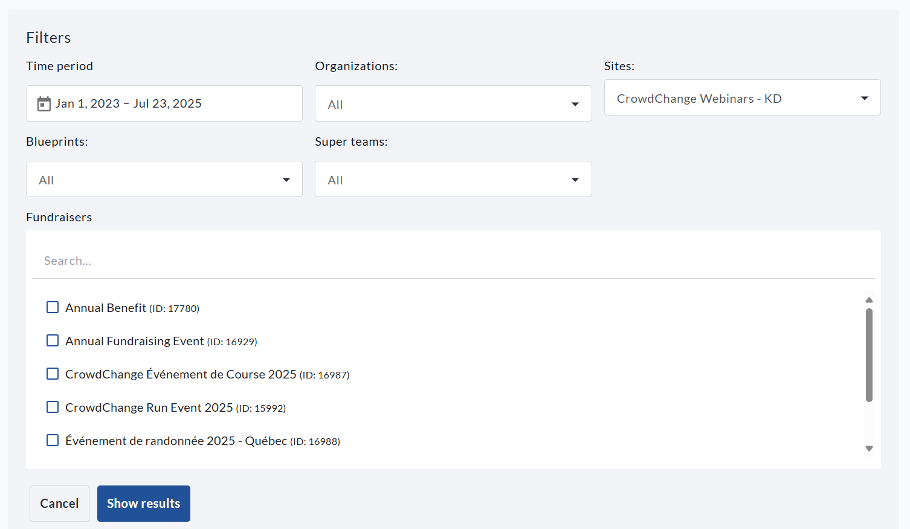
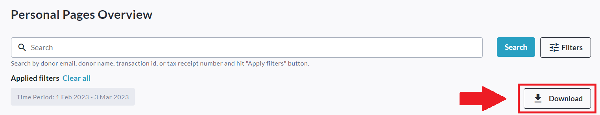
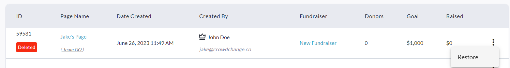
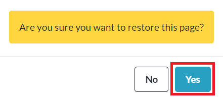

<!-- Source: https://chadmin.crowdchange.help/ct/how-to-access-the-personal-pages-report | Nav: How to Access the Personal Pages Report | Mirrored 2026-10-14 -->

# How to Access the Personal Pages Report

The **Personal Pages Report**shows you information on all personal fundraising pages that have been created, including who the page owner is! (See crown icon next to user's name under Created By)

This report also allows you to see deleted personal pages and restore them if necessary.

To access it, follow these simple steps:

1. Go to your CrowdChange site and **Log In**.

2. Click **Profile** in in the top right corner, then**Admin**.

3. Go to **Reports** **\> Personal Pages Report**using the left sidebar and you will be taken here:

   
4. You may use the search bar and/or click **Filters** in the top right corner to filter the pages listed by a specific Time Period, Organization, Subsite, Blueprints (if enabled), or Fundraiser. Be sure to click **Show results** to apply these filters.

   
5. Download the Excel version of this report by clicking **Download** in the top right!

   

## Restoring a Deleted Personal Page

To restore a personal page which was deleted, simply click the 'triple dot' icon to the right of the page marked as 'Deleted' (see tag in red), and click '**Restore**' as shown in screenshot below.  

Then click '**Yes**' within the prompt that appears:  

The page owner will receive an email notification letting them know that their page has been restored.
