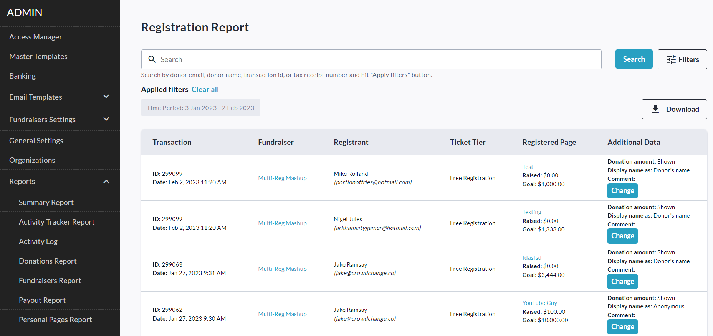
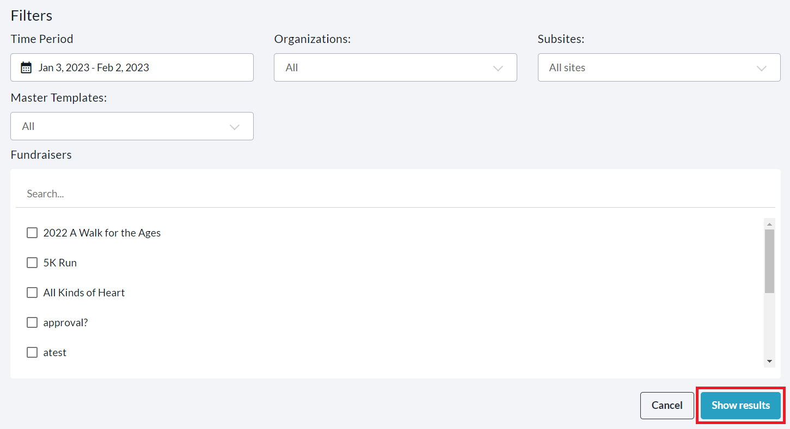
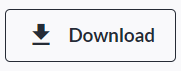
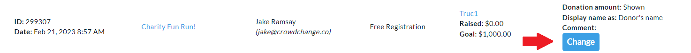
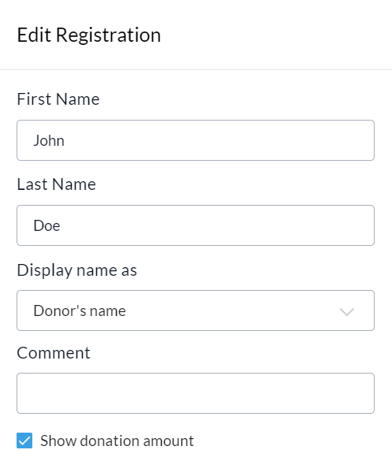
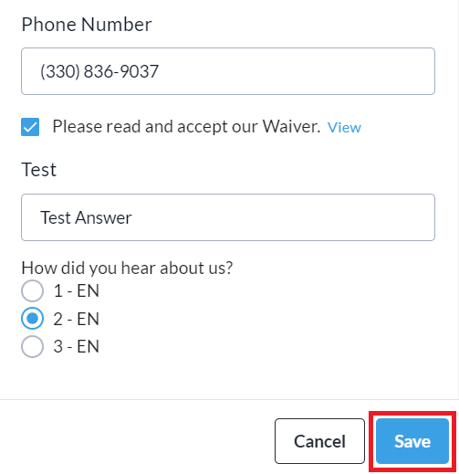

<!-- Source: https://chadmin.crowdchange.help/ct/how-to-access-the-registration-report | Nav: How to Access the Registration Report | Mirrored 2026-10-14 -->

# How to Access the Registration Report

The **Registration Report**provides detailed information about all registrations made / purchased on your CrowdChange site. For sites with our Multi-Registration flow enabled, it provides useful functionality such as the ability to adjust individual registrant names, display names, comments, show/hide amount settings, and answers to custom checkout questions.

At a glance, you can see **Registrant Name** \& **Email Address** , the **Transaction ID** , **Date of Transaction** , selected **Registration Type** , associated **Personal / Team Page** (if any) and you will have links to those pages, as well as the fundraiser. The Excel version of the report provides further detail.  
You also have the ability to search for specific registrations (by email, name, or transaction ID), and filter the report for a specific time period, fundraiser, subsite and/or organization.

To access this report, follow these simple steps:

1. Go to your CrowdChange site and **Log In**.

2. Click **Profile** in in the top right corner, then**Admin**.

3. Go to **Reports** **\> Registrations Report**using the left sidebar. You will be taken here:

   
4. To find a specific registration, you can use the search bar to search by email, name, or transaction ID. Click **Filters** in the top right corner to filter for a specific Time Period, Organization, Subsite, Fundraiser, and/or Master Template (if enabled on your site). Be sure to click **Show results** to apply these filters.

   
5. Click the **Download** button in the top right to get the Excel version of the report sent to your email!

   

Note that answers to [**Custom Questions**](how-to-use-custom-questions.md) which are set to '**Repeat for each registrant**' will appear in the Excel version of the Registration Report. Within this report, go to your fundraiser's specific tab (named: Fundraiser ID - Fundraiser Name), and scroll all the way to the right, to the last columns.

## To Change Registrant Name, Comment and Answers to Custom Questions

These features only apply for transactions made to fundraisers with our multi-registration flow.

Next to any registration on a multi-registration enabled site, you can click the **Change** button to adjust the registrant **name** ('username' in Admin Reports), and/or the**display name** (within public Donation Lists). You can also edit any displayed **comment** and set whether to show or hide the transaction **amount**.

Follow these simple steps to do so:

1. Go to your CrowdChange site and **Log In**.

2. Click **Profile** in in the top right corner, then**Admin**.

3. Go to **Reports** **\> Registrations Report**using the left sidebar.

4. Click the **Change**button next to a registration.

   
5. Make any desired adjustments to registrant **name** (username in Admin Reports),**display name** , **comment** , **show/hide amount** setting, and **answers to custom checkout questions**.

     
   
6. Click **Save**to confirm your changes.
