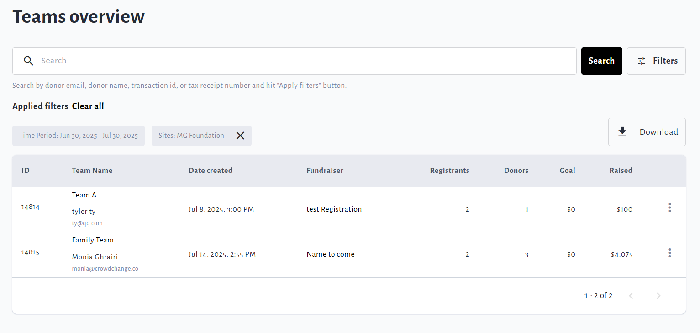
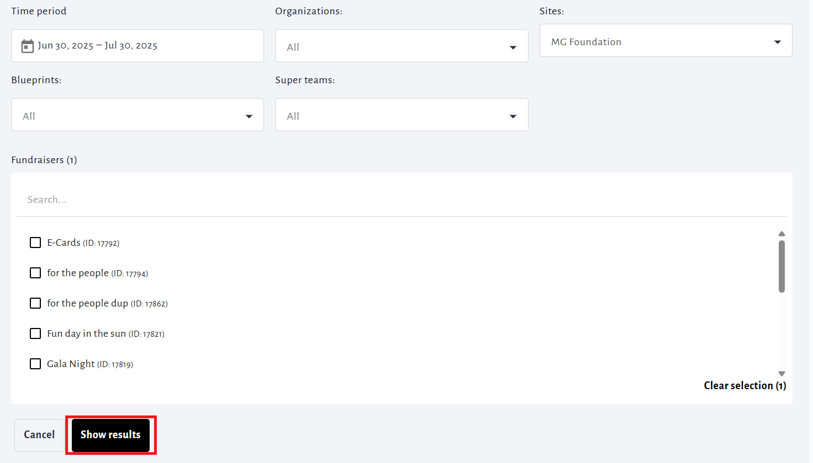
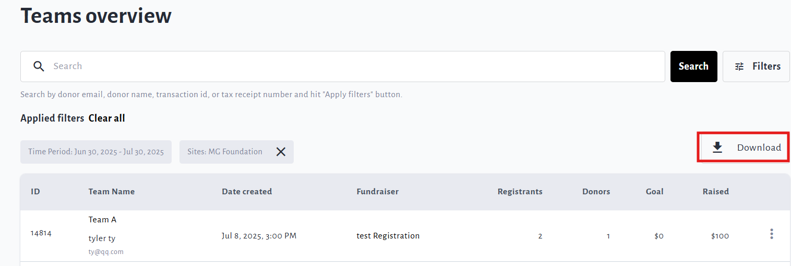
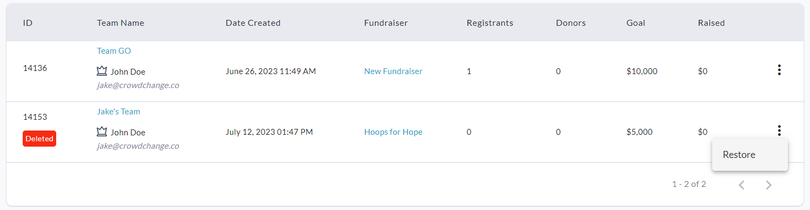
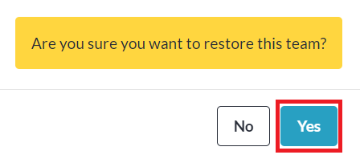

<!-- Source: https://chadmin.crowdchange.help/ct/how-to-access-the-teams-report | Nav: How to Access the Teams Report | Mirrored 2026-10-14 -->

# How to Access the Teams Report

The **Teams Report**shows you information on all team fundraising pages that have been created, including who the team captain is! (See the crown icon next to user's name under Team Name)

This report also allows you to see deleted team pages and restore them if necessary.

To access it, follow these simple steps:

1. Go to your CrowdChange site and **Log In**.

2. Click **Profile** in in the top right corner, then**Admin**.

3. Go to **Reports** **\> Teams Report**using the left sidebar, and you will be taken here:

   

4. You may use the search bar and/or click **Filters** in the top right corner to filter the teams listed by a specific Time Period, Organization, Subsite, Master Template (if enabled), or Fundraiser. Be sure to click **Show results** to apply these filters.

   

5. Download the Excel version of this report by clicking **Download** in the top right!

   

Please note that the following information is found in the **Excel**Teams Report:

* Name of team captain

* Email of team captain

* Emails of personal page creators

* Amount Raised (Total Raised Online + Total Received Offline)

* Amount Pledged (Any Pending Pledges and Offline Donations)

<!-- -->

* Answers to Custom Questions

## Restoring a Deleted Team Page

To restore a team page which was deleted, simply click the 'triple dot' icon to the right of the page marked as 'Deleted' (see tag in red), and click '**Restore**' as shown in screenshot below.  

Then click '**Yes**' within the prompt that appears:  

The team page owner will receive an email notification letting them know that their team has been restored.
