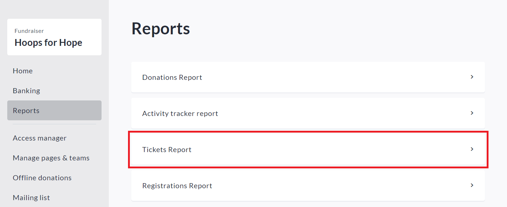
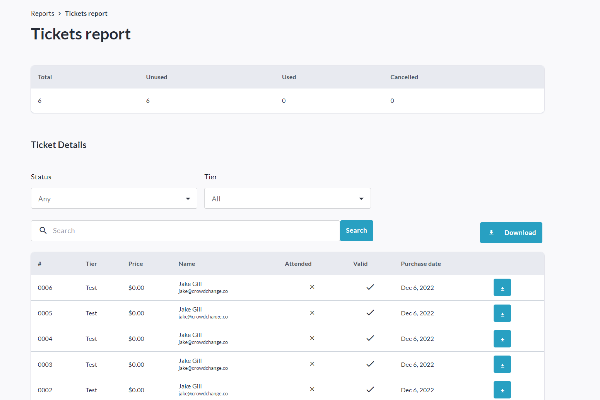

<!-- Source: https://chadmin.crowdchange.help/ct/how-to-access-the-tickets-report-fundraiser-level | Nav: How to Access the Tickets Report (Fundraiser Level) | Mirrored 2026-10-14 -->

# How to Access the Tickets Report (Fundraiser Level)

The **Tickets Report**is where you can find details of all tickets issued for your fundraiser. You can search/filter for specific tickets, and download either an Excel report of all tickets issued, or individual PDF tickets.

To access it, follow these simple steps:

1. Go to your CrowdChange site and **Log In**.

2. Go to your fundraising page and click **Manage Fundraiser**in the top right corner.

   
3. Click **Reports** on the left sidebar, then**Tickets Report**.

   
4. You will be taken to the **Tickets Report** **→ Ticket Details**page, where you can see detailed information on all issued tickets. If you're looking for information on a specific ticket, you can use the search bar and search by name, ticket number or email. You may also filter by the Status and Tier of the ticket.

   

You can download an Excel report listing all tickets issued by clicking **Download**. The email you receive with the download link will have the subject 'Fundraiser Guests Report'.

The Excel report also contains answers to custom checkout and registration questions.

To download PDFs of **individual tickets**, click the download icon to the right of each ticket.
