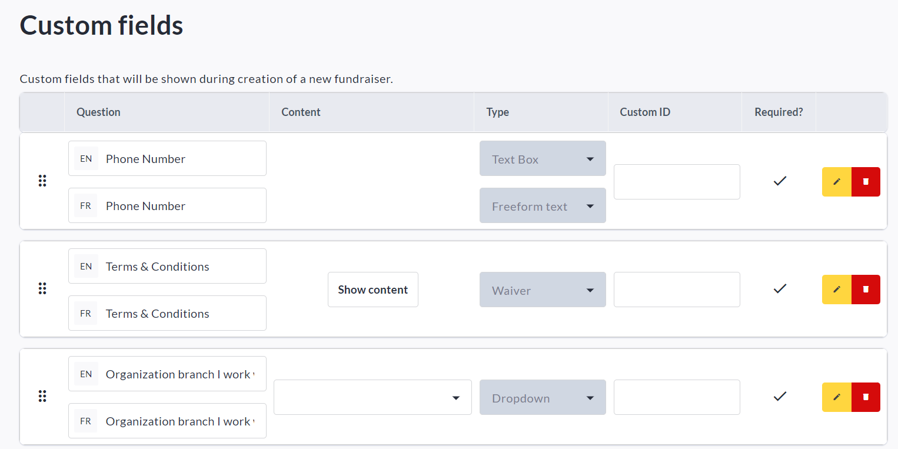
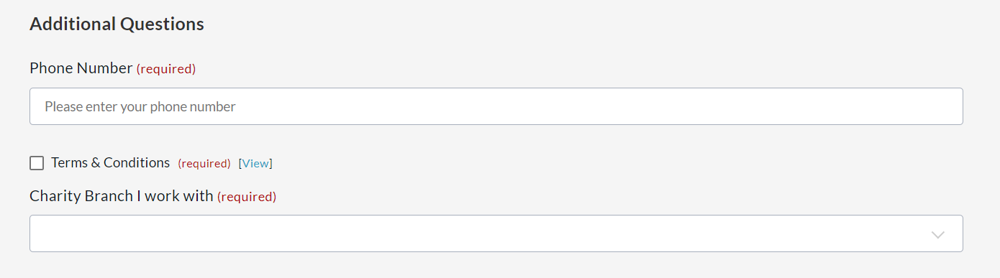

<!-- Source: https://chadmin.crowdchange.help/ct/how-to-add-custom-fields-to-the-start-a-fundraiser | Nav: How to Add Custom Fields to the Start a Fundraiser Process | Mirrored 2026-10-14 -->

# How to Add Custom Fields to the Start a Fundraiser Process

Need to collect additional information from fundraiser creators on your site?

You have the ability to add custom fields to the Start a Fundraiser process, similar to how [Custom Questions](how-to-use-custom-questions.md) work on the checkout page. You can add as many as you need!  
Please note that this feature is **NOT**enabled by default and you will need to reach out to your Partner Success Representative directly to have it enabled for your site(s).

Some common use cases for this feature are for example - if you need to:

* Collect phone numbers or other contact information from fundraiser creators

* Require waivers to be signed (or Terms of Use be agreed to) pre-launch

* Ask Survey type questions to gather information from fundraiser creators

These fields can be set up from **Profile \> Admin \> Fundraisers Settings \> Custom Fields**and show up when creating or editing fundraisers.

All responses can be found later in the[**Admin Fundraisers Report**](how-to-access-the-fundraisers-report.md).

## Detailed Steps

To get started and add your first custom field, follow these steps:

1. Log in to a CrowdChange account with admin permissions.

2. Click **Profile → Admin**in the upper right-hand corner of your CrowdChange site.

3. Click **Fundraisers Settings → Custom Fields**

4. On the **Custom Fields** page, you can click **Add Question** to create a question or field, which will be shown during the creation process of a fundraiser.

5. Fill out the **Question** and **Content** fields (if applicable), then select a **Type** (Text Box *- contains sub-types* , Multi-Line Text, Checkboxes, Dropdown or Waiver), and whether the question will be **Required**or not. Here are a few example questions:

   

   You can return to this page at any time to **Edit** , **Remove** , or **Add**custom questions / fields.

If you require the ability to set**Custom ID's** for each question, reach out to your Partner Success Representative for this feature to be enabled on your site.

## Fundraiser Creator's View

Once you have added your custom questions / fields, going forward, all fundraiser creators on your CrowdChange site will see the created questions in the final section of the Start a Fundraiser process, called Additional Questions, as shown below:  

They will not be able to create their fundraiser until any required questions are answered.  
Remember that you can access all answers to these custom fields in the [**Admin Fundraisers Report**](how-to-access-the-fundraisers-report.md).
