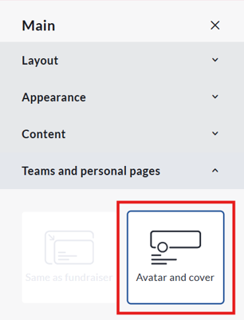
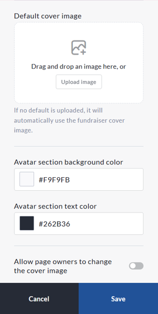
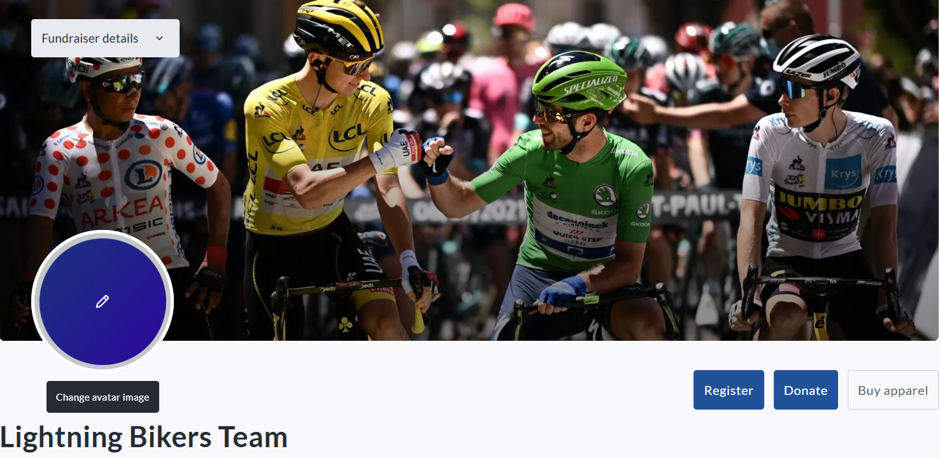
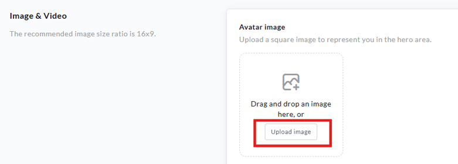

<!-- Source: https://chadmin.crowdchange.help/ct/how-to-add-or-change-an-avatar-on-a-personal-or-te | Nav: How to Add or Change an Avatar on a Personal or Team Fundraising Page | Mirrored 2026-10-14 -->

# How to Add or Change an Avatar on a Personal or Team Fundraising Page

Personal and Team Fundraising Pages now support Avatars, allowing page owners to display a profile-style image that represents themselves or their team.

Avatars are displayed within the **Cover image block**and help personalize fundraising pages.

*** ** * ** ***

## **Avatar and Cover Image Display**

Fundraiser owners can enable the Avatar layout for Personal and Team Fundraising Pages and customize how it appears.

**How to Enable the Avatar Layout**

1. Navigate to your fundraiser and click **Manage Fundraiser**.

2. Click **Design Your Fundraiser**.

3. Click **Edit** in the top right corner of the Hero image section.

4. Under **Team and personal pages** select the **Avatar and Cover** layout.

5. Configure the desired settings and click **Save**.

Select the Avatar \& Cover layout under Team and Personal Pages.

*** ** * ** ***

## **Available Configurations**

Once enabled, you can:

* Upload a dedicated cover image for Personal and Team Pages.

* Allow page owners to change the cover image on their own page.

* Select the background color for the avatar section.

* Select the text color used within the avatar section.

Customize the cover image, permissions, and colours for Personal and Team Pages.

*** ** * ** ***

## **Cover Image Behavior**

When a dedicated cover image is uploaded, it will be displayed on all Personal and Team Fundraising pages.

If no dedicated cover image is uploaded, the fundraiser's main hero image will automatically be used as the default cover image on all Personal and Team Fundraising pages.

*** ** * ** ***

## **Changing Your Avatar**

You can update your avatar at any time from your Personal or Team Fundraising Page.

1. Go to your Personal or Team Fundraising Page and log in.

2. Hover your cursor over the avatar image.

3. Click the **pencil icon** that appears on the avatar or click directly on the avatar image.

4. A file selection window will open on your device.

5. Select the image you would like to use and upload it.

6. Adjust the image if prompted and click **Save**.

Your new avatar will be displayed immediately after saving.

This can also be adjusted within your Personal or Team Page Settings.

*** ** * ** ***

## **For Personal Pages**

1. Go to your Personal Fundraising Page and log in.

2. Click **Manage My Page**.

3. Select **Page Settings**.

4. Locate the **Image \& Video** section.

5. Click **Upload Image**.

6. Select an image from your computer.

7. Adjust the image and click **Save**.

8. Click **Save** at the bottom of the page settings screen.

Update your avatar at any time from your page settings.

*** ** * ** ***

## **For Team Pages**

1. Go to your Team Fundraising Page and log in.

2. Click **Manage My Team**.

3. Select **Team Settings**.

4. Locate the **Image \& Video** section.

5. Click **Upload** or **Change Avatar**.

6. Select an image from your computer.

7. Adjust the image if prompted and click **Save**.

8. Click **Save** at the bottom of the page settings screen.

*** ** * ** ***

## **Team Avatar Display Logic**

When a Team Fundraising Page is created, the system will automatically determine which avatar to display based on the images that have been provided.

* If a team avatar is uploaded during the Create a Team process, that image will be displayed as the Team Page avatar.

* If no team avatar is uploaded, the Team Captain's avatar will automatically be used as the Team Page avatar.

* If the Team Captain does not upload an avatar when creating their Personal Fundraising Page, their profile image will be used as the avatar for both their Personal Fundraising Page and the Team Fundraising Page.

This ensures that every Team Fundraising Page will have an avatar displayed, even if a dedicated team image has not been uploaded.

*** ** * ** ***

## **Tips for Best Results**

* Use a high-quality square image whenever possible.

* Avoid images with important content near the edges.

* Ensure the subject is centered for the best appearance across devices.

* Use clear logos or group photos for team avatars.
