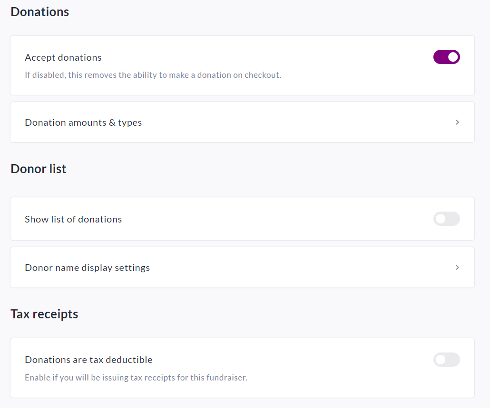
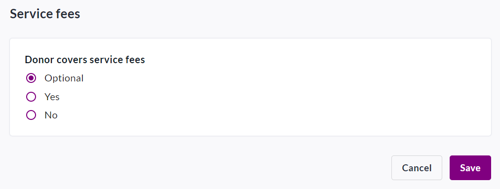
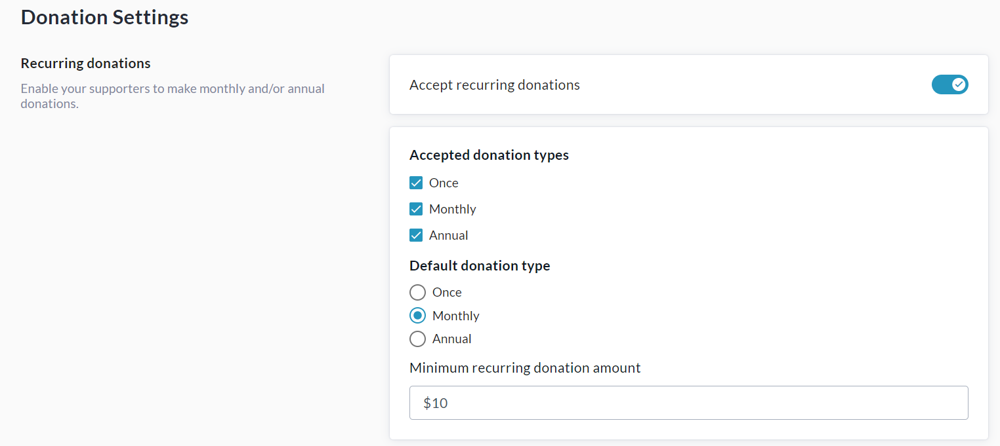
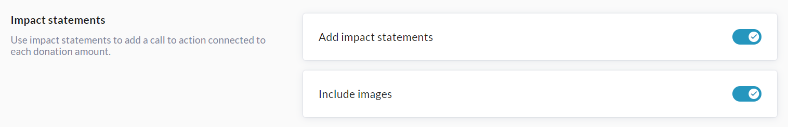
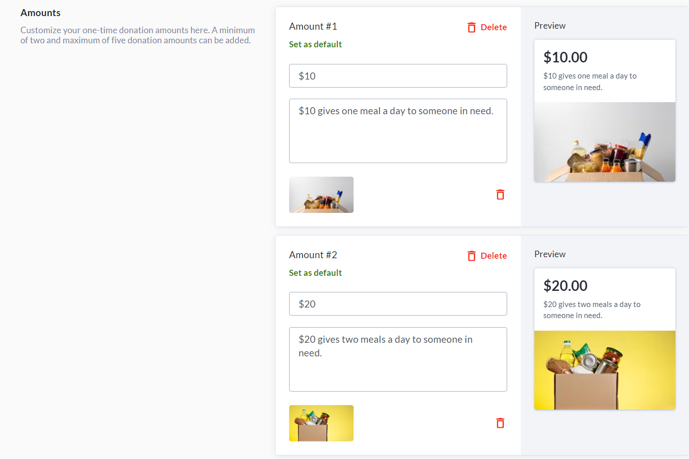
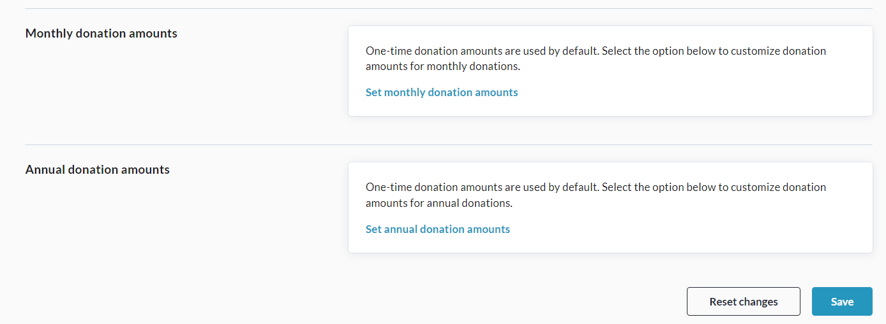

<!-- Source: https://chadmin.crowdchange.help/ct/how-to-adjust-default-donation-amounts-settings | Nav: How to Adjust Default Donation Amounts & Settings | Mirrored 2026-10-14 -->

# How to Adjust Default Donation Amounts & Settings

After creating your fundraiser on CrowdChange, the next step is to confirm your desired default donation amounts and settings. We also highly recommend adding **Impact Statements** and **Images** to each default donation amount. To make these changes, you will need to access your fundraiser's **Donation Settings**.  
**Please Note:** Impact Statements and Images are NOT enabled by default.

Reach out to your Partner Success Representative today to request they be enabled!

Follow the simple steps below to access this menu:

1. Go to your CrowdChange site and**Log In**.

2. Navigate to the fundraiser you have created.

3. Click **Manage Fundraiser** in the top right corner of the page.

4. Click **Donation Settings**on the left sidebar.

5. From the **Donation Settings** section, you can enable or disable donations, the donation list, tax receipts, and set service fee behavior at checkout.

     
   
6. Click into **Donation Amounts \& Types** to set your accepted and default donation types (eg. monthly, annual, one-time), set a minimum recurring donation amount, and adjust default donation amounts for One-Time, Monthly, and Annual donations (if enabled) separately. You can also add **Impact Statements** and images if this feature is enabled. For example:

     
     
     
   

**Remember** that you can set up donation amounts, impact statements and images **separately**for your One-Time, Monthly and Annual donation options.

To customize Monthly donations, click '**Set Monthly Donation Amounts**' shown above.

To customize Annual donations, click '**Set Annual Donation Amounts**' shown above.

If Monthly and Annual donations are not customized, they will use the One-Time donations settings.

6. Ensure to click **Save** at the bottom to confirm your settings.

   You can also undo all changes made by clicking **Reset changes**.
