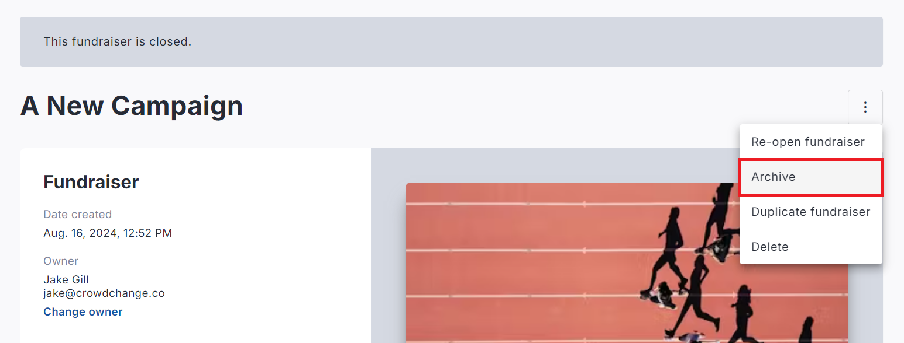
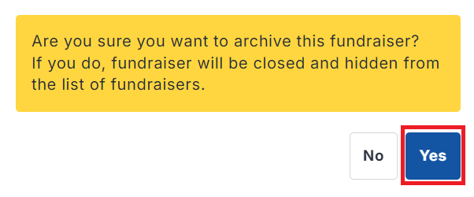
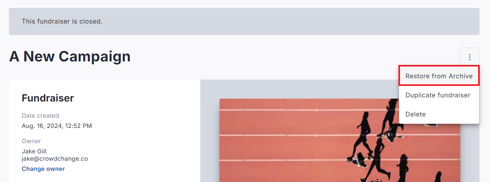
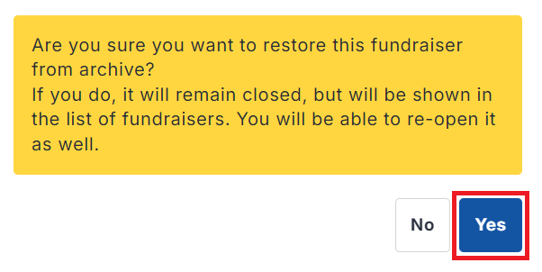

<!-- Source: https://chadmin.crowdchange.help/ct/how-to-archive-a-fundraiser | Nav: How to Archive a Fundraiser | Mirrored 2026-10-14 -->

# How to Archive a Fundraiser

## To Archive a Fundraiser

Please note that fundraisers must first be closed before they can be archived.

Refer to the steps in 'How to Close or Reopen a Fundraiser' before continuing.

1. Go to the closed fundraiser you would like to archive.

2. Click **Manage Fundraiser** in the top-right corner.

3. Click the **triple-dot icon** in the top-right corner, then**Archive → Yes**.

   

   

This will archive the fundraiser - it will be hidden from the list of fundraisers and only accessible to Admins (not visible to the public) and it will not be capable of accepting sales or transactions of any kind.

## To Un-archive a Fundraiser

1. Go to the fundraiser you would like to restore from archive.

2. Click**Manage Fundraiser**in the top-right corner.

3. Click the**triple-dot icon** , then **Restore from Archive → Yes**.

   

   

This will un-archive the fundraiser, restoring it to the list of fundraisers, and making it publicly visible, but it will remain closed until manually reopened. You can re-open it to allow transactions to proceed again.
