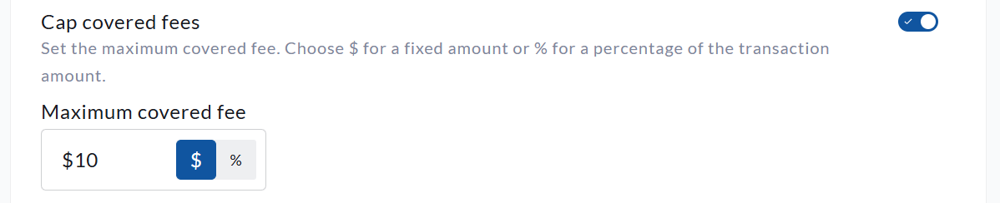

<!-- Source: https://chadmin.crowdchange.help/ct/how-to-cap-user-transaction-fees | Nav: How to Cap User Transaction Fees | Mirrored 2026-10-14 -->

# How to Cap User Transaction Fees

CrowdChange allows organizations to let their donors cover the transaction fees associated with their donation or purchase, ensuring that 100% of the donation goes to the organization.

This fee is usually a small percentage of the overall donation value, and we find that 93% of the time, given the option, a donor will choose to cover the fees. This structure however can sometimes discourage higher value donations as these fees scale alongside donation value.

CrowdChange is equipped with a **Cap Covered Fees** feature in order to limit the maximum amount that a donor would have to pay. The difference in fees would then be covered by the organization. The **Cap covered fees**function can be applied either by a dollar amount, or a percentage value of the overall donation amount.  
For example, assume that a $100 donation results in $4 in total transaction fees. This amount is for illustration only, as actual fees vary based on factors such as the payment processor, contractual agreement, and card type.

If your site has a covered-fee cap of $2, or 2% of the donation amount, the donor would contribute a maximum of $2 toward those fees. Their total payment would therefore be $102.

The cap does not reduce the transaction fees associated with the payment. Any portion not covered by the donor is absorbed by your organization, and the standard fees outlined in your CrowdChange agreement are deducted from the total transaction amount.

*** ** * ** ***

To use the **Cap Covered Fees**feature, please follow these steps:

1. Go to your CrowdChange site and log in to your administrator account.

2. In the top right-hand corner of your screen, click on **Profile → Admin**.

3. This will bring you to the **General Settings** screen. Toggle on **Cap Covered Fees** and enter a **Maximum Amount** that your donors will be able to cover if they choose to do so.

4. Click **Save**at the bottom of the page to apply your changes.

The **Cap covered fees** setting within the **General settings** section of the *Admin dashboard*  
Please note that the **Cap Covered Fees** feature takes effect across your entire CrowdChange site, and will be applied to all fundraisers at once.
