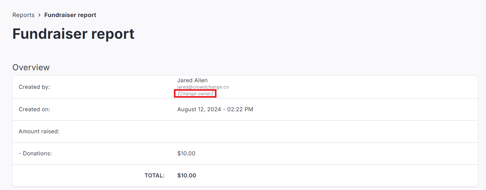
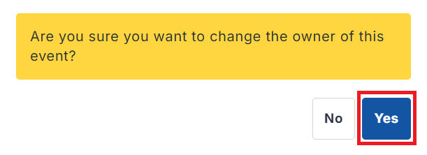

<!-- Source: https://chadmin.crowdchange.help/ct/how-to-change-a-fundraiser-host-owner | Nav: How to Change a Fundraiser Host/Owner | Mirrored 2026-10-14 -->

# How to Change a Fundraiser Host/Owner

As an Admin user, you can change the host/owner of a fundraiser to give someone else complete access to the fundraiser and enable them to receive its notifications.

Follow these simple steps to change the fundraiser host/owner:  
*Please note that you must first be logged in to perform this action.*

1. Go to the fundraiser you would like to change host/owner of.

2. Click **Manage My Fundraiser** in the top right corner of the page.

3. Click **Reports** on the left sidebar, then **Fundraiser Report**.

4. Click **Change Owner** and select **Yes** in the popup that appears.

     
   
5. Enter the email address of the new owner.

6. Click **Save**.

The new owner/host will receive an email invitation to manage the fundraiser. Once the page reloads, administrative options will no longer be available to the previous owner unless they are an Admin.
