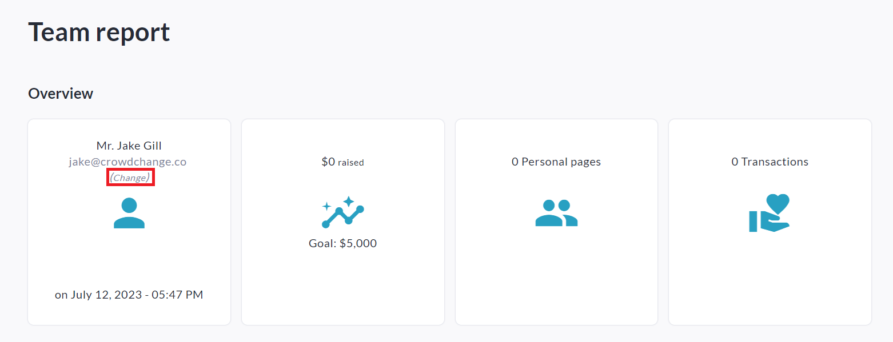
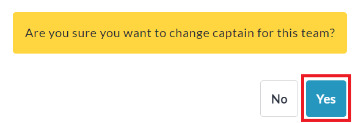
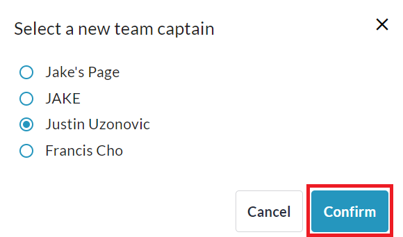

<!-- Source: https://chadmin.crowdchange.help/ct/how-to-change-a-team-captain | Nav: How to Change a Team Captain | Mirrored 2026-10-14 -->

# How to Change a Team Captain

As an Admin user, if you ever need to change the owner or 'Team Captain' of a Team page, it's a quick and simple process! You can do so using the steps below:

1. Go to your CrowdChange site and **Log In** with your Admin account.

2. Go to the Team page you would like to change Team Captain for.

3. Click**Manage my Team**in the top left.

   
4. Click **Report**on the left sidebar.

5. Click **Change** under the current Team Captain's email address as highlighted below in brackets.

   
6. Click **Yes**for 'Are you sure you want to change captain for this team?'.

   
7. Select the new team captain from the list of connected personal pages and click **Confirm** .

   *(The owner of the selected personal page will become the new team captain.)*

   
