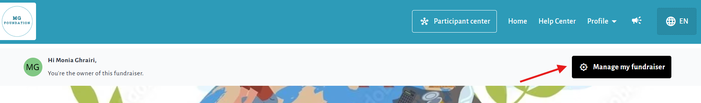
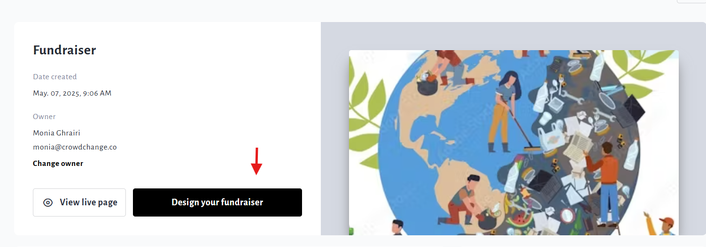
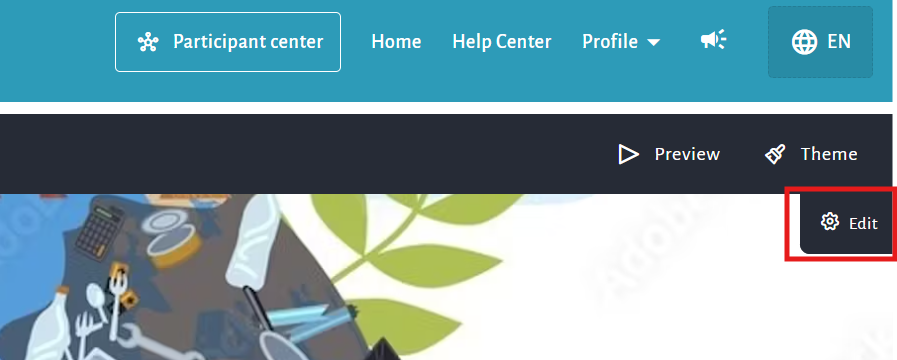
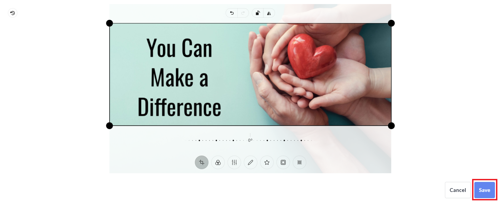

<!-- Source: https://chadmin.crowdchange.help/ct/how-to-change-cover-photo | Nav: How to Change Cover Photo | Mirrored 2026-10-14 -->

# How to Change Cover Photo

Need to change your fundraiser's cover / banner / Hero image? It's simple, just follow these easy steps:

1. Go to your fundraising page and ensure you are logged in.

2. Click **Manage My Fundraiser** in the top right corner of the page.

   
3. Click the **Design your fundraiser** button.

   
4. Hover over the fundraiser's current image and click the **Gear**icon that appears on the top right of the page.

   
5. On the right sidebar that appears, scroll down and expand the **Content**section.

6. Click on the **pencil**icons to change the current images.

7. Select the new image from your computer, crop and edit if desired, and click **Save**.

   
8. At the bottom of the sidebar, click **Save** to confirm and publish your changes.

   
