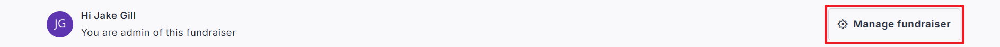
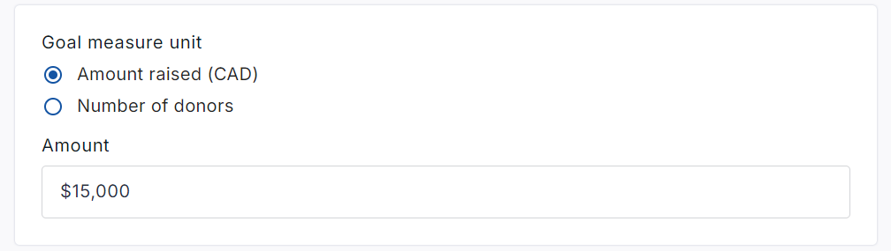

<!-- Source: https://chadmin.crowdchange.help/ct/how-to-change-your-fundraising-goal | Nav: How to Change Your Fundraising Goal | Mirrored 2026-10-14 -->

# How to Change Your Fundraising Goal

Getting more donations come through than you ever expected? Changing your fundraising goal is simple!

*Please note that you must first be logged in to perform this action.*

1. From your fundraising page, click **Manage Fundraiser** in the top right corner.

   
2. Click **General Settings** on the left sidebar.

3. Scroll down to **Goal Measure Unit**, and adjust the goal amount as desired.

   
4. Scroll down to the bottom of the page and click **Save**.

   

## For Personal Page Goals...

1. From your Personal page (while logged in), click **Manage my Page** then **Page Settings**.

2. Change the amount under **Fundraiser page goal**as desired.

3. Click the **Save** button at the bottom.

## For Team Page Goals...

1. From your Team page (while logged in), click **Manage my Team** then **Team Settings**.

2. Change the amount under **Team goal**as desired.

3. Click the **Save** button at the bottom.
