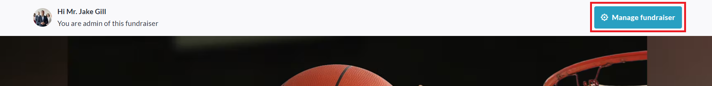
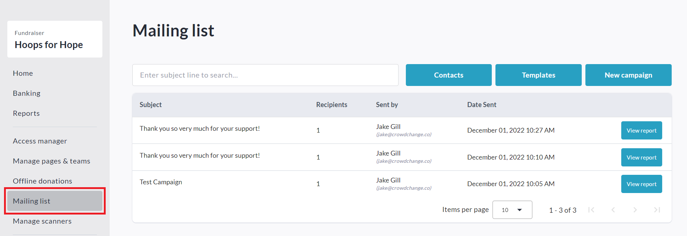
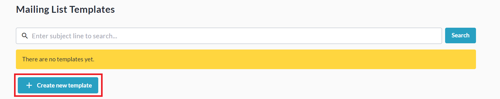
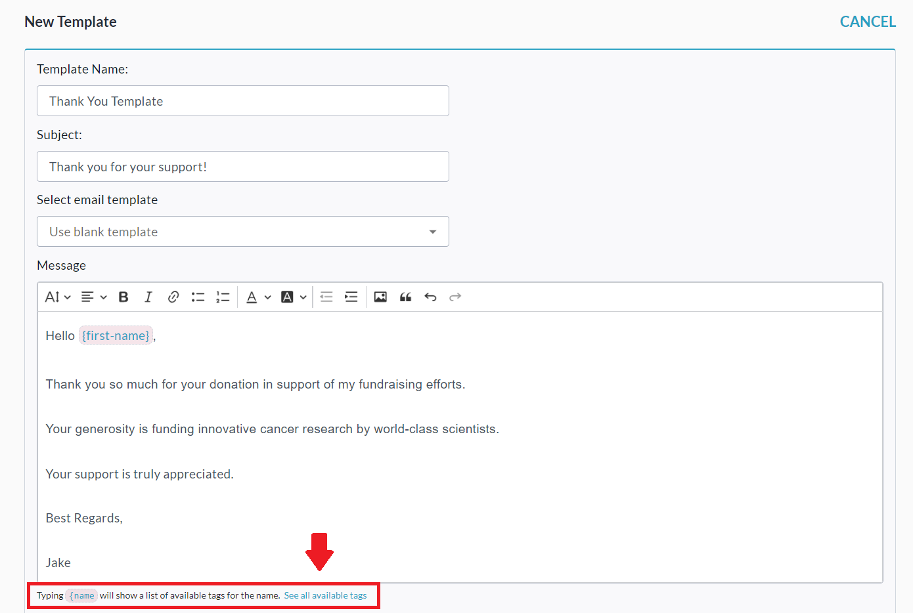

<!-- Source: https://chadmin.crowdchange.help/ct/how-to-create-a-custom-email-template | Nav: How to Use the Mailing List > How to Create a Custom Email Template | Mirrored 2026-10-14 -->

# How to Create a Custom Email Template

You can save a lot of time sending email campaigns by creating **custom templates** within the Mailing List!  
See also: **How to Use the Mailing List**

Follow these simple steps below to create a custom email template:

1. From your fundraising page, click **Manage Fundraiser**.

   
2. On the left sidebar, click**Mailing List**.

   
3. Click **Templates** , then **Create New Template**.

   

   
4. Set a **Template Name** , **Subject** , **Message Body** , and add any desired **Dynamic Tags**. For example:

   
5. *Optional: Click* ***Send Preview Email*** *to get a preview.*

6. Click **Save**to save the template.
